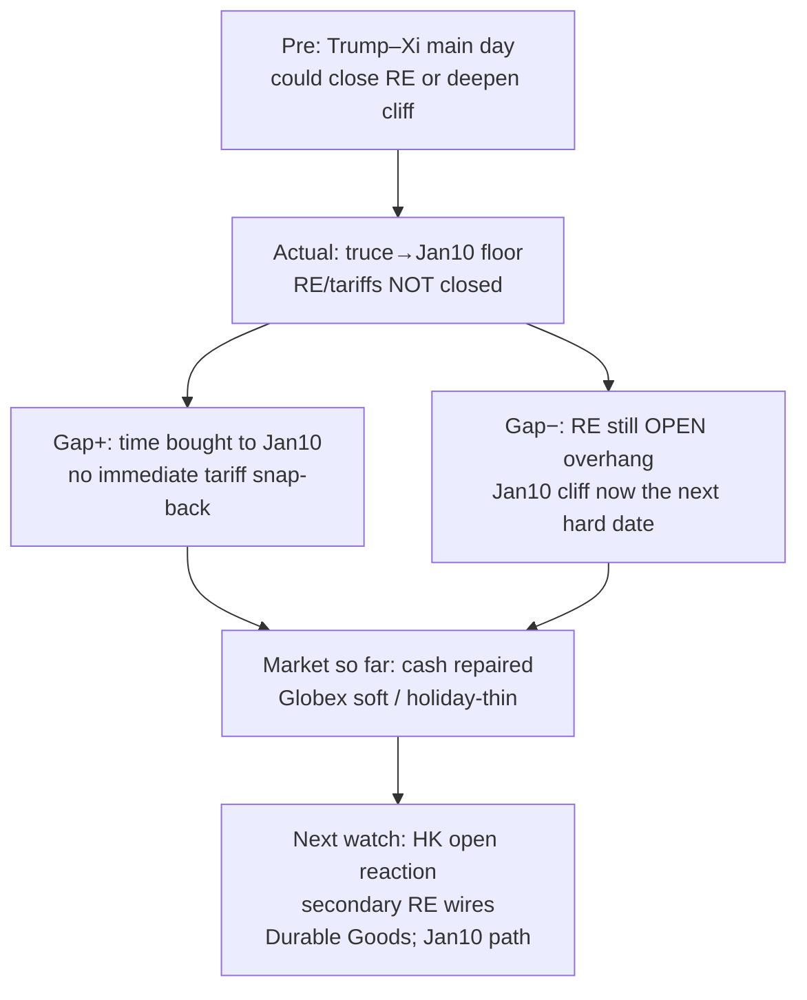

# Expectation Gap — Trump–Xi / Rare Earths lifecycle / 预期差 — 特习/稀土生命周期

**As-of:** 2026-09-25 ~08:34 MYT  
**Event status:** Main day **CLOSED**; truce floor **IN**; RE/tariff package **still OPEN**  
**Claim class:** CONFIRMED (truce→Jan10); RELIABLE (no RE package); INFERENCE (market pricing)

## Pre vs Actual / 预期 vs 实际

| Dimension | Pre-summit market frame | Actual (Thu→Fri morning) | Gap |
|---|---|---|---|
| Truce / 停火 | Extension or bigger deal (Bessent framing) | Extended to **Jan 10 2027** | **Floor delivered** — short extension, not durable deal |
| Rare earths / 稀土 | Possible delivery/export-control language | **No comprehensive package** | **OPEN overhang continues** |
| Tariffs / 关税 | Possible reset | Left for later rounds | **OPEN** |
| Optics / 观感 | State dinner + tech titans | Delivered (Musk/Bezos/Pichai etc.) | Optics **IN**; substance thin |
| Equity tape / 股指 | Soft OPEN risked cascade | **FULL repaired to flat** | Tape **did not** price toxic RE print overnight |
| Asia confirm / 亚洲确认 | Would use CN/KR/TW cash | **CN/KR/TW CLOSED** | Confirmation **delayed** to HK/JP/MY + Mon CN reopen |

### Thinking caption / 思维说明
1. **Observe:** Floor (truce) **in**; RE close **out** — same structural gap as Evening, now post-main-day.  
2. **Why it matters:** AI-factory critical-minerals / export-control narrative stays live under holiday-dark Asia.  
3. **Falsifier:** CONFIRMED RE delivery/export-control language **or** explicit breakdown that re-prices Jan10 cliff abruptly.

**What this means / 这说明什么:** Expectation gap = **time bought, certainty not bought**. RE lifecycle remains **OPEN** into holiday-thin handoff.  
预期差 = **买到时间，未买到确定性**；稀土生命周期在假期薄交接中仍为 **未解**。
