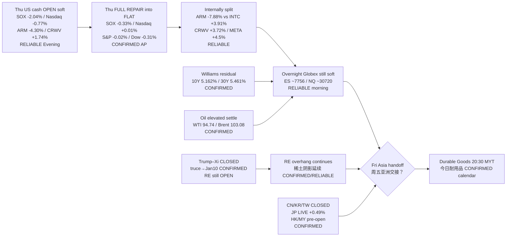

# Transmission Chain — Morning 2026-09-25 / 传导链 — 早盘

**As-of:** 2026-09-25 ~08:34 MYT  
**Claim class:** ILLUSTRATIVE structure; node facts CONFIRMED/RELIABLE as labeled  
**Dominant theme:** Rates-shock residual + RE/truce overhang + holiday-thin Asia digest after Thu FULL repair  
**Source:** AP/WTOP Thu FULL; Yahoo Globex ~08:33 MYT; SSE/TWSE/KR holiday calendars; InvestingLive/FP Trump–Xi; RTT/The Star oil

### Thinking caption / 思维说明
1. **Observe / 观察:** Evening question “cascade into close?” → **NO — repaired to flat**. Summit “close RE?” → **still NO — floor only (truce→Jan10)**.  
2. **Why it matters / 为何重要:** AI-factory hardware avoided cascade close but ARM idiosyncratic hard + RE overhang + holiday dark mute Asia confirmation; rates/oil still bind multiples.  
3. **Falsifier / 证伪:** Globex reclaim + HK bid + constructive RE follow-up **or** soft Globex cascade + toxic RE wire + hot Durable Goods.

**What this means / 这说明什么:** Dominant theme = **Thu OPEN semi-hard → FULL repair flat → soft Globex → holiday-thin Asia digest under RE OPEN + rates residual → Durable Goods later**.
