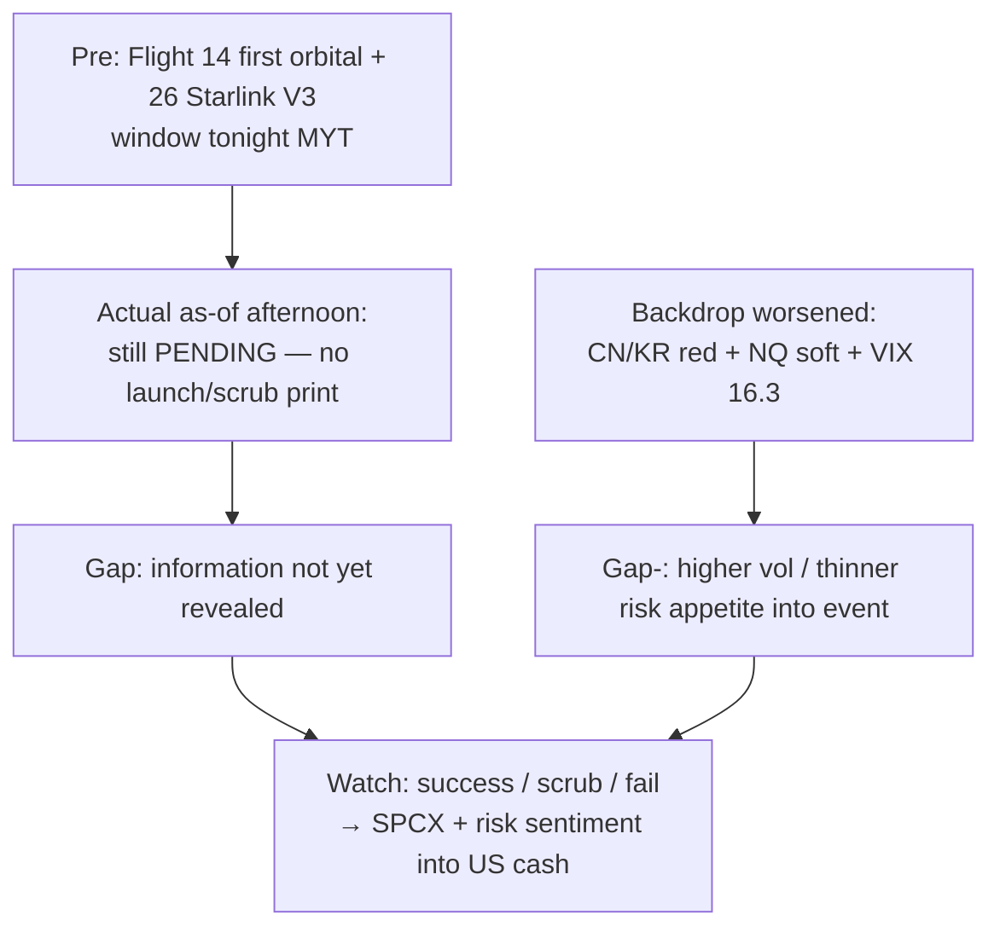
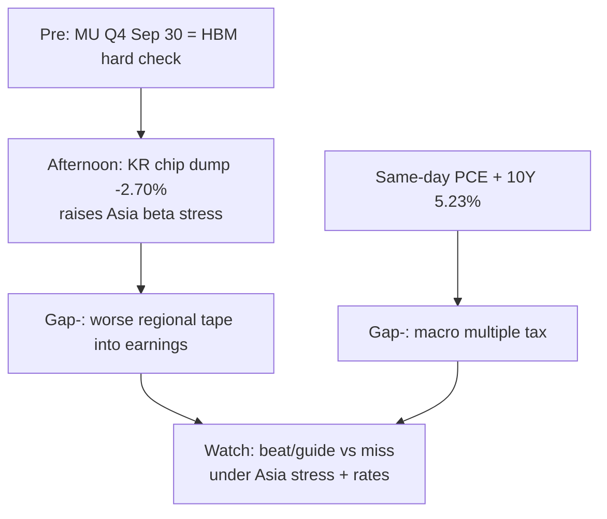

# Expectation Gap — MU Q4 pre-event + Starship pre-event / 预期差 — 美光财报前 + 星舰发射前

**As-of:** 2026-09-28 ~17:30 MYT  
**Lifecycle stage:** **Pre-Event** for both MU Q4 (Wed Sep 30) and Starship Flight 14 (tonight window)  
**Claim class:** CONFIRMED calendars; RELIABLE Starship license; INFERENCE on pricing

## A. Starship Flight 14 (tonight) / 星舰第14次飞行（今晚）

| Dimension | Pre / Morning frame | Afternoon actual so far | Gap |
|---|---|---|---|
| License / 许可 | FAA Sep 26 | Still licensed | Unchanged |
| Window / 窗口 | 8:15–9:30 a.m. EDT | Still NET — **outcome NOT printed** | Time decay only |
| SPCX tape / 股价 | Fri +0.44% mild | Mon cash N/A; event vol pending | Pricing deferred to window |
| Risk backdrop / 风险背景 | Globex mild soft | Asia risk-off + NQ -1.11% + VIX 16.3 | **Harder backdrop** into launch |

## B. MU FY2026 Q4 (Wed Sep 30) / 美光Q4（周三）

| Dimension | Pre frame | Afternoon update | Gap |
|---|---|---|---|
| Guide/EPS path | HBM bottleneck optimistic consensus (unverified $) | Unchanged — pre-event | Levels N/A |
| Asia memory beta | KR morning LIVE -0.59% | **KOSPI -2.70% FULL chip dump** | **Wider Asia stress into print** |
| US MU tape | Fri +0.16% quiet | Mon cash N/A | Quiet US vs loud Asia |
| Macro stack | PCE same day | 10Y **5.23%** + oil rebound | Harder multiple/inflation backdrop |

### Thinking caption / 思维说明
1. **Observe:** Starship = **information not yet revealed**; MU = **Asia beta deteriorated** into pre-event.  
2. **Why it matters:** Do not treat Fri MU flat + SOX green as sufficient cushion — KR dump is new.  
3. **Falsifier:** Clean Starship + MU beat/guide **or** fail + miss under 5.23% 10Y.

**What this means / 这说明什么:** Expectation gap into evening/week = **Starship binary unresolved** + **MU pre-event Asia stress wider than morning**.  
进入晚间/本周的预期差 = **星舰二元未解** + **美光财报前亚洲压力比早盘更宽**。
