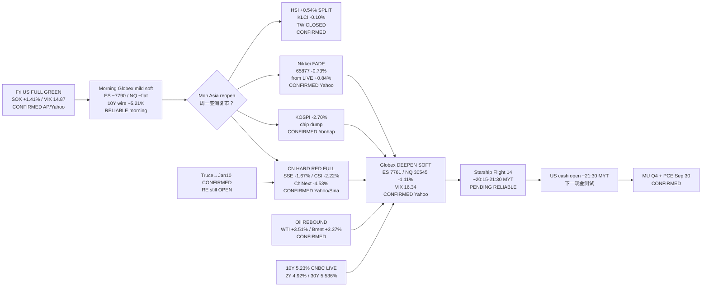

# Transmission Chain — Afternoon 2026-09-28 / 传导链 — 午后

**As-of:** 2026-09-28 ~17:30 MYT  
**Claim class:** ILLUSTRATIVE structure; node facts CONFIRMED/RELIABLE as labeled  
**Dominant theme:** Asia FULL risk-off (CN hard red / KR chip dump / JP fade) → Globex deepen soft + VIX 16.3 + 10Y 5.23% + oil rebound → Starship PENDING  
**Source:** Yahoo Asia FULL / Globex LIVE ~17:10–17:26 MYT; CNBC Tradeweb yields; Yonhap/Sina; Morning continuity

### Thinking caption / 思维说明
1. **Observe / 观察:** Morning veto “CN bid or dump?” → **DUMP hard**. JP extend? → **FADE**. Globex soft hold? → **DEEPEN (NQ -1.11%)**.  
2. **Why it matters / 为何重要:** Fri SOX confirmation is **Asia-refused** into afternoon MYT; multiples further taxed by 5.23% 10Y + oil rebound; Starship still evening binary.  
3. **Falsifier / 证伪:** Clean Starship + US reclaim of Fri green + yields ease **or** Starship fail + SOX give-back + 10Y >5.30%.

**What this means / 这说明什么:** Dominant theme = **Fri green → morning soft digest → Asia FULL CN/KR hard red + JP fade → Globex/VIX/yields worsen + oil rebound → Starship → US cash**.
