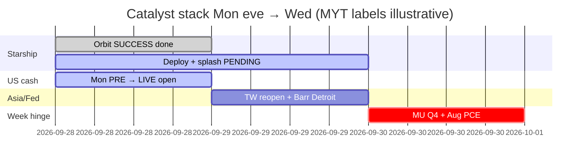

# Catalyst Timeline — 7-day / 催化剂时间线（7日）
**As-of:** 2026-09-28 ~21:20 MYT · Evening  
**Claim classes:** CONFIRMED / TENTATIVE / RUMOR / OPEN

| When (MYT) | Event | Status | Why it can break tape |
|---|---|---|---|
| **Now → ~Tue 06:48** | Starship Flight 14 **remaining mission** (V3 deploy → deorbit → Pacific splashdown) | **IN FLIGHT** after orbit SUCCESS | Late fail reverses orbit optics; full SUCCESS may re-rate SPCX |
| **~21:30 Mon** | US cash **open** Mon session | CONFIRMED schedule | PRE split → LIVE breadth test; Fri SOX +1.41% untested |
| **Tue Sep 29** | **TWSE reopen** (Teachers’ Day end) | CONFIRMED | First Taiwan AI-chain cash after Mon dark + KR/CN red |
| **Tue Sep 29** | Fed Gov **Barr — Detroit Economic Club** (~23:00–01:30 MYT / 11:00–13:30 local) | **CONFIRMED** calendar | Hawkish residual vs Sep 23 “further adjustments likely” |
| **Wed Sep 30** | **MU FY2026 Q4** earnings | CONFIRMED IR | Memory sleeve hard check under KOSPI −2.70% |
| **Wed Sep 30** | **Aug PCE** (BEA) | CONFIRMED | With 10Y already 5.23% — inflation/Fed path veto |
| **~Sep 30** | TSLA Special Order window | TENTATIVE | Narrative/vol only if printed |
| Ongoing | Bessent truce → **Jan 10 2027** | CONFIRMED floor | Floor ≠ certainty |
| Ongoing | **Rare earths / tariffs package** | **OPEN** | Toxic wire risk into US hours |
| Owned soft | AAPL Taction ~$5.72B jury (appeal) | Soft Event-log | Not thesis rewrite without 8-K/settlement |
| Owned | QCOM–Apple patent renew **Apr 1 2027** | CONFIRMED | Structural edge SoC path |

## Overnight-break risks (explicit) / 隔夜破坏点（明确）
1. Starship **deploy/reentry failure** after orbit success headlines  
2. Mon US cash **cascade** following PRE laggards (INTC/CRWV/PLTR/MU)  
3. **10Y >5.23%** disorderly extension in cash hours  
4. **RE/tariff toxic wire**  
5. Oil **re-squeeze** toward aft highs into PCE week  
6. Tue open: **TW gap** + Barr surprise

**What this means / 这说明什么:** Next 36h = **cash open + Starship completion + Tue TW/Barr**; week hinge remains **Wed MU+PCE** under 5.23% 10Y.  
未来36小时 = **现金开盘 + 星舰收官 + 周二台股/Barr**；本周枢纽仍是 **周三美光+PCE**（十年期5.23%背景下）。
