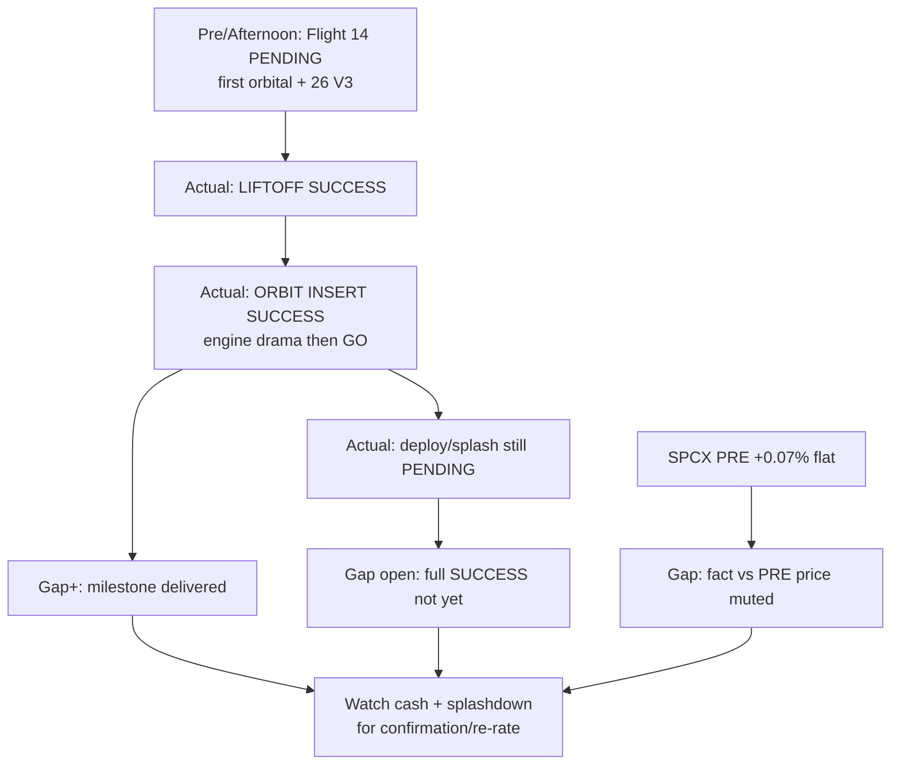

# Expectation Gap — Starship Flight 14 lifecycle / 预期差 — 星舰第14次飞行生命周期

**As-of:** 2026-09-28 ~21:20 MYT  
**Lifecycle stage:** **In-Flight / Mid-Event** (post-liftoff, post-orbit insert; pre-full mission complete)  
**Claim class:** CONFIRMED liftoff+orbit (BBC/Wikipedia); RELIABLE remaining timeline; INFERENCE on pricing

## A. Starship Flight 14 / 星舰第14次飞行

| Dimension | Pre / Afternoon frame | Evening actual | Gap |
|---|---|---|---|
| License | FAA licensed | Unchanged | — |
| Liftoff | PENDING in window | **SUCCESS ~07:48 CDT** | **Positive gap filled** |
| Orbit insert | Contingent on health | **SUCCESS** (after engine-drama reassessment) | **Positive gap filled** (first sustained orbit) |
| Starlink V3 deploy | Planned ~T+34 | **In progress / imminent** | Information **partially open** |
| Splashdown / full SUCCESS | Planned ~T+10h | **PENDING** | **Still unresolved** |
| SPCX tape | Fri +0.44%; event vol expected | PRE **+0.07% flat** | **Price lag / muted PRE reaction** vs milestone |
| Risk backdrop | Asia red + NQ −1.11% + VIX 16.3 | NQ soft eases (−0.58%); VIX ~16.0 | Backdrop **mildly better**, still not Fri reclaim |

## B. MU FY2026 Q4 (still pre-event) / 美光Q4（仍为事件前）

| Dimension | Afternoon | Evening update | Gap |
|---|---|---|---|
| Calendar | Wed Sep 30 C | Unchanged | — |
| Asia beta | KOSPI −2.70% lock | Unchanged lock | Stress **still wider** than Fri quiet MU |
| US MU tape | Fri +0.16% | PRE **−1.18%** | **Pre-earn fade started in PRE** |
| Macro | 10Y 5.23% + oil rebound | 10Y still 5.23%; oil fade-hold | Multiple tax **persists** |

### Thinking caption / 思维说明
1. **Observe:** Starship = **two major gaps filled** (liftoff, orbit); **one major gap open** (full mission). SPCX PRE did **not** gap with the headline. MU PRE fade **widens** pre-event soft.  
2. **Why it matters:** Avoid equating orbit headline with sleeve re-rate; wait for cash + splashdown.  
3. **Falsifier:** Clean splashdown + SPCX cash rip **or** late fail + risk-off cascade.

**What this means / 这说明什么:** Expectation gap Evening = **orbit milestone delivered / full SUCCESS unresolved / SPCX PRE muted / MU pre-earn PRE soft**.  
晚间预期差 = **入轨里程碑已交付 / 完整成功未解 / SPCX盘前反应平淡 / 美光盘前已软**。
