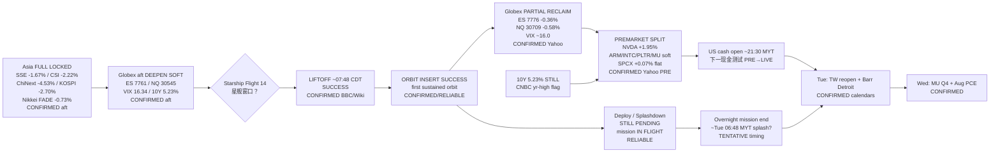

# Transmission Chain — Evening 2026-09-28 / 传导链 — 晚间

**As-of:** 2026-09-28 ~21:20 MYT  
**Claim class:** ILLUSTRATIVE structure; node facts CONFIRMED/RELIABLE as labeled  
**Dominant theme:** Asia FULL risk-off (locked) → Starship LIFTOFF + ORBIT INSERT SUCCESS (mission in flight) → Globex partial reclaim + PRE split → US cash open / overnight mission end  
**Source:** Yahoo Globex/PRE ~21:18–21:22 MYT; CNBC yields; BBC/Wikipedia Starship; Afternoon continuity

### Thinking caption / 思维说明
1. **Observe / 观察:** Starship PENDING → **Orbit SUCCESS (mission open)**. Globex deepen hold? → **Partial reclaim**. Broad PRE risk-off? → **Split (NVDA bid / digestion)**. SPCX PRE rip? → **No (+0.07%)**.  
2. **Why it matters / 为何重要:** Milestone fact upgraded without PRE price confirmation; rates + Asia locks still bind into cash open.  
3. **Falsifier / 证伪:** Late mission fail + cash cascade **or** full SUCCESS + Fri green reclaim + yields ease.

**What this means / 这说明什么:** Dominant Evening theme = **Asia risk-off locked → Starship orbit success (mission open) → soft eases + PRE split → cash / overnight completion / Tue–Wed stack**.  
晚间主主题 = **亚洲风险偏好已锁 → 星舰入轨成功（任务未完）→ 软度减轻+盘前分化 → 现金/隔夜收官/周二–周三堆叠**。
