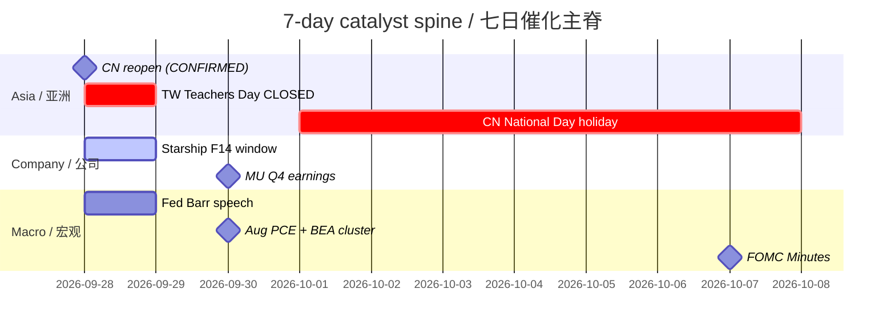

# Catalyst Timeline — 7-day / 催化剂时间线（7日）
**As-of:** 2026-09-28 ~08:30 MYT · Claim: CONFIRMED / TENTATIVE / RELIABLE as labeled  
**Sources:** Master Monitor 2026-09-28; Fed/BEA/BOJ/SSE calendars; Space.com/Aviation Week

| Date (MYT lens) | Event | Class | Materiality for AI factory |
|---|---|---|---|
| **Mon Sep 28** | CN equities reopen (SSE/SZSE) | **CONFIRMED** | A-share pacing / RE OPEN sensitivity |
| **Mon Sep 28** | TWSE CLOSED (Teachers' Day) | **RELIABLE** | Thin TW AI-chain cash |
| **Mon Sep 28** | KOSPI/Nikkei LIVE; HK/MY open | Calendar | Asia digest of Fri US green |
| **Mon Sep 28** | Fed Barr outlook & housing ~22:05 MYT | **CONFIRMED** | Rates-path language |
| **Mon Sep 28** | **Starship Flight 14** window ~20:15–21:30 MYT | **RELIABLE** day-of (FAA licensed) | SPCX vol/narrative; outcome OPEN |
| Tue Sep 29 | Starship backup if scrub | **RELIABLE** | Contingency |
| Tue Sep 29 | Fed speakers (Bowman/Barr/Waller/Cook) | **CONFIRMED** | Path residual |
| **Wed Sep 30** | **Aug PCE** + GDP third / BEA cluster ~20:30 MYT | **CONFIRMED** | Macro hard check / WACC |
| **Wed Sep 30** | **MU FY2026 Q4** ~04:30 MYT Oct 1 (call) | **CONFIRMED** IR | Memory bottleneck print |
| Wed Sep 30 | Starship 2nd backup if needed | **RELIABLE** | Contingency |
| Wed Sep 30 | TSLA SO / robotaxi watch | **TENTATIVE** | Physical AI narrative |
| Thu Oct 1 | BOJ Tankan; ISM Mfg (RELIABLE sec.); Claims pattern | Mixed | JP/US activity |
| Thu Oct 1 | **CN National Day holiday starts** (SSE closed Oct 1–7) | **CONFIRMED** | Asia liquidity hole again |
| Fri Oct 2 | Census Full M3; BOJ monetary base | **CONFIRMED** | CapEx follow-through |
| Through Oct 7 | **FOMC Minutes** Oct 7 2pm ET | **CONFIRMED** | Path detail |
| Ongoing | Bessent truce→Jan 10 2027; **RE/tariffs OPEN** | Truce **CONFIRMED**; RE **OPEN** | Supply-chain overhang |
| Ongoing | QCOM–Apple patent renew effective Apr 1 2027 | **CONFIRMED** | Edge SoC clarity |

**Thinking caption:** Stack density peaks **Wed Sep 30 (PCE + MU)**; Mon is **reopen + Starship binary**; Oct 1 CN holiday returns fast — do not treat Mon CN open as lasting Asia liquidity.  
密度高峰在 **9/30（PCE+美光）**；周一是 **复市+星舰二元**；10/1 很快再入国庆休市——勿把周一A股开盘当成持久亚洲流动性。
