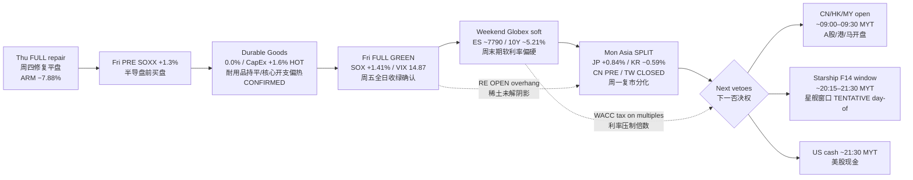

# Transmission Chain — 2026-09-28 Morning / 传导链 — 早盘
**Dominant theme / 主导主题:** Fri FULL green (CapEx-hot + SOX bid) → weekend Globex soft / 10Y firmer → Mon Asia reopen SPLIT → Starship + CN open vetoes  
**Claim class:** RELIABLE (tape) + CONFIRMED (calendars) + INFERENCE (arrows)  
**As-of:** 2026-09-28 ~08:30 MYT · Sources: Yahoo/AP/CNBC/Master Monitor

**Thinking caption / 思维图注:**  
Observe Fri confirmation vs overnight refusal to chase. Why: CapEx/semi demand optics ≠ multiple expansion under 5.2% 10Y. Falsifier: CN hard red + Starship fail + 10Y disorderly, OR CN bid + clean launch + yields ease. Watch next: Asia open → Starship → US cash.  
观察周五确认与隔夜拒绝追涨的分裂。为何：资本开支/半导需求光学 ≠ 在十年期约5.2%下的倍数扩张。证伪：A股重挫+星舰失败+利率失控，或A股走强+发射顺利+利率回落。下一步：亚洲开盘→星舰→美股。
