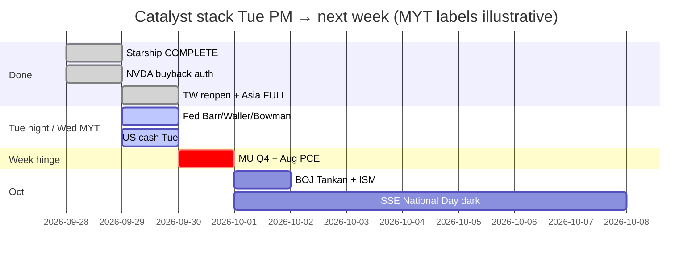

# Catalyst Timeline — 7-day / 催化剂时间线（7日）
**As-of:** 2026-09-29 ~17:30 MYT · Afternoon  
**Claim classes:** CONFIRMED / TENTATIVE / OPEN  
**Update vs Morning:** TW reopen PENDING → **DONE soft −0.82%**; CN/HK/MY PRE → **FULL**; Fed speakers still **upcoming** US hours; Starship COMPLETE owned.

| When (MYT) | Event | Status | Why it can break tape |
|---|---|---|---|
| **Owned ~09:00 Tue** | **TWSE reopen FULL** | **DONE soft −0.82%** (47,631.96) CONFIRMED | First Taiwan AI-chain cash — soft not cascade |
| **Owned Tue session** | CN/HK/MY FULL | DONE — CN mild green; HSI −0.48%; KLCI −1.56% | CN did **not** extend Mon hard red |
| **~23:00 Tue** | Fed Bowman cyber (11:00 ET pre-recorded) | CONFIRMED upcoming | Light unless supervision shock |
| **~00:40 Wed** | Fed Barr Detroit (12:40 ET) | CONFIRMED upcoming | Medium if rates-path rewrite |
| **~03:00 Wed** | Fed Waller Sibos (3:00 ET) | CONFIRMED upcoming | Light–medium (payments) |
| Cook AI Oakland | Fed-site **Sep 28** delivered | RELIABLE done | Morning “Tue Cook AI” was that stamp |
| Tue Cook rural Asheville | Secondary agenda | TENTATIVE / text N/A | Do not treat as CONFIRMED transcript |
| **~21:30 Tue** | US cash open Tue session | CONFIRMED upcoming | Mon red + Asia soft digest vs repair |
| **Wed Sep 30 ~20:30** | **Aug PCE + GDP third** (8:30 ET) | CONFIRMED BEA | With 10Y already 5.247% — inflation/Fed path veto |
| **~04:30 MYT Oct 1** | **MU FY2026 Q4** (2:30pm Mountain Wed) | CONFIRMED IR PRE ACTIVE | Memory sleeve hard check after Mon −2.61% |
| **Thu Oct 1** | BOJ Summary+Tankan; ISM Mfg; Construction; claims | CONFIRMED / RELIABLE | JP + US activity stack |
| **Oct 1–7** | SSE National Day closed; reopen **Oct 8** | CONFIRMED SSE | CN cash dark week ahead |
| **Oct 6** | MRVL Investor Day | CONFIRMED IR | Networking/custom Si path |
| **Oct 7** | FOMC Minutes 2:00 p.m. ET | CONFIRMED Fed | Path language |
| Ongoing | Bessent truce → **Jan 10 2027** | CONFIRMED floor | Floor ≠ certainty |
| Ongoing | **Rare earths / tariffs package** | **OPEN** | Toxic wire risk |
| Owned | Starship Flight 14 **COMPLETE** | RELIABLE done | Digestion / SPCX catch-up — not pending |
| Owned | NVDA **+$150B** buyback auth | RELIABLE done | Island vs breadth |
| ~Sep 30 | TSLA Special Order window | TENTATIVE | Narrative/vol only if printed |

**What this means / 这说明什么:** Asia open vetoes **answered**; next hours = **Fed speakers + US cash**; week hinge remains **Wed MU+PCE** under ~5.25% 10Y.  
亚洲开盘否决权**已答**；未来数小时 = **美联储讲话 + 美股现金**；本周枢纽仍是 **周三美光+PCE**（十年期约5.25%）。
