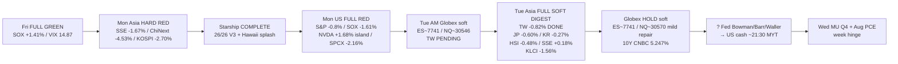

# Transmission — Afternoon / 传导（午后）
**As-of:** 2026-09-29 ~17:30 MYT · Afternoon  
**Dominant theme:** Asia FULL soft digest of Mon US RED + Globex hold soft + rates residual → Fed speakers / US cash / MU-PCE hinge  
**Claim classes:** CONFIRMED / RELIABLE / INFERENCE

**Updated wire (INFERENCE):**  
`Fri FULL GREEN SOX +1.41% → Mon Asia HARD RED → Starship COMPLETE → Mon FULL RED SOX −1.61% + NVDA buyback island / SPCX −2.16% → Tue AM Globex soft + TW PENDING → Tue Asia FULL TW −0.82% / CN stabilize / JP·KR·HSI·MY soft → Globex hold soft / 10Y 5.247% → Fed speakers → US cash → MU/PCE Wed`

**What this means / 这说明什么:** Binding constraint **migrated** from Asia open (answered soft-digest) back to **US rates path + Tue cash + Wed MU/PCE**. Starship/NVDA buyback are owned digestion, not afternoon binaries.  
约束已从亚洲开盘（已答偏软消化）**迁移**回**美利率路径 + 周二现金 + 周三美光/PCE**。星舰/回购为已拥有消化项。
