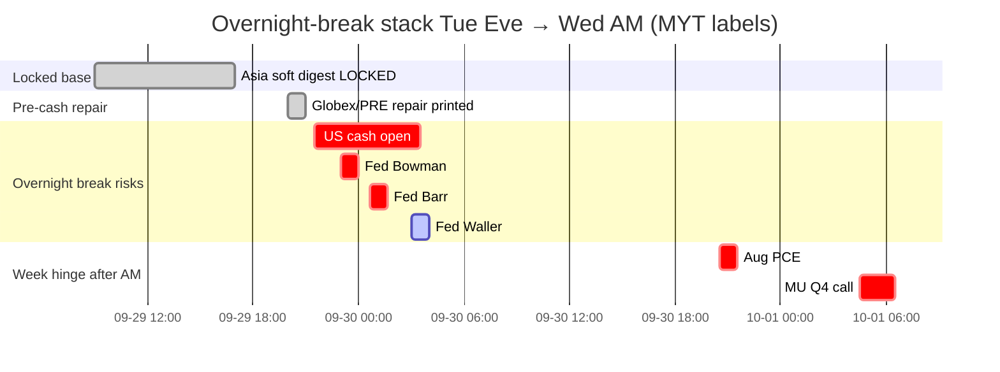

# Catalyst Timeline — 7-day / 催化剂时间线（7日）
**As-of:** 2026-09-29 ~21:10 MYT · Evening  
**Claim classes:** CONFIRMED / TENTATIVE / OPEN  
**Update vs Afternoon:** Globex hold soft → **REPAIR BID**; PRE **BROAD SEMI REPAIR** now printed; 10Y **EASE to 5.23%**; oil **SHARP FADE ~90.6**; Fed speakers still **upcoming**; US cash still **PRE**. Overnight-break risks **prominent**.

| When (MYT) | Event | Status | Why it can break overnight / tape |
|---|---|---|---|
| Owned Tue Asia | Asia FULL soft digest | **LOCKED** CONFIRMED | Day-base — soft not cascade |
| **~21:30 Tue** | **US cash open** | CONFIRMED upcoming | **PRIMARY** — PRE repair → LIVE falsifier |
| **~23:00 Tue** | Fed Bowman cyber (11:00 ET pre-recorded) | CONFIRMED upcoming | Light unless supervision shock — **overnight** |
| **~00:40 Wed** | Fed Barr Detroit (12:40 ET) | CONFIRMED upcoming | **Medium overnight** if rates-path rewrite |
| **~03:00 Wed** | Fed Waller Sibos (3:00 ET) | CONFIRMED upcoming | Light–medium overnight (payments) |
| Tue US session → ~04:00 Wed | Full Tue cash + Globex late | CONFIRMED calendar | PRE hold vs fade; SOX path |
| Overnight residual | 10Y / oil / RE | OPEN / LIVE | Re-spike yields; oil squeeze; toxic RE wire |
| Cook AI Oakland | Fed-site **Sep 28** delivered | RELIABLE done | Not a Tue binary |
| Tue Cook rural Asheville | Secondary agenda | TENTATIVE / text N/A | Do not elevate |
| **Wed Sep 30 ~20:30** | **Aug PCE + GDP third** (8:30 ET) | CONFIRMED BEA | After Wed morning report — inflation/Fed path |
| **~04:30 MYT Oct 1** | **MU FY2026 Q4** (2:30pm Mountain Wed) | CONFIRMED IR PRE ACTIVE | Memory sleeve hard check (PRE +1.57% tonight) |
| **Thu Oct 1** | BOJ Summary+Tankan; ISM Mfg; claims | CONFIRMED / RELIABLE | JP + US activity stack |
| **Oct 1–7** | SSE National Day closed; reopen **Oct 8** | CONFIRMED SSE | CN cash dark week — last CN sessions Wed |
| **Oct 6** | MRVL Investor Day | CONFIRMED IR | Networking/custom Si (PRE +2.02% tonight) |
| **Oct 7** | FOMC Minutes 2:00 p.m. ET | CONFIRMED Fed | Path language |
| Ongoing | Bessent truce → **Jan 10 2027** | CONFIRMED floor | Floor ≠ certainty |
| Ongoing | **Rare earths / tariffs package** | **OPEN** | Toxic overnight wire risk |
| Owned | Starship Flight 14 **COMPLETE** | RELIABLE done | Digestion; SPCX PRE +1.15% — cash confirm pending |
| Owned | NVDA **+$150B** buyback auth | RELIABLE done | Island + PRE extend vs cash breadth |

### Overnight-break risks (prominent) / 隔夜破坏风险（突出）
1. **US cash fades PRE repair** — Mon SOX −1.61% reasserts.  
2. **Hawkish Barr/Bowman/Waller** path language under 5.23% 10Y.  
3. **10Y re-spike** >5.25% / toward 5.30%.  
4. **Oil re-squeeze** reversing −2% fade (Hormuz/Iran OPEN).  
5. **RE/tariff toxic wire**.  
6. **SPCX PRE catch-up fails** in cash.

**What this means / 这说明什么:** Next ~12 hours = **cash open + Fed speakers stack** — the PRE repair setup is constructive but **highly falsifiable overnight** before Wed morning. Week hinge remains **MU+PCE**.  
未来约12小时 = **现金开盘 + 美联储讲话堆叠**——盘前修复铺垫建设性但**隔夜高度可证伪**。本周枢纽仍是**美光+PCE**。
