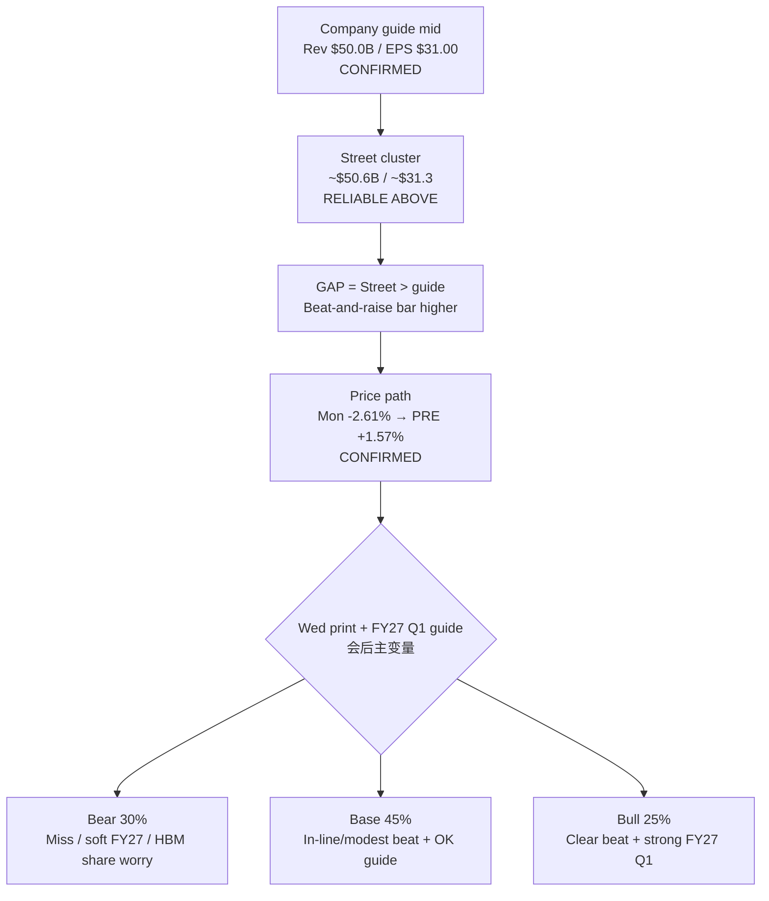

# Expectation Gap — MU FY2026 Q4 (PRE ACTIVE) / 预期差 — 美光 FY2026 Q4（会前进行中）

**As-of:** 2026-09-29 ~21:10 MYT · Evening  
**Event Book:** `/home/box/investment/research-os/events/mu-fy26-q4/`  
**Claim classes:** CONFIRMED (guide/IR) · RELIABLE (Street cluster) · HYPOTHESIS (scenarios)

## Event facts / 事件事实
| Item | Value | Claim |
|---|---|---|
| Call | Wed Sep 30 2:30pm Mountain ≈ **04:30 MYT Thu Oct 1** | CONFIRMED IR |
| Company guide (Ex-99.1 2026-06-24) | Rev **$50.0B±$1.0B** / GM **~86%** / non-GAAP EPS **$31.00±$1.00** (GAAP $30.73±$1.00) | CONFIRMED SEC |
| Street cluster | ~**$50.6B** / ~**$31.3** | RELIABLE |
| Gap | Street **above** guide mid on Rev & EPS | RELIABLE |
| Scenarios (locked PRE) | Bear **30%** / Base **45%** / Bull **25%** | HYPOTHESIS |
| Mon cash | **1,053.98 (−2.61%)** | CONFIRMED |
| Tue PRE | **1,070.50 (+1.57%)** | CONFIRMED CNBC PRE |
| Asia context | KOSPI soft 2nd day; TW soft reopen locked | CONFIRMED |

## Expectation gap map / 预期差地图

### Thinking caption / 思维说明
1. **Observe:** Street sits **above** guide mid → “beat” alone may be **insufficient** if FY27 Q1 guide disappoints.  
2. **Tonight’s PRE +1.57%** repairs Mon fade but **raises** the bar for no-negative-surprise into the call.  
3. **Macro co-hinge:** Aug PCE Wed 8:30 ET (before call in US calendar terms; MU call late Wed US / early Thu MYT) — rates path can dominate multiple even on a clean print.  
4. **Falsifier:** Guide cut / HBM share loss narrative **or** blowout FY27 + eased 10Y.

**What this means / 这说明什么:** MU remains the **memory-sleeve week hinge**. Evening PRE bid is a **setup**, not a verdict. Pair with Aug PCE for the rates × memory joint veto.  
美光仍是**内存袖本周枢纽**。晚间盘前买盘是**铺垫**不是裁决。需与8月PCE组成利率×内存联合否决。

**EN gap one-liner:** Street > guide mid + PRE repair after Mon −2.61% → bar for clean surprise is **elevated**; FY27 Q1 guide may dominate Q4 print.  
**ZH 一句：** 街预期高于指引中值 + 周一−2.61%后盘前修复 → 干净超预期门槛**抬高**；FY27 Q1指引可能压过Q4印数。
