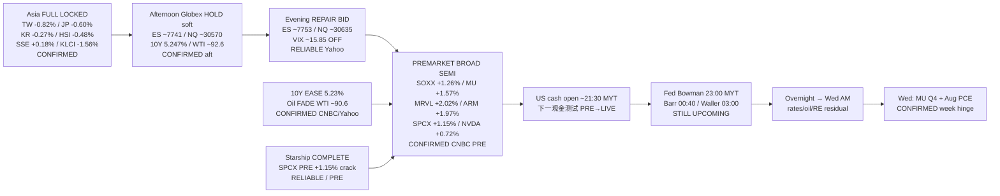

# Transmission Chain — Evening 2026-09-29 / 传导链 — 晚间

**As-of:** 2026-09-29 ~21:10 MYT  
**Claim class:** ILLUSTRATIVE structure; node facts CONFIRMED/RELIABLE as labeled  
**Dominant theme:** Asia FULL soft digest LOCKED → Afternoon Globex hold soft → Evening Globex/PRE REPAIR + 10Y ease + oil fade → Fed speakers / US cash open → MU/PCE Wed  
**Source:** Yahoo Globex ~21:00–21:12 MYT; CNBC yields/PRE ~09:10–09:13 EDT; Afternoon continuity

### Thinking caption / 思维说明
1. **Observe / 观察:** Afternoon hold soft → **Evening repair bid**. 10Y 5.247% → **5.23% ease**. WTI 92.6 → **~90.6 fade**. SPCX fact≠price → **PRE +1.15% crack**. Fed speakers → **still upcoming**.  
2. **Why it matters / 为何重要:** Constructive pre-cash setup after Asia soft digest; cash + speakers remain the falsifiers.  
3. **Falsifier / 证伪:** Cash fades PRE + hawkish speakers + 10Y re-spike + oil squeeze **or** cash holds repair + speakers calm + SPCX cash catch-up.

**What this means / 这说明什么:** Dominant Evening theme = **Asia soft locked → PRE/futures repair under macro ease → cash/speakers overnight → MU/PCE Wed**.  
晚间主主题 = **亚洲偏软已锁 → 宏观缓释下的盘前/期货修复 → 隔夜现金/讲话 → 周三美光/PCE**。
