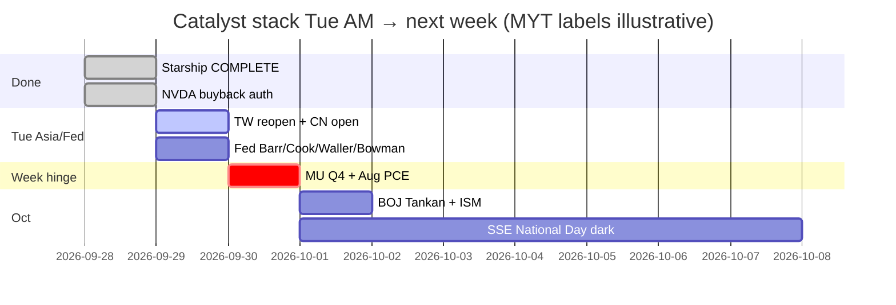

# Catalyst Timeline — 7-day / 催化剂时间线（7日）
**As-of:** 2026-09-29 ~08:30 MYT · Morning  
**Claim classes:** CONFIRMED / TENTATIVE / OPEN

| When (MYT) | Event | Status | Why it can break tape |
|---|---|---|---|
| **~09:00 Tue** | **TWSE reopen** (post Teachers’ Day) | CONFIRMED calendar; print PENDING at dump | First Taiwan AI-chain cash after Mon dark + Mon US/Asia red |
| **~09:00–09:30 Tue** | CN/HK/MY open | CONFIRMED schedule | Stabilize vs extend Mon hard red under RE OPEN |
| **~23:00 Tue** | Fed Bowman cyber (11:00 ET pre-recorded) | CONFIRMED | Light unless supervision shock |
| **~00:40 Wed** | Fed Barr Detroit (12:40 ET) | CONFIRMED | Medium if rates-path rewrite |
| **~01:25 Wed** | Fed Cook AI/tech (1:25 ET) | CONFIRMED | Medium for AI narrative tone |
| **~03:00 Wed** | Fed Waller Sibos (3:00 ET) | CONFIRMED | Light–medium (payments) |
| **~21:30 Tue** | US cash open Tue session | CONFIRMED | Mon red digest vs repair |
| **Wed Sep 30 ~20:30** | **Aug PCE + GDP third** (8:30 ET) | CONFIRMED BEA | With 10Y already ~5.23% — inflation/Fed path veto |
| **~04:30 MYT Oct 1** | **MU FY2026 Q4** (2:30pm Mountain Wed) | CONFIRMED IR | Memory sleeve hard check after Mon −2.61% |
| **Thu Oct 1** | BOJ Summary+Tankan; ISM Mfg; Construction; claims | CONFIRMED / RELIABLE | JP + US activity stack |
| **Oct 1–7** | SSE National Day closed; reopen **Oct 8** | CONFIRMED SSE | CN cash dark week ahead |
| **Oct 6** | MRVL Investor Day | CONFIRMED IR | Networking/custom Si path |
| **Oct 7** | FOMC Minutes 2:00 p.m. ET | CONFIRMED Fed | Path language |
| Ongoing | Bessent truce → **Jan 10 2027** | CONFIRMED floor | Floor ≠ certainty |
| Ongoing | **Rare earths / tariffs package** | **OPEN** | Toxic wire risk |
| Owned | Starship Flight 14 **COMPLETE** | RELIABLE done | Digestion / SPCX catch-up watch — not pending |
| Owned | NVDA **+$150B** buyback auth | RELIABLE done | Island vs breadth |
| ~Sep 30 | TSLA Special Order window | TENTATIVE | Narrative/vol only if printed |

**What this means / 这说明什么:** Next hours = **TW/CN open + Fed speakers**; week hinge remains **Wed MU+PCE** under ~5.23% 10Y; Starship/NVDA buyback are **done facts** entering digestion.  
未来数小时 = **台/A股开盘 + 美联储讲话**；本周枢纽仍是 **周三美光+PCE**（十年期约5.23%）；星舰/回购已是**进入消化的既成事实**。
