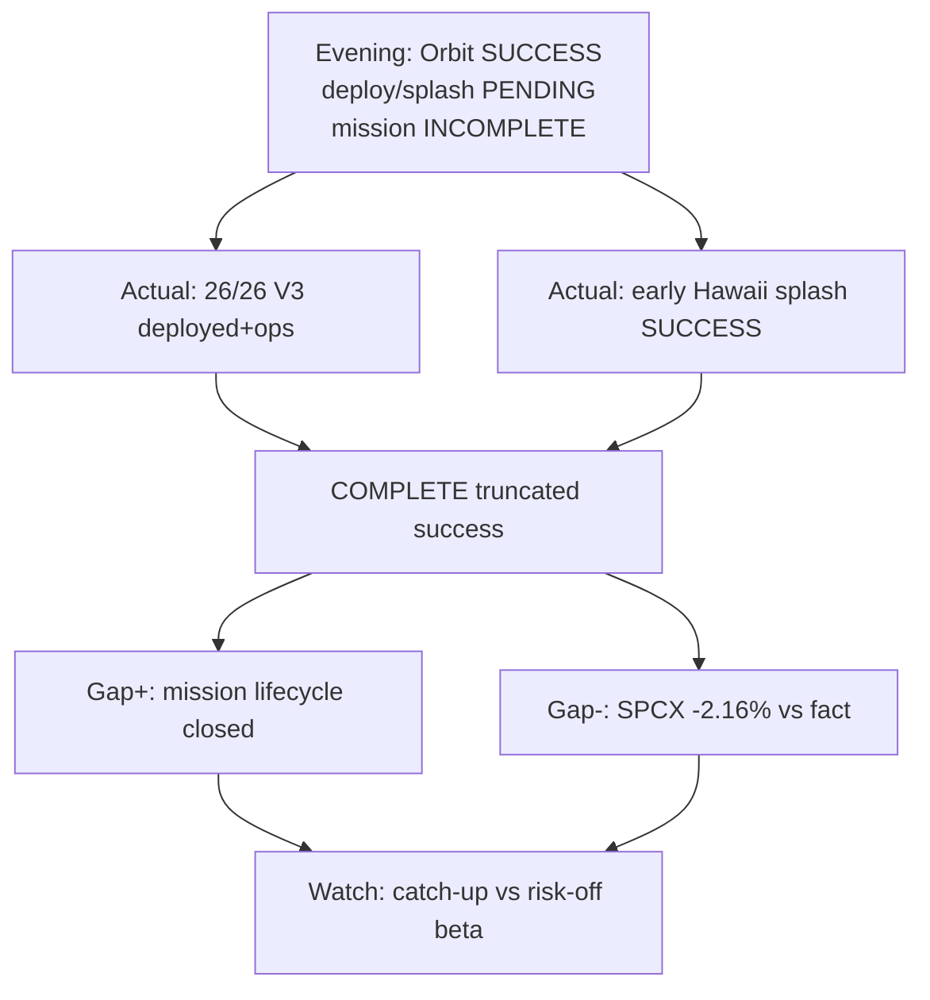

# Expectation Gap — Morning 2026-09-29 / 预期差 — 早盘

**As-of:** 2026-09-29 ~08:30 MYT  
**Lifecycle stages:** Starship Flight 14 = **COMPLETE** (post-event); NVDA buyback = **printed capital-return event**; MU = still pre-event  
**Claim class:** CONFIRMED/RELIABLE facts; INFERENCE on pricing gaps

## A. Starship Flight 14 lifecycle / 星舰第14次飞行生命周期

| Dimension | Evening frame (incomplete) | Morning actual | Gap |
|---|---|---|---|
| Liftoff | SUCCESS ~07:48 CDT | Unchanged | Evening-owned |
| Orbit insert | SUCCESS | Unchanged | Evening-owned |
| Starlink V3 deploy | In progress / imminent | **26/26 deployed + operating** | **Positive gap filled** — first operational orbital V3 batch |
| Splashdown | PENDING (~Tue ~06:48 MYT plan) | **Early controlled Hawaii splash ~11:57 a.m. EDT Mon (~23:57 MYT)** | **Positive gap filled** (truncated caution ≠ FAIL) |
| FAA | Not emphasized Eve | **No mishap investigation** | Regulatory clean |
| Mission status | **INCOMPLETE** | **COMPLETE (truncated success)** | **NEW vs Evening** |
| SPCX tape | PRE +0.07% flat | Mon FULL **−2.16%** | **Fact/price negative gap** — capacity up, price down |

## B. NVDA buyback authorization / 英伟达回购授权

| Dimension | Pre / Eve frame | Actual | Gap |
|---|---|---|---|
| Capital return | Not in Eve/Company cut | **+$150B auth; ~$235B remaining through FY2028** | **NEW gap filled** (RELIABLE) |
| NVDA tape | PRE +1.95% | FULL **+1.68%** | Bid **held into cash** (island) |
| SOX tape | PRE ~flat / soft | FULL **−1.61%** | **Buyback did not lift breadth** |

## C. MU FY2026 Q4 (still pre-event) / 美光Q4（仍为事件前）

| Dimension | Evening | Morning update | Gap |
|---|---|---|---|
| Calendar | Wed Sep 30 C | Unchanged | — |
| MU tape | PRE −1.18% | FULL **−2.61%** | Pre-earn fade **widened** |
| Macro | 10Y 5.23% | 10Y ~5.23–5.24% still | Multiple tax **persists** |

### Thinking caption / 思维说明
1. **Observe:** Starship = **lifecycle gaps filled** (deploy+splash); pricing gap **opened** (SPCX −2.16%). NVDA buyback = **auth gap filled**; SOX breadth gap **open**. MU pre-earn soft **wider**.  
2. **Why it matters:** Separate **scenario upgrades** from **tape confirmation**.  
3. **Falsifier:** SPCX/SOX catch-up on constructive facts **or** reopen cascade + MU miss path.

**What this means / 这说明什么:** Morning expectation gap = **Starship COMPLETE delivered / SPCX price lagged / NVDA buyback delivered as island / SOX breadth failed / MU pre-earn softer**.  
早盘预期差 = **星舰收官已交付 / SPCX价格滞后 / 英伟达回购以孤岛交付 / SOX广度失败 / 美光财报前更软**。
