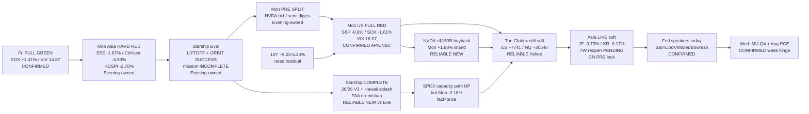

# Transmission Chain — Morning 2026-09-29 / 传导链 — 早盘

**As-of:** 2026-09-29 ~08:30 MYT  
**Claim class:** ILLUSTRATIVE structure; node facts CONFIRMED/RELIABLE as labeled  
**Dominant theme:** Starship COMPLETE → SPCX capacity / Physical AI adjacency + rates/semi digest transmission (Mon FULL RED)  
**Source:** AP Mon closes; CNBC SOX/NVDA/SPCX; Yahoo Globex/Asia ~08:20–08:30 MYT; Master Monitor; Spaceflight Now/Ars; GlobeNewswire NVDA

### Thinking caption / 思维说明
1. **Observe / 观察:** Starship incomplete → **COMPLETE**. PRE split → **FULL RED** (NVDA island only). Eve Globex reclaim → **faded soft**. SPCX COMPLETE → **price −2.16%**.  
2. **Why it matters / 为何重要:** Capacity/scenario upgrade (V3 + buyback) can coexist with multiple compression (rates + SOX digest).  
3. **Falsifier / 证伪:** TW/CN bid + yields ease + SPCX/SOX catch-up **or** reopen hard red + 10Y disorderly + cascade.

**What this means / 这说明什么:** Dominant Morning theme = **Mon red rates/semi digest → Starship COMPLETE + NVDA buyback (constructive facts) → soft Globex/Asia → TW reopen + Fed speakers → Wed MU/PCE**.  
早盘主主题 = **周一收红利率/半导消化 → 星舰收官+英伟达回购（建设性事实）→ 期货/亚洲仍软 → 台股复市+美联储讲话 → 周三美光/PCE**。
