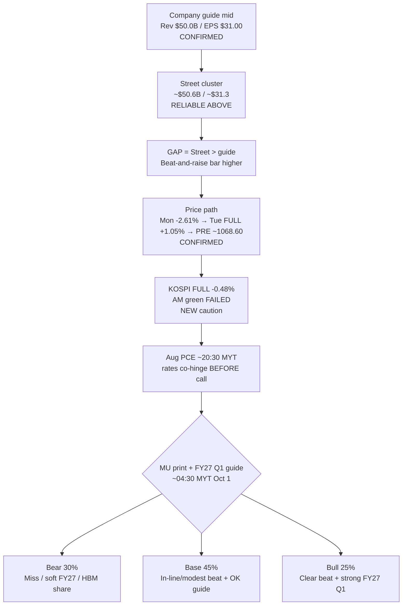

# Expectation Gap — MU FY2026 Q4 + Aug PCE (ACTIVE) / 预期差 — 美光 Q4 + 8月PCE（激活）

**As-of:** 2026-09-30 ~17:30 MYT · Afternoon  
**Event Book:** `/home/box/investment/research-os/events/mu-fy26-q4/`  
**Claim classes:** CONFIRMED (guide/IR/BEA) · RELIABLE (Street cluster) · HYPOTHESIS (scenarios)

## Event facts / 事件事实
| Item | Value | Claim |
|---|---|---|
| Aug PCE + GDP third | Wed 8:30 ET ≈ **20:30 MYT TODAY** — UPCOMING | CONFIRMED BEA |
| MU Call | Sep 30 2:30pm Mountain = 4:30pm ET ≈ **04:30 MYT Thu Oct 1** — UPCOMING | CONFIRMED IR |
| Company guide | Rev **$50.0B±$1.0B** / GM **~86%** / EPS **$31.00±$1.00** | CONFIRMED SEC |
| Street cluster | ~**$50.6B** / ~**$31.3** | RELIABLE ABOVE |
| Gap | Street **above** guide mid | RELIABLE |
| Scenarios (locked PRE) | Bear **30%** / Base **45%** / Bull **25%** | HYPOTHESIS |
| Tue FULL MU | **1,065.08 (+1.05%)** | CONFIRMED |
| Wed PRE MU | **~1,068.60** | CONFIRMED CNBC PRE |
| Asia context NEW | Nikkei **+1.94%** / KOSPI **−0.48%** FULL | CONFIRMED — KR fade caution |
| Macro into print | 10Y CNBC **5.228%** ease; WTI **~90.45** bounce | RELIABLE LIVE |

## Expectation gap map / 预期差地图

### Thinking caption / 思维说明
1. **Observe:** Street still **above** guide; PRE mild; **KR FULL red** is new geographic caution vs Morning’s KR LIVE green.  
2. **PCE still prints before MU call** — rates path can dominate multiple even on a clean MU print.  
3. **Falsifier:** Guide cut / HBM share loss **or** blowout FY27 + eased 10Y after cool PCE.

**What this means / 这说明什么:** MU remains the **memory-sleeve overnight hinge**. Asia SPLIT (esp. KR fade) is a **setup caution**, not a MU verdict. Pair with Aug PCE for the rates × memory joint veto.  
美光仍是**内存袖隔夜枢纽**。亚洲分裂（尤其韩股转红）是**铺垫警示**不是美光裁决。需与今晚8月PCE组成利率×内存联合否决。

**EN gap one-liner:** Street > guide mid + Tue +1.05% / PRE ~1068 + KR FULL −0.48% → bar remains **elevated**; PCE path may dominate before the call.  
**ZH 一句：** 街高于指引 + 周二+1.05%/盘前约1068 + 韩股全日−0.48% → 门槛仍**偏高**；PCE路径可能在电话会前主导倍数。
