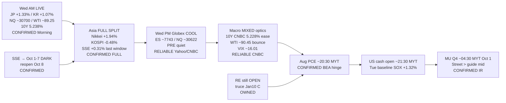

# Transmission Chain — Afternoon 2026-09-30 / 传导链 — 午后

**As-of:** 2026-09-30 ~17:30 MYT  
**Claim class:** ILLUSTRATIVE structure; node facts CONFIRMED/RELIABLE as labeled  
**Dominant theme:** Asia FULL SPLIT (JP extend / KR fade / CN last-window mild) → Globex cool + oil bounce + 10Y ease → PCE/US cash/MU hinge  
**Source:** Yahoo/CNBC ~17:25–17:35 MYT; Nikkei/Kyodo; Yicai/Sina; BEA; Micron IR

### Thinking caption / 思维说明
1. **Observe / 观察:** Asia → **SPLIT FULL**. Globex → **cooled AM NQ**. Yields → **further ease**. Oil → **bounce**. PCE/MU → **still ahead**.  
2. **Why it matters / 为何重要:** Asia veto answered unevenly; macro into PCE is mixed; hard data/earnings vetoes remain.  
3. **Falsifier / 证伪:** Hot PCE + repair fade + MU soft FY27 **or** cool PCE + MU beat/raise + SOX extend.

**What this means / 这说明什么:** Dominant Afternoon theme = **Asia SPLIT close → Globex cool into mixed rates/oil optics → PCE then US cash then MU**.  
午后主主题 = **亚洲分裂收盘 → Globex冷却进入混合利率/油价光学 → PCE然后美股现金然后美光**。
