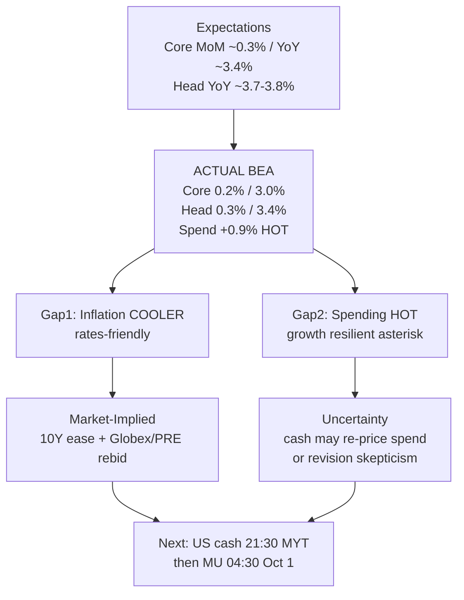

# Expectation Gap — Aug PCE Lifecycle / 预期差 — 8月PCE生命周期

**As-of:** 2026-09-30 ~21:10 MYT  
**Event:** Personal Income and Outlays, August 2026 (+ GDP Q2 2026 third)  
**Status:** **DELIVERED** ~20:30 MYT (BEA CONFIRMED)  
**Claim classes:** Facts (BEA) | Expectations (pre-release Street/nowcast) | Market-Implied (PRE/Globex) | Uncertainty (annual-update YoY optics)

## Tri-layer gap / 三层预期差

| Layer | Pre-release (Expectations) | Actual (Facts — BEA) | Gap / 差额 |
|---|---|---|---|
| Core PCE MoM | ~**0.3%** (Street / Cleveland Fed nowcast ~0.27%) | **+0.2%** | **COOLER** (−0.1 ppt vs ~0.3% cons) |
| Core PCE YoY | ~**3.4%** | **+3.0%** | **COOLER** (−0.4 ppt) — **annual-update caveat** |
| Headline PCE MoM | ~**0.3–0.4%** | **+0.3%** | **IN LINE / slight cool** |
| Headline PCE YoY | ~**3.7–3.8%** | **+3.4%** | **COOLER** — annual-update caveat |
| PCE spending MoM | typically ~0.3–0.5% band (soft prior) | **+0.9%** | **HOT surprise** |
| Real PCE MoM | — | **+0.6%** | Firm demand |
| Personal income MoM | — | **+0.2%** | Soft vs July same-release +0.3% |
| Saving rate | — | **4.1%** | Fact |
| GDP Q2 third | second-est baseline (not re-quoted here) | **+2.2%** (**+0.7 ppt** vs second) | Growth revised **UP** |

### Same-release revision note / 同日修订说明（Uncertainty）
BEA annual update revises history from Jan 2021. July MoM PCE price and core in the **same** August release table = **+0.1% / +0.1%** (supersede prior vintage). Honest YoY read = August vs **revised** July in this vintage, not vs the old “July core 3.3%” memory alone.

## Market pricing vs fundamental / 市场定价 vs 基本面

| Channel | Pre-PCE (Afternoon) | Post-PCE (~21:10 MYT) | Market-Implied read |
|---|---|---|---|
| US 10Y (CNBC) | 5.226–5.228% | **~5.217%** | Further ease |
| ES / NQ | ~7,743 / ~30,622 cool | **~7,755 / ~30,720** | Rebid |
| VIX | ~16.01 | **~15.79** | Off |
| SOXX PRE | quiet | **+0.58%** | Mild semi bid |
| MU PRE | ~1,068.60 aft | **~1,079.50 (+1.35%)** | Memory bid into call |
| Gold | ~4,221 | **~4,241** | Extend |

### Thinking caption / 思维说明
1. **Fundamental Expectation vs Actual:** Inflation **cooler**; spending **hotter** — mixed stack, not one-way dovish.  
2. **Market Pricing:** First reaction **rates-friendly rebid** (yields down, VIX off, NQ/PRE up).  
3. **Falsifier into cash:** Hot spend / revision skepticism → 10Y re-spike and PRE fade **or** cash owns the cool core.

**What this means / 这说明什么:** Expectation gap evening = **cooler inflation beat + hot spending surprise**; market priced the inflation side first; cash and MU still open.  
晚间预期差 = **通胀偏凉超预期 + 支出偏热惊喜**；市场先定价通胀侧；现金与美光仍开放。
