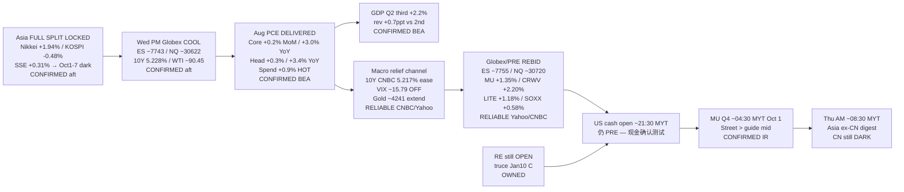

# Transmission Chain — Evening 2026-09-30 / 传导链 — 晚间

**As-of:** 2026-09-30 ~21:10 MYT  
**Claim class:** ILLUSTRATIVE structure; node facts CONFIRMED/RELIABLE as labeled  
**Dominant theme:** Asia FULL SPLIT LOCKED → Afternoon Globex cool into PCE → cooler PCE + hot spend DELIVERED → 10Y ease + Globex/PRE rebid → US cash open → MU Q4 overnight  
**Source:** BEA PCE/GDP ~20:30 MYT; Yahoo Globex ~21:06–21:10 MYT; CNBC PRE/yields ~09:07–09:09 EDT; Afternoon continuity

### Thinking caption / 思维说明
1. **Observe / 观察:** Afternoon cool → **PCE cooler + spend hot**. Globex → **REBID**. 10Y 5.228% → **5.217%**. VIX → **OFF**. US cash → **still PRE**. MU → **still ahead**.  
2. **Why it matters / 为何重要:** Rates channel opened; demand asterisk remains; cash + MU are overnight falsifiers.  
3. **Falsifier / 证伪:** Cash fades PRE + 10Y re-spike + MU soft FY27 **or** cash holds + MU beat/raise + SOX extend.

**What this means / 这说明什么:** Dominant Evening theme = **PCE cooler delivered → rates ease → PRE/futures rebid → cash then MU overnight**.  
晚间主主题 = **PCE偏凉已印 → 利率缓释 → 盘前/期货再买 → 隔夜现金然后美光**。
