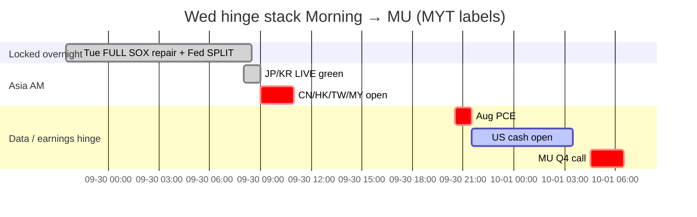

# Catalyst Timeline — 7-day / 催化剂时间线（7日）
**As-of:** 2026-09-30 ~08:30 MYT · Morning  
**Claim classes:** CONFIRMED / TENTATIVE / OPEN  
**Update vs Evening:** Tue cash **FULL MIXED + SOX +1.32%**; Fed speakers **DELIVERED SPLIT** (Barr hawk / Williams no-rush); SPCX **CASH +2.59%**; oil **further fade ~89.25**; Asia JP/KR **LIVE green**; CN/TW **PRE**; **PCE TODAY** + **MU overnight** now primary.

| When (MYT) | Event | Status | Why it can break tape |
|---|---|---|---|
| Owned Tue US | Tue FULL mixed + SOX +1.32% | **LOCKED** CONFIRMED | Semi repair base for Wed |
| Owned Tue Fed | Barr hawk / Bowman silent / Waller payments / Williams no-rush | **DELIVERED** RELIABLE | Split — PCE decides which side |
| Owned | SPCX COMPLETE cash +2.59% | CONFIRMED | Catch-up printed — hold test |
| **~09:00–09:30 Wed** | **CN/HK/TW/MY open** | CONFIRMED upcoming | **PRIMARY AM** — last CN window pre-dark |
| Wed Asia session | Asia FULL after JP/KR green LIVE | LIVE / upcoming | Digestion quality |
| **~20:30 Wed** | **Aug PCE + GDP third** (8:30 ET) | CONFIRMED BEA | **PRIMARY PM** — rates path veto |
| ~21:30 Wed | US cash open | CONFIRMED calendar | PCE reaction into LIVE |
| **~04:30 MYT Oct 1** | **MU FY2026 Q4** (2:30pm Mountain Wed) | CONFIRMED IR PRE ACTIVE | Memory hard check (Tue +1.05%) |
| **Thu Oct 1** | BOJ Summary+Tankan; ISM Mfg; claims | CONFIRMED / RELIABLE | JP + US activity stack |
| **Oct 1–7** | SSE National Day closed; reopen **Oct 8** | CONFIRMED SSE | CN cash dark — Wed last window |
| **Oct 6** | MRVL Investor Day | CONFIRMED IR | Networking/custom Si (Tue +4.51%) |
| **Oct 7** | FOMC Minutes 2:00 p.m. ET | CONFIRMED Fed | Path language after PCE |
| Ongoing | Bessent truce → **Jan 10 2027** | CONFIRMED floor | Floor ≠ certainty |
| Ongoing | **Rare earths / tariffs package** | **OPEN** | Toxic wire risk into CN holiday |
| Owned | Starship Flight 14 **COMPLETE** | RELIABLE done | Digestion; SPCX cash +2.59% |
| Owned | NVDA **+$150B** buyback auth | RELIABLE done | Island faded Tue −0.72% |

### Same-day break risks / 本日破坏风险
1. **CN/TW open hard red** on last pre-holiday window under RE OPEN.  
2. **Hot Aug PCE** → 10Y re-spike >5.25–5.30%.  
3. **MU miss / soft FY27 Q1** after Street > guide mid.  
4. **Oil re-squeeze** off ~89 handle.  
5. **RE/tariff toxic wire**.  
6. **SOX repair fades** without NVDA confirmation into PCE.

**What this means / 这说明什么:** Next ~20 hours = **Asia open → PCE → US cash → MU call** — speakers answered overnight; **data/earnings are today’s vetoes**.  
未来约20小时 = **亚洲开盘 → PCE → 美股现金 → 美光电话会**——讲话隔夜已答；**数据/财报是今日否决权**。
