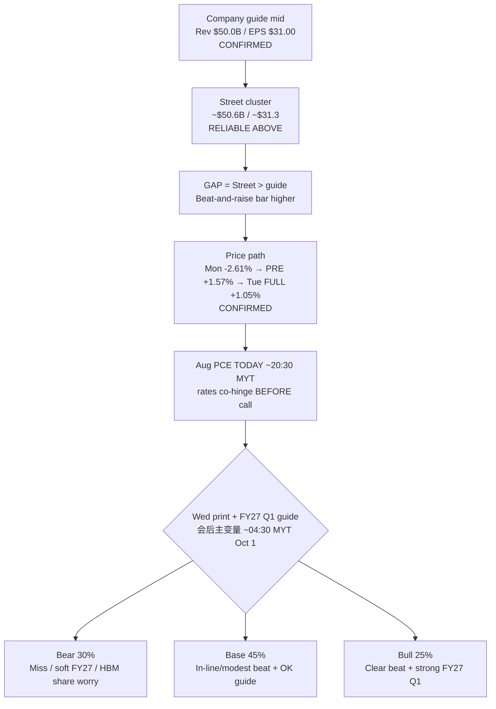

# Expectation Gap — MU FY2026 Q4 (PRINT DAY) / 预期差 — 美光 FY2026 Q4（公布日）

**As-of:** 2026-09-30 ~08:30 MYT · Morning  
**Event Book:** `/home/box/investment/research-os/events/mu-fy26-q4/`  
**Claim classes:** CONFIRMED (guide/IR) · RELIABLE (Street cluster) · HYPOTHESIS (scenarios)

## Event facts / 事件事实
| Item | Value | Claim |
|---|---|---|
| Call | Wed Sep 30 2:30pm Mountain ≈ **04:30 MYT Thu Oct 1** | CONFIRMED IR |
| Company guide (Ex-99.1 2026-06-24) | Rev **$50.0B±$1.0B** / GM **~86%** / non-GAAP EPS **$31.00±$1.00** | CONFIRMED SEC |
| Street cluster | ~**$50.6B** / ~**$31.3** | RELIABLE |
| Gap | Street **above** guide mid on Rev & EPS | RELIABLE |
| Scenarios (locked PRE) | Bear **30%** / Base **45%** / Bull **25%** | HYPOTHESIS |
| Mon cash | **1,053.98 (−2.61%)** | CONFIRMED |
| Tue PRE (Eve) | **1,070.50 (+1.57%)** | CONFIRMED CNBC PRE |
| **Tue FULL** | **1,065.08 (+1.05%)** | **CONFIRMED CNBC** — Morning owns |
| Macro co-hinge | Aug PCE **TODAY** 8:30 ET ≈ 20:30 MYT | CONFIRMED BEA |
| Asia context | JP/KR Wed LIVE green; TW/CN PRE | CONFIRMED LIVE |

## Expectation gap map / 预期差地图

### Thinking caption / 思维说明
1. **Observe:** Street still **above** guide mid; Tue FULL **+1.05%** confirms Eve PRE repair partially into cash (not full PRE level).  
2. **PCE prints before MU call** in US calendar — rates path can dominate multiple even on a clean MU print.  
3. **Falsifier:** Guide cut / HBM share loss **or** blowout FY27 + eased 10Y after cool PCE.

**What this means / 这说明什么:** MU is the **memory-sleeve day hinge**. Tue cash bid is a **setup**, not a verdict. Pair with Aug PCE for the rates × memory joint veto.  
美光是**内存袖当日枢纽**。周二现金买盘是**铺垫**不是裁决。需与今日8月PCE组成利率×内存联合否决。

**EN gap one-liner:** Street > guide mid + Tue +1.05% after Mon −2.61% → bar for clean surprise remains **elevated**; FY27 Q1 guide + PCE path may dominate Q4 print.  
**ZH 一句：** 街预期高于指引中值 + 周一−2.61%后周二+1.05% → 干净超预期门槛仍**偏高**；FY27 Q1指引 + PCE路径可能压过Q4印数。
