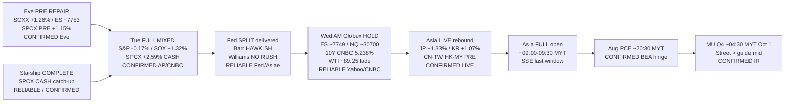

# Transmission Chain — Morning 2026-09-30 / 传导链 — 早盘

**As-of:** 2026-09-30 ~08:30 MYT  
**Claim class:** ILLUSTRATIVE structure; node facts CONFIRMED/RELIABLE as labeled  
**Dominant theme:** Eve PRE repair → Tue FULL SOX cash repair + majors soft → Fed Barr hawk / Williams no-rush SPLIT → Wed Asia LIVE green + Globex hold → PCE/MU hinge  
**Source:** AP/CNBC/Yahoo Tue FULL; Fed PDFs; Asiae Williams; Yahoo Globex/Asia ~08:30 MYT

### Thinking caption / 思维说明
1. **Observe / 观察:** Eve PRE repair → **Tue SOX +1.32% cash**. Majors → **still soft**. Fed → **split not cascade**. Oil → **further fade**. SPCX → **FULL cash +2.59%**. Asia → **JP/KR green LIVE**.  
2. **Why it matters / 为何重要:** Sleeve repair can print without risk-on confirmation; PCE/MU are the next hard vetoes after speakers answered.  
3. **Falsifier / 证伪:** CN/TW hard red + hot PCE + MU soft FY27 **or** PCE cool + MU beat/raise + SOX extend.

**What this means / 这说明什么:** Dominant Morning theme = **PRE→cash semi repair under Fed split → Asia green digest → PCE/MU today**.  
早盘主主题 = **盘前→现金半导修复（美联储分裂下）→ 亚洲绿盘消化 → 今日PCE/美光**。
