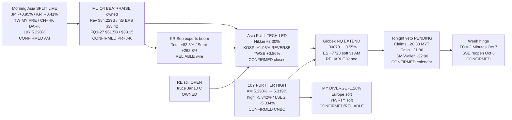

# Transmission Chain — Afternoon 2026-10-01 / 传导链 — 午后

**As-of:** 2026-10-01 ~17:30 MYT  
**Claim class:** ILLUSTRATIVE structure; node facts CONFIRMED/RELIABLE as labeled  
**Dominant theme:** MU beat+raise → Asia memory/AI equity beta HIT (JP/KR/TW) while 10Y further high suppresses breadth/MY/Europe; NQ extend vs ES lag into Claims/ISM veto  
**Source:** DimsumDaily/MoneyToday/EDAILY/Focus Taiwan/CNA Asia closes; Yahoo Globex ~17:25–17:30 MYT; CNBC Tradeweb yields; Morning continuity; Master calendar

### Thinking caption / 思维说明
1. **Observe / 观察:** AM Asia soft KR → **FULL KR green**; JP **extended**; MY **red**; 10Y **further high**; NQ **extend** / ES **lag**.  
2. **Why it matters / 为何重要:** Memory geographic transmission **fired**; rates multiple channel **tightened further** — narrow AI bid ≠ broad risk-on.  
3. **Falsifier / 证伪:** Soft Claims/ISM + 10Y ease + MU cash catch-up **or** hot labour/ISM + 10Y hold + NQ/MU cash fade.

**What this means / 这说明什么:** Dominant Afternoon theme = **MU/AI Asia beta HIT under a further 10Y push, with NQ leading ES into the Claims/ISM veto**.  
午后主主题 = **美光/AI亚洲贝塔兑现，叠加十年期再冲，NQ领ES进入申领/ISM否决窗口**。
