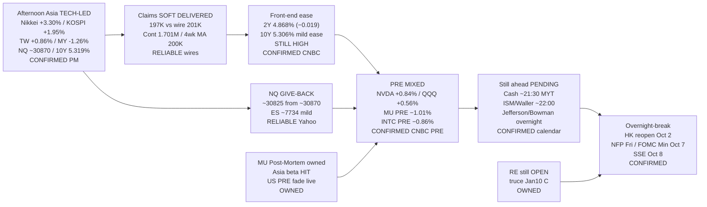

# Transmission Chain — Evening 2026-10-01 / 传导链 — 晚间

**As-of:** 2026-10-01 ~21:12 MYT  
**Claim class:** ILLUSTRATIVE structure; node facts CONFIRMED/RELIABLE as labeled  
**Dominant theme:** Soft Claims opens labour-ease channel but sticky 10Y + NQ give-back + MU PRE fade keep digestion split into US cash / ISM veto  
**Source:** FXStreet/AFX Claims wires; CNBC Tradeweb ~09:12 EDT; CNBC PRE ExtendedMkt; Yahoo Globex ~21:11–21:13 MYT; Afternoon Asia FULL continuity

### Thinking caption / 思维说明
1. **Observe / 观察:** Claims **soft**; 10Y **still high**; NQ **gave back**; MU PRE **fade**; NVDA/QQQ PRE **bid**.  
2. **Why it matters / 为何重要:** Labour channel eased but **multiple tax not lifted** — explains split PRE digestion.  
3. **Falsifier overnight / 隔夜证伪:** Soft ISM + 10Y ease + MU cash repair **or** hot ISM + hawkish speakers + MU/NQ deeper fade.

**What this means / 这说明什么:** Dominant Evening theme = **soft Claims into a still-high 10Y with split PRE (NVDA bid / MU fade) ahead of cash/ISM**.  
晚间主主题 = **偏软申领进入仍高的十年期，盘前分裂（英伟达强/美光弱），前方是现金/ISM**。
