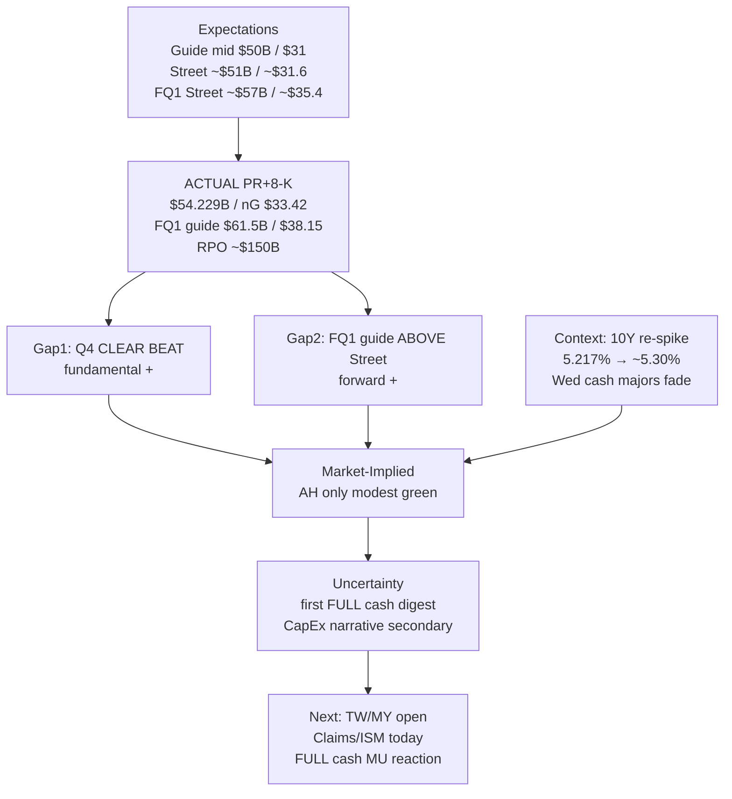

# Expectation Gap — MU FY26 Q4 Lifecycle / 预期差 — 美光FY26 Q4生命周期

**As-of:** 2026-10-01 ~08:30 MYT  
**Event:** Micron Technology FY2026 Q4 results + FQ1-27 guidance  
**Status:** **ACTUAL PRINTED** (GlobeNewswire PR + SEC 8-K Ex. 99.1 accepted 2026-09-30 16:02 ET)  
**Lifecycle stage:** Actual → Market Reaction (AH modest) → first FULL cash digestion ahead  
**Claim classes:** Facts (PR/8-K) | Expectations (pre-release guide/Street) | Market-Implied (Wed cash/AH/Globex) | Uncertainty (CapEx narrative secondary)

## Tri-layer gap / 三层预期差

| Layer | Pre-release (Expectations) | Actual (Facts — PR/8-K) | Gap / 差额 |
|---|---|---|---|
| Revenue | Guide **$50.0B ± $1.0B**; Street ~**$51.07B** | **$54.229B** | **CLEAR BEAT** vs guide **and** Street |
| nG Gross margin | Guide **~86%** | **87.0%** (GAAP 86.8%) | **BEAT** |
| nG EPS | Guide **$31.00 ± $1.00**; Street ~**$31.61** | **$33.42** (GAAP $32.87) | **CLEAR BEAT** |
| FQ1-27 Revenue | Street ~**$57B** | Guide **$61.5B ± $1.5B** | **Guide ABOVE Street** |
| FQ1-27 nG EPS | Street ~**$35.40** | Guide **$38.15 ± $1.00** | **Guide ABOVE Street** |
| FQ1-27 nG GM | — | **~86.25%** | Fact (seq ease vs Q4 87.0%) |
| OCF / adj FCF | — | **$43.97B / $33.20B** | Fact |
| Cash EOY | — | **$73.48B** | Fact |
| Visibility (call) | Pre: tight HBM narrative | RPO ~**$150B**; **26 SCAs**; >75% FY27; tight **2028** | RELIABLE secondary — structural support |

### Special items / 特殊项
- Patent license **$500M** in Q4 GAAP opex (excluded from nG) — Fact.  
- Some secondary wires cite elevated FY27 CapEx as AH restraint — treat as **Uncertainty / secondary narrative**, not sole CONFIRMED cause of modest AH.

## Market pricing vs fundamental / 市场定价 vs 基本面

| Channel | Pre-print | Post-print (~08:30 MYT) | Market-Implied read |
|---|---|---|---|
| MU Wed cash | Tue 1,065.08 (+1.05%); Eve PRE ~1,079.50 (+1.35%) | Wed close **1,065.11 (~flat)** | Pre-print bid did not extend in cash |
| MU AH | — | **Modest / slight green** (CNBC/SA) | EPS surprise partly pre-priced; multiple tight |
| US 10Y | Eve **5.217%** post-PCE | Wed **~5.293%** / LIVE **5.298%** | WACC tightened into print |
| SOXX / SOX | Eve PRE SOXX +0.58% | Wed SOXX **+0.21%** / SOX ~flat | Mild — not euphoric chain bid |
| KOSPI Thu LIVE | Wed −0.48% | **~−0.41%** LIVE | Memory geographic caution |
| ES / NQ | Eve ~7,755 / ~30,720 | **~7,735 / ~30,769** | ES fade; NQ hold |

### Thinking caption / 思维说明
1. **Fundamental Expectation vs Actual:** Q4 **clear beat**; FQ1 guide **above Street** — positive surprise stack.  
2. **Market Pricing:** First reaction **modest** — consistent with pre-pricing (PRE +1.35%, Street>guide) + overnight **multiple tax** (10Y re-spike).  
3. **Falsifier into cash:** CapEx/rates narrative → gap down **or** 10Y ease + catch-up bid owns the beat+raise.

**What this means / 这说明什么:** Expectation gap morning = **large positive fundamental surprise + restrained market pricing under 5.3% 10Y**; next resolution = first FULL cash digestion.  
早盘预期差 = **大幅正基本面惊喜 + 在5.3%十年期下克制的市场定价**；下一解析 = 首次完整现金消化。
