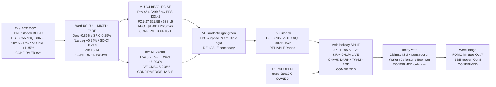

# Transmission Chain — Morning 2026-10-01 / 传导链 — 早盘

**As-of:** 2026-10-01 ~08:30 MYT  
**Claim class:** ILLUSTRATIVE structure; node facts CONFIRMED/RELIABLE as labeled  
**Dominant theme:** MU Q4 beat+raise → memory/HBM/AI factory chain + rates/oil backdrop (10Y re-spike + Wed cash mixed fade)  
**Source:** GlobeNewswire/SEC MU; WSJ/Reuters/AP Wed FULL; Yahoo Globex/Asia ~08:25–08:30 MYT; CNBC yields; Evening continuity; Master monitor

### Thinking caption / 思维说明
1. **Observe / 观察:** Eve rebid → **Wed cash mixed fade**. 10Y ease → **re-spike ~5.30%**. MU → **beat+raise**, AH → **modest**. Asia → **holiday SPLIT**.  
2. **Why it matters / 为何重要:** Memory fundamental transmission fired; rates multiple channel tightened — ΔEPS ≠ ΔPrice.  
3. **Falsifier / 证伪:** TW/MY hard red + hot Claims/ISM + MU cash gap **or** soft labour/ISM + 10Y ease + MU cash catch-up.

**What this means / 这说明什么:** Dominant Morning theme = **MU beat+raise into AI memory chain under 10Y re-spike / Wed cash fade / Asia holiday-aware digest**.  
早盘主主题 = **美光超预期上修进入AI内存链，叠加十年期再冲 / 周三现金回吐 / 亚洲假期感知消化**。
