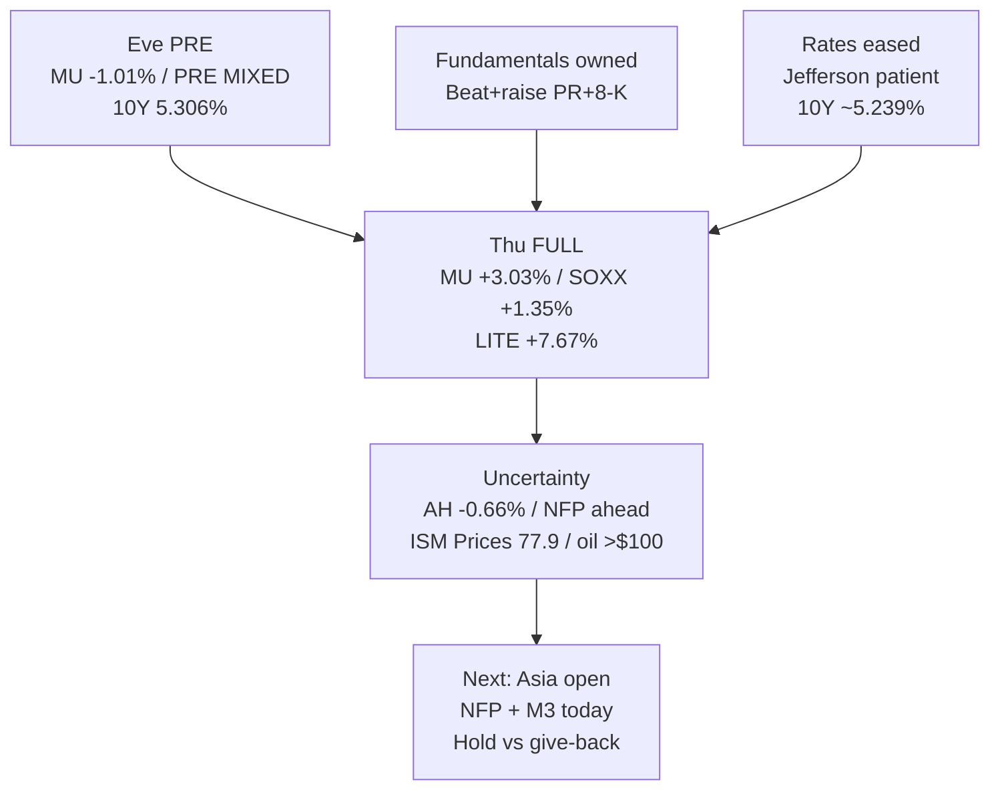

# Expectation Gap — MU Post-Mortem cash digest + NFP day / 预期差 — 美光现金消化 + 非农日

**As-of:** 2026-10-02 ~08:30 MYT  
**Events in lifecycle:** (1) MU FY26 Q4 — **Actual owned**; cash reaction **DELIVERED Thu**; (2) NFP Sep — **PENDING today 08:30 ET**; (3) FOMC Minutes Oct 7 / SSE Oct 8 — **FORWARD**  
**Claim classes:** Facts | Expectations | Market-Implied | Uncertainty

## A) MU — Actual → cash ownership (update vs Wed AH modest)

| Layer | Pre-cash (Eve PRE) | Thu FULL Actual market | Gap / 差额 |
|---|---|---|---|
| MU price path | PRE **−1.01%** | Cash **+3.03%** to **1,097.39** | **REVERSE — ownership fired** |
| Fundamental | Q4 **$54.229B** / nG **$33.42** / FQ1 **$61.5B / $38.15** | Unchanged (Post-Mortem) | Fact stack still **CLEAR BEAT + guide ABOVE Street** |
| AH after Thu | — | **−0.66%** to 1,090.20 | Mild give-back — not euphoria |
| SOXX / SOX | Eve PRE SOXX +0.36% | Thu **+1.35% / +1.59%** | Chain bid **confirmed** |
| KOSPI | Thu FULL **+1.95%** | Fri LIVE **~−0.27%** | Geographic **digest** after surge |
| 10Y context | Eve **5.306%** | Settle **~5.239%** | Multiple tax **eased** into cash ownership |

### Thinking caption / 思维说明
1. **Fundamental gap:** Still **large positive** (unchanged Post-Mortem).  
2. **Market pricing update:** First FULL cash **owned** the beat after PRE fade — ΔPrice caught up when ΔMultiple eased.  
3. **Falsifier:** Hot NFP → give-back **or** soft NFP → extend ownership.

## B) NFP today — Expectations vs binders (pre-print)

| Binder into NFP | Level / status | Implication |
|---|---|---|
| Claims soft (lagging) | **197K** vs 201K | Mild labour cool already printed |
| ISM Employment | **52.7** expanding | Not a collapse signal |
| ISM Prices | **77.9** spike | Sticky inflation optics **hot** |
| Oil | WTI **$92.87** / Brent **~$102.5** | Inflation channel live |
| Fed tone | Jefferson **patient** | Path relief vs hike panic |
| 10Y | Settle **~5.239%** / LIVE **~5.254%** | Eased but still HIGH |
| Market-Implied | SOXX green / VIX ~16.4 | Sleeve risk-on **fragile** into print |

**What this means / 这说明什么:** Expectation gap morning = **MU cash ownership closed much of the AH-modest gap**, while **NFP expectation gap is still OPEN** under a **hot Prices/oil binder + patient Fed**. Next resolution = Asia open → NFP.  
早盘预期差 = **美光现金认领大幅收窄盘后偏弱缺口**，而**非农预期差仍开**——约束是**偏热价格项/油价 + 偏耐心联储**。下一解析 = 亚洲开盘 → 非农。
