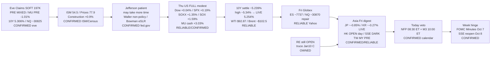

# Transmission Chain — Morning 2026-10-02 / 传导链 — 早盘

**As-of:** 2026-10-02 ~08:30 MYT  
**Claim class:** ILLUSTRATIVE structure; node facts CONFIRMED/RELIABLE as labeled  
**Dominant theme:** Thu FULL SOXX/MU leadership + rates ease/Jefferson patient → Asia soft digest + NFP day (ISM Prices 77.9 + oil >$100 binder)  
**Source:** CNBC/Yahoo Thu FULL + Fri Globex/Asia; Master monitor 2026-10-02; Evening continuity; ISM/Census/Fed.gov; boj.or.jp

### Thinking caption / 思维说明
1. **Observe / 观察:** Eve PRE MIXED → **Thu cash modest + SOXX/MU lead**. 10Y spike → **ease ~5.24%**. MU PRE fade → **cash +3%**. Asia Thu surge → **Fri soft digest**.  
2. **Why it matters / 为何重要:** Physical-layer price transmission (MU/SOXX/LITE) fired; inflation binder (Prices/oil) still live into NFP.  
3. **Falsifier / 证伪:** Hot NFP + 10Y >5.35% + Asia hard red **or** soft NFP + Asia catch-up + SOX extend.

**What this means / 这说明什么:** Dominant Morning theme = **Thu AI-sleeve cash confirmation under easing-but-not-dead inflation/rates veto into NFP, with Asia soft digest + HK open / CN dark**.  
早盘主主题 = **周四AI袖现金确认，叠加缓和但未死的通胀/利率否决进入非农，亚洲偏软消化 + 港开/A休**。
