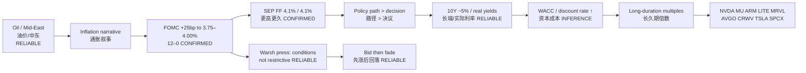

# FOMC Sep 2026 — Transmission Chain Diagram｜传导链图示
**As-of:** 2026-09-17  
**Claim class:** CONFIRMED (decision/SEP) + RELIABLE (tape) + INFERENCE (links)  
**Sources:** Fed statement/SEP; Post-Mortem pack under `events/fomc-2026-09/`

**Thinking caption｜思维说明**
- Observe: path/SEP/dots, not only the 25 bp binary.｜盯路径与点阵，不只盯加息 25bp。
- Why: binary was ~92–93% priced; residual = higher-for-longer WACC.｜二元已定价；残差是更高更久贴现率。
- Alternative: oil/term-premium alone can move 10Y without a hawkish SEP.｜备选：油价/期限溢价也可推高 10Y。
- Falsifier: 10Y falls & AI multiples expand while SEP path still “sticky.”｜证伪：SEP 仍紧但 10Y 下行且 AI 倍数扩张。
- Next: BOJ Fri Sep 18 USDJPY/carry; MU Sep 30.｜下一步：周五日银；美光 9/30。
