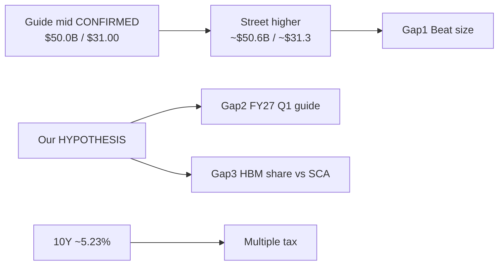
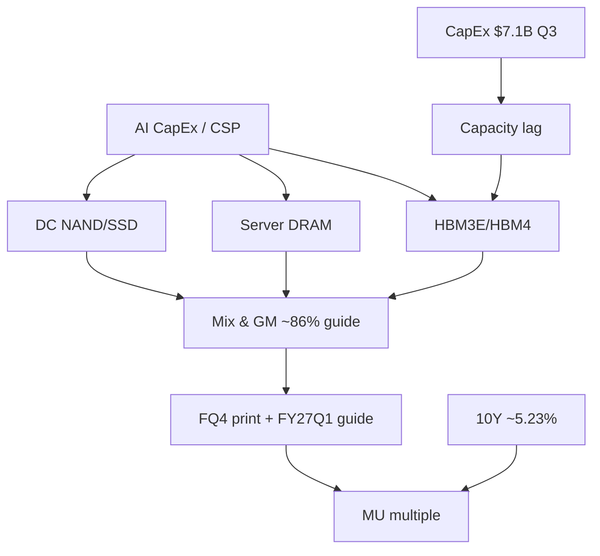

# Micron (MU) FY2026 Q4 — Pre-Event Snapshot / Event Book (PRE)
# 美光科技 FY2026 第四财季 — 会前快照 / 事件簿（会前）

**Event / 事件:** Micron Technology, Inc. (Nasdaq: MU) FY2026 Q4 Financial Results + Earnings Call  
**Report as-of / 报告时点:** Tue **2026-09-29 ~09:00 MYT** (Asia/Kuala_Lumpur)  
**Lifecycle stage / 生命周期阶段:** **Pre-Event Snapshot only** — do **not** overwrite theses after Actual; leave Actual/Post stubs empty until print  
**Path:** `/home/box/investment/research-os/events/mu-fy26-q4/PRE_EVENT_SNAPSHOT.md`  
**Companion:** `EXEC_SUMMARY.md` (same folder); charts under `charts/`  
**Company pack:** `/home/box/investment/research-os/companies/MU/`  
**Governing:** `/home/box/investment/RESEARCH_OS_MASTER_PROMPT.md` + skill *Global Investment Research OS* + `charts/CHARTING_STANDARD.md`  
**Self-contained:** Yes — readable offline without chat context  
**Purpose:** Research / education only — **no** personalized trading instructions  

**Central equation / 核心等式:**  
`Actual Fundamental Outcome − Priced Expectations = Repricing Potential`  
`实际基本面结果 − 已定价预期 = 重定价空间`

---

## 0. Claim classification legend | 证据分级说明

| Class | Meaning | 中文 |
|-------|---------|------|
| **CONFIRMED FACT** | Primary official source (SEC, Micron IR, Fed calendar, FRED) | 已确认事实（一手官方） |
| **RELIABLE REPORTING** | Quality newswire / IR secondary / OS morning with cited primary | 可靠报道 |
| **INFERENCE** | Logical conclusion from confirmed/reliable inputs | 推断 |
| **HYPOTHESIS** | Testable view used for scenarios — not fact | 假设（可证伪） |
| **SPECULATION** | Unverified narrative; low weight | 臆测 |
| **N/A (unverified)** | Not invented — gap until sourced | 未核实（不编造） |

---

## 1. Executive Summary | 执行摘要

### English

1. **Calendar (CONFIRMED):** MU reports FY2026 Q4 after the US close on **Wed 30 Sep 2026**; earnings call **2:30pm Mountain** (= **4:30pm ET** under MDT/EDT) ≈ **04:30 MYT Thu 1 Oct 2026** (CALCULATED). IR event page live; announced ~**2026-08-26**.
2. **Company Q4 guide (CONFIRMED, SEC Ex-99.1 2026-06-24):** Revenue **$50.0B ± $1.0B**; gross margin **approximately 86%**; non-GAAP diluted EPS **$31.00 ± $1.00**; GAAP diluted EPS **$30.73 ± $1.00**. Operating expenses outlook ~$1.86B GAAP / ~$1.65B non-GAAP.
3. **Prior quarter bar (CONFIRMED):** FY26 Q3 (ended May 28, 2026) revenue **$41.456B** (record); non-GAAP EPS **$25.11**; GAAP EPS **$24.67**; non-GAAP GM **84.9%**. Midpoint Q4 guide implies ~**+21%** sequential revenue.
4. **Street (RELIABLE cluster, not a single terminal scrape):** Revenue roughly **$50.4–50.8B** (mid ~**$50.6B**); non-GAAP EPS roughly **$31.1–31.5** (mid ~**$31.3**). Street sits **modestly above** guide midpoint.
5. **Tape into the event (RELIABLE):** MU Mon close **$1,053.98 (−2.61%)**; SOX **12,465.24 (−1.61%)**; 10Y ~**5.23%**; VIX **16.07**; Globex still soft Tue AM. Pre-earn fade under rates + semi digest.
6. **Our base case (HYPOTHESIS, 45%):** Modest beat vs **company guide midpoint**, FY27 Q1 guide roughly consistent with the already-raised Street bar; HBM commentary constructive but competitive-share risk acknowledged. Residual two-way price action under WACC tax.
7. **Expectation gap:** Not primarily “will they miss $50B?” Gap is **(i)** size of beat vs Street-above-guide, **(ii)** **FY27 Q1 guide**, **(iii)** HBM mix durability / share vs SK hynix & Samsung.
8. **Scenarios (HYPOTHESIS):** Bear **30%** / Base **45%** / Bull **25%**.

### 简体中文

1. **日程（已确认）：** 美光于 **2026-09-30 周三**美股收盘后公布 FY2026 Q4；电话会山地时间 **14:30**（= 美东 **16:30**）≈ 大马时间 **10月1日周四约 04:30**。
2. **公司 Q4 指引（已确认）：** 收入 **$50.0B ± $1.0B**；毛利率约 **86%**；非 GAAP EPS **$31.00 ± $1.00**；GAAP EPS **$30.73 ± $1.00**。
3. **上季标尺（已确认）：** Q3 收入 **$41.456B**；非 GAAP EPS **$25.11**；指引中点隐含环比约 **+21%**。
4. **街共识（可靠区间）：** 收入约 **$50.4–50.8B**（中枢 ~**$50.6B**）；非 GAAP EPS 约 **$31.1–31.5**（中枢 ~**$31.3**）——已略高于指引中点。
5. **会前盘面：** MU 周一 **$1,053.98（−2.61%）**；SOX **−1.61%**；十年期约 **5.23%**——财报前软 + 利率压制倍数。
6. **我方基准（假设，45%）：** 相对**公司指引中点**小幅超预期；下季指引大体匹配已抬高的街门槛；HBM 表述偏建设性但承认份额竞争。双向波动。
7. **预期差：** 主要不在“会否跌破 $50B”，而在超预期幅度、**下季指引**、HBM 结构/份额可持续性。
8. **情景（假设）：** 熊 **30%** / 基准 **45%** / 牛 **25%**。

---

## 2. Why This Event Matters | 为何本事件重要

### English
- MU is the **Memory — HBM / DRAM / NAND** node in the AI-factory coverage chain. The print is a hard check on whether **AI accelerator build-outs** still translate into memory ASP, mix, and FCF after a week of **rates tax** (10Y ~5.23%) and **SOX digestion**.
- Company set an unusually high bar in June (**$50B** midpoint, **~86%** GM). Street then edged **above** that midpoint. Repricing risk therefore skews to **guide + narrative**, not only the Q4 binary.
- Competitive HBM context (SK hynix / Samsung share rotation) means “sold-out” language must be read against **share and CapEx** evidence.

### 简体中文
- 美光是 AI 工厂链的**存储节点**（HBM/DRAM/NAND）。本季是在利率压制与半导消化之后，对 AI 资本开支→存储价格/结构/自由现金流的**硬核验证**。
- 公司 6 月已给出极高门槛；街又略抬高于指引中点。重定价风险偏向**指引与叙事**，不只当季二元结果。
- HBM 竞争（SK 海力士 / 三星份额）要求把“订满”表述对照**份额与资本开支**证据。

---

## 3. Historical Context | 历史背景（仅已核实）

| Period | Revenue | Non-GAAP EPS | Notes | Class | Source |
|--------|---------|--------------|-------|-------|--------|
| FY25 Q4 (YoY base) | ~**$11.3B** cited in previews | **$3.03** cited | YoY base for explosive growth comps | RELIABLE REPORTING (preview wires); confirm vs IR if needed | FactSheets / NextEarningsDate cluster |
| FY26 Q1 | **$13.64B** (vs guide mid context in preview) | **$4.78** | Beat history cited by FinanceFeeds-style previews | RELIABLE REPORTING of prior beats | Preview synthesis; prefer IR for audit |
| FY26 Q2 | **$23.860B** | **$12.20** | CONFIRMED in Q3 comparative table | CONFIRMED | SEC Ex-99.1 |
| FY26 Q3 | **$41.456B** | **$25.11** | Record; Cloud Memory **$13.769B**; Core DC **$11.524B** | CONFIRMED | SEC Ex-99.1 2026-06-24 |
| FY26 Q4 guide | **$50.0B ± $1.0B** | **$31.00 ± $1.00** | GM ~86%; 14-week quarter / 53-week year noted in previews | Guide CONFIRMED; 14-week note RELIABLE | SEC + preview wires |

**HBM cycle notes (sourced):**
- Micron: HBM4 (1-beta) in **high-volume shipments** for lead customer; HBM4E (1-gamma) volume production expected **calendar 2027** — **CONFIRMED** (SEC product highlights).
- Industry HBM revenue share Q2 2026 (Counterpoint via quality press): SK hynix **50%**, Samsung **33%**, Micron **18%** — **RELIABLE REPORTING**.
- CEO (Q3 PR): multi-year Strategic Customer Agreements (SCA｜战略客户协议) to enhance durability/predictability — **CONFIRMED** as company statement (not independent verification of contract terms).

---

## 4. Event Facts table | 事件事实表

| Field | Value | Class | Source |
|-------|--------|-------|--------|
| Company | Micron Technology, Inc. (Nasdaq: MU) | CONFIRMED | IR / SEC |
| Event | FY2026 Q4 Financial Results + Earnings Call | CONFIRMED | Micron IR event page |
| Call local time | Wed **2026-09-30**, **2:30pm Mountain** | CONFIRMED | IR; Company Monitor 2026-09-28 |
| Call ET | **4:30pm ET** Wed Sep 30 | CONFIRMED (Mountain+2 in MDT/EDT) | IR page shows 4:30 PM ET |
| MYT | ~**04:30 MYT Thu 2026-10-01** | CONFIRMED (CALCULATED) | ET+12 in EDT season |
| Announced | ~**2026-08-26** | CONFIRMED / RELIABLE | Prior company monitor |
| Fiscal Q4 weeks | **14 weeks** (53-week FY2026) cited in previews | RELIABLE REPORTING | Earnings preview wires (re-verify in 10-Q if needed) |
| Prior Q3 call | Wed Jun 24, 2026, 2:30pm Mountain | CONFIRMED | SEC Ex-99.1 |
| CIK | **0000723125** | CONFIRMED | SEC EDGAR |
| Webcast | investors.micron.com | CONFIRMED | IR |

---

## 5. Terminology boxes | 术语框

### HBM (High Bandwidth Memory｜高带宽内存)
| EN | 中文 | Simple explanation | Investment meaning |
|----|------|--------------------|--------------------|
| HBM | 高带宽内存 | Stacked DRAM with very high bandwidth for AI accelerators | Mix/ASP upside; qualification & capacity are the bottleneck narrative |

### DRAM (Dynamic Random-Access Memory｜动态随机存取存储器)
| EN | 中文 | Simple explanation | Investment meaning |
|----|------|--------------------|--------------------|
| DRAM | 动态随机存取存储器 | Volatile main memory (DDR5, LPDDR, graphics, HBM family) | Cyclical ASP + AI server content |

### NAND (NAND Flash｜与非闪存)
| EN | 中文 | Simple explanation | Investment meaning |
|----|------|--------------------|--------------------|
| NAND | 与非闪存 | Non-volatile storage (SSD, UFS, QLC) | Data-center SSD / client storage cycle |

### ASP (Average Selling Price｜平均售价)
| EN | 中文 | Simple explanation | Investment meaning |
|----|------|--------------------|--------------------|
| ASP | 平均售价 | Blended price per bit or unit | Primary GM lever with mix |

### CapEx (Capital Expenditure｜资本开支)
| EN | 中文 | Simple explanation | Investment meaning |
|----|------|--------------------|--------------------|
| CapEx | 资本开支 | Cash spent on PPE / capacity | Supply response lag vs scarcity rents |

### Bit growth｜比特出货增长
| EN | 中文 | Simple explanation | Investment meaning |
|----|------|--------------------|--------------------|
| Bit growth | 比特增长 | Volume in bits shipped | Separates price vs volume in memory cycles |

### HBM3E / HBM4｜高带宽内存世代
| EN | 中文 | Simple explanation | Investment meaning |
|----|------|--------------------|--------------------|
| HBM3E / HBM4 | HBM 世代 | Successive HBM generations; HBM4 now in volume at Micron for lead customer (CONFIRMED) | Generation mix drives ASP/GM and share fights |

### Expectation Gap｜预期差
| EN | 中文 | Simple explanation | Investment meaning |
|----|------|--------------------|--------------------|
| Expectation Gap | 预期差 | Our fundamentals − market pricing | Positive gap = upside if actual > priced |

### Whisper｜私下预期 / 耳语数字
| EN | 中文 | Simple explanation | Investment meaning |
|----|------|--------------------|--------------------|
| Whisper | 耳语数字 | Informal Street number above published consensus | Often moves stock more than “consensus”; treat as SPECULATION unless sourced |

### SCA (Strategic Customer Agreements｜战略客户协议)
| EN | 中文 | Simple explanation | Investment meaning |
|----|------|--------------------|--------------------|
| SCA | 战略客户协议 | Multi-year customer agreements cited by Micron | Claimed durability of demand/pricing — verify via commentary, not assume terms |

### GM (Gross Margin｜毛利率)
| EN | 中文 | Simple explanation | Investment meaning |
|----|------|--------------------|--------------------|
| GM | 毛利率 | Gross profit / revenue | Q4 guide ~86% is cycle-peak territory (company outlook) |

### SOX (PHLX Semiconductor Index｜费城半导体指数)
| EN | 中文 | Simple explanation | Investment meaning |
|----|------|--------------------|--------------------|
| SOX | 费城半导体指数 | Semiconductor equity index | Relative beta context for MU reaction |

---

## 6. Street Consensus | 街共识

**Method note:** Bloomberg/FactSet/Refinitiv terminals were **not** accessible as a live scrape this run. Consensus below is a **RELIABLE REPORTING cluster** from quality preview articles (as-of ~Sep 21–28, 2026). Prefer treating as a **range**. Primary lock remains **company guidance** (CONFIRMED).

### 6.1 Company guidance (primary lock)

| Metric | GAAP | Non-GAAP | Class | Source |
|--------|------|----------|-------|--------|
| Revenue | **$50.0B ± $1.0B** | **$50.0B ± $1.0B** | CONFIRMED | SEC Ex-99.1 2026-06-24 |
| Gross margin | **~86%** | **~86%** | CONFIRMED | same |
| Operating expenses | **~$1.86B** | **~$1.65B** | CONFIRMED | same |
| Diluted EPS | **$30.73 ± $1.00** | **$31.00 ± $1.00** | CONFIRMED | same |
| Diluted shares assumption | ~**1.15B** | ~**1.15B** | CONFIRMED (outlook footnote) | same |

### 6.2 Street cluster (secondary)

| Source (preview) | Rev | EPS (non-GAAP bias) | As-of | Class |
|------------------|-----|---------------------|-------|-------|
| Vantage / Trader Central paraphrase | ~**$50.6B** | ~**$31.27** | ~Sep 21 | RELIABLE REPORTING |
| FactSheets.com | ~**$50.6B** | ~**$31.30** | ~Sep late | RELIABLE REPORTING |
| TickerLeague (21 analysts cited) | **$50.8B** (range $46.9–59.8B) | **$31.33** (range $28.04–37.44) | ~Sep 23 | RELIABLE REPORTING |
| TradingKey / IBD cite | **$50.82B** | **$31.43** | ~Sep | RELIABLE REPORTING |
| NextEarningsDate.com | **$51.13B** | **$31.50** | undated page | RELIABLE REPORTING (verify freshness) |
| FinanceFeeds cite | ~**$50.42B** | ~**$31.14** | ~Sep | RELIABLE REPORTING |

**Working Street band used in this Event Book (INFERENCE from cluster):**  
Rev **~$50.4–50.8B** (center ~**$50.6B**); non-GAAP EPS **~$31.1–31.5** (center ~**$31.3**).

**Whisper:** N/A (unverified) as a discrete StreetAccount print this run. Polymarket-style “EPS > $32.22” cites in one preview = **SPECULATION / thin market** — do not treat as consensus.

### 6.3 Prior actuals for context (CONFIRMED)

| | FQ3-26 | FQ2-26 | FQ3-25 |
|--|--------|--------|--------|
| Revenue | $41,456M | $23,860M | $9,301M |
| GAAP EPS | $24.67 | $12.07 | $1.68 |
| Non-GAAP EPS | $25.11 | $12.20 | $1.91 |
| Non-GAAP GM % | 84.9% | 74.9% | 39.0% |

---

## 7. Market-Implied | 市场隐含

| Item | Value | As-of | Class | Source |
|------|-------|-------|-------|--------|
| MU last cash close | **$1,053.98** | Mon 2026-09-28 16:00 ET | RELIABLE REPORTING | Yahoo Finance; AI Factory Morning 2026-09-29-0830 |
| Day change | **−$28.30 (−2.61%)** | Mon | RELIABLE | same |
| Overnight (Blue Ocean) | ~**$1,049.60 (−0.42%)** | Yahoo overnight stamp ~Sep 28 eve | RELIABLE REPORTING | Yahoo quote page |
| vs recent | 5D **+0.96%**; 1M **+12.98%**; YTD **~+269%** (Yahoo trailing) | as-of Mon close page | RELIABLE REPORTING | Yahoo |
| Day range Mon | High **1,076.97** / Low **1,027.62** (morning table) | Mon | RELIABLE | Morning watchlist table |
| SOX | **12,465.24 (−1.61%)** | Mon | RELIABLE | Morning report (AP/CNBC/Yahoo) |
| S&P / Nasdaq Mon | **7,683.69 (−0.8%)** / **26,820.38 (−0.9%)** | Mon | RELIABLE | Morning |
| 10Y UST | ~**5.23–5.24%** | Tue AM | RELIABLE | Morning (CNBC/Yahoo) |
| VIX | **16.07 (+8.1%)** | Mon | RELIABLE | Morning |
| Options expected move | ~**7%** (Yahoo “What’s happening”) vs ~**10.3%** (Trader Central Oct 2 straddle as-of Sep 21 at ~$1,015) | Sep 21–28 | RELIABLE REPORTING — **variance** | Do **not** invent a single IV |
| Analyst target avg | ~**$1,515–1,521** | Yahoo ~Sep 28 page | RELIABLE REPORTING | Yahoo; TradingKey ~$1,515 |
| Target range | Low **$361** / High **$2,200** (Yahoo) | Sep 28 page | RELIABLE REPORTING | Yahoo |
| Wedbush | Outperform; PT **$1,400** reiterated | 2026-09-28 | RELIABLE REPORTING | Yahoo ratings strip |
| Citi (preview cite) | PT **$1,300** (from $1,150); model Rev **$51B** / EPS **$31.45** | ~Sep 23 | RELIABLE REPORTING | MEXC/preview paraphrase |
| Market cap | N/A (unverified exact live) — rough INFERENCE ~**$1.19T** using ~1.13B basic shares × $1,053.98 | — | INFERENCE / N/A prefer | Shares from Q3 diluted ~1.145B |

**Relative read (INFERENCE):** MU underperformed Mag7 island (NVDA +1.68% on buyback) and printed a **pre-earn fade** into Sep 30 under SOX soft — consistent with positioning ahead of a high-bar print, not proof of a fundamental miss.

---

## 8. Our Fundamental Expectations | 我方基本面预期（HYPOTHESIS）

**Label: HYPOTHESIS — challengeable. Not a forecast sold as fact. Research/education only.**

| Theme | Our expectation (HYPOTHESIS) | Why (evidence chain) |
|-------|------------------------------|----------------------|
| HBM mix | Constructive HBM4 volume + SCA language continues; **not** assuming share gain vs SK hynix/Samsung | CONFIRMED HBM4 HVS; RELIABLE share MU 18% Q2 |
| DRAM / NAND pricing | Still firm for server/data-center; watch any language on **second-half supply response** | Cycle + AI content; CapEx lag |
| CapEx | CapEx remains elevated vs history; watch whether management frames **discipline vs sold-out** | Q3 net CapEx **$7.1B** CONFIRMED |
| AI demand | Demand narrative intact but **multiple already taxed** by 10Y ~5.23% | Morning tape RELIABLE |
| Q4 print vs guide mid | **Modest beat** vs $50.0B / $31.00 mid more likely than clean miss — **but** Street-above-guide means “modest beat vs guide” can still = “in-line to soft vs Street” | Prior three quarters beat midpoints (RELIABLE beat history) |
| FY27 Q1 guide | The **main** reaction variable | Event elasticity pattern for memory names |

---

## 9. Expectation Gap | 预期差

**Definition:** Expectation Gap = Our Fundamentals − Market Pricing  

| Dimension | Market / Street pricing | Our fundamentals (HYPOTHESIS) | Gap | Class |
|-----------|-------------------------|-------------------------------|-----|-------|
| Q4 revenue | Street ~$50.6B > guide mid $50.0B | Modest beat vs **guide mid**; may only **match** Street | **Small-to-moderate negative vs Street** if only mid-guide beat | HYPOTHESIS |
| Q4 EPS | Street ~$31.3 vs guide mid $31.0 | Similar | Same | HYPOTHESIS |
| GM ~86% | Priced as achievable | Achievable if mix holds; fragile if ASP softens | **Fragility underappreciated** if call hedges pricing | HYPOTHESIS |
| FY27 Q1 | Partially in models; exact unknown | Primary surprise channel | **Largest open gap** | HYPOTHESIS |
| HBM durability | Sold-out / booked narrative | True for lead platforms but **share** fight real (18%) | **Share vs scarcity** gap | HYPOTHESIS |
| Multiple | Pre-earn fade −2.61%; 10Y 5.23% | Even good print can see limited multiple expansion | **WACC tax** | INFERENCE |

**Equation application:**  
- If Actual ≈ guide mid + soft FY27 Q1 → Repricing Potential **negative vs Street** (Bear skew).  
- If Actual ≈ Street + solid FY27 Q1 + HBM booked → Repricing Potential **positive** but may still fight rates (Base/Bull mix).  
- If Actual ≫ Street + strong guide → Bull; measure elasticity in Post-Mortem (do not invent here).

---

## 10. Scenario Matrix EVENT | 情景矩阵

Probabilities sum to **100%**. All scenarios are **HYPOTHESIS** for research planning — **not** personalized trading advice.

| Scenario | Prob | Rev / GM / EPS / guide / HBM narrative | Price-reaction hypothesis (HYPOTHESIS) | Falsifier |
|----------|------|----------------------------------------|----------------------------------------|-----------|
| **BEAR** | **30%** | Soft vs Street (near/below guide mid or GM miss); FY27 Q1 cut or cautious; HBM qualification/share caution | Gap-down; SOX sympathy soft; fade continues | Clear beat + strong guide |
| **BASE** | **45%** | Modest beat vs **guide mid**, roughly **in-line Street**; FY27 Q1 roughly matches raised bar; HBM constructive | Two-way / choppy; limited multiple expansion under 10Y | Large miss **or** blowout guide |
| **BULL** | **25%** | Clear beat vs Street; strong FY27 Q1; HBM booked through 2027–28 language | Squeeze vs −2.61% pre-earn fade; relative strength vs SOX | Guide disappointment despite beat |

**Base-case probability to report upstream: 45%.**

### Detail (HYPOTHESIS)

**Bear 30%**
- Triggers: Rev ≤~$49–50B with soft GM; EPS toward low end; CapEx up + guide down; competitive HBM share language.
- Reaction hypothesis: −5% to beyond options-move downside (options band ~7–10% cited — do not treat as prediction).

**Base 45%**
- Triggers: Rev ~$50.5–51.0B area; EPS ~$31.2–31.5; GM ~86%; FY27 Q1 not a shock.
- Reaction hypothesis: ± few percent chop; narrative digests overnight into Thu US session.

**Bull 25%**
- Triggers: Rev ≥ Street high-cluster; EPS clear beat; FY27 Q1 above whisper-like hopes; SCA/HBM booked-out.
- Reaction hypothesis: reclaim toward recent highs zone — **path dependent on rates**; not guaranteed.

---

## 11. Catalysts | 催化剂

### Call-day (Wed Sep 30 US / Thu Oct 1 MYT)
1. Q4 revenue, GM, EPS vs guide bands and Street cluster.
2. FY2027 Q1 guidance (Rev / GM / EPS).
3. HBM3E/HBM4 commentary, lead-customer mix, qualification updates.
4. CapEx / capacity / SCA commentary.
5. DRAM & NAND pricing / bit growth qualitative remarks.
6. Same-day macro stack: **Aug PCE + GDP third** (Wed 8:30 ET) — separate event lane but same calendar day (CONFIRMED calendar).

### Next 30–90 days
| Catalyst | Window | Class |
|----------|--------|-------|
| MU Post-Mortem / elasticity | ~Oct 1 MYT | Routine (separate) |
| Competitor memory prints / Korea tape | ongoing | RELIABLE when sourced |
| CSP CapEx commentary (hyperscalers) | next reporting season | Calendar TBD |
| HBM4E / 16-high milestones | company updates | Watch IR |
| Rates / SOX regime | continuous | Macro OS |

---

## 12. KPIs with traffic lights | KPI 信号灯

**Rule:** GREEN / YELLOW / RED only on measurable evidence.

| KPI | Light | Evidence |
|-----|-------|----------|
| Event calendar lock | **GREEN** | IR page + Company Monitor CONFIRMED |
| Company Q4 guide freshness | **GREEN** | SEC Ex-99.1 CONFIRMED |
| Street consensus precision | **YELLOW** | Cluster only; no live FactSet/Bloomberg point |
| Price / tape freshness | **YELLOW** | Mon close locked; Tue US cash not yet printed at as-of |
| Options IV precision | **YELLOW** | 7–10% variance; no OS-owned vol surface |
| HBM share evidence | **YELLOW** | Counterpoint Q2 via press (RELIABLE), not Micron IR share print |
| Expectation map completeness | **GREEN** | Guide + Street band + our HYPOTHESIS + gaps filled |
| Falsifiers registered | **GREEN** | See §13 |
| Valuation readiness | **YELLOW** | No full DCF/SOTP this PRE; targets secondary only |

---

## 13. Falsifiers (pre-registered) | 证伪条件（预登记）

Falsifiers of **our Base (45%)**:
1. Q4 revenue **materially below** $49B or GM **clearly below** ~86% with negative FY27 Q1 guide → shift **Bear**.
2. Q4 + FY27 Q1 **both** clearly above Street high-cluster with assertive HBM booked language → shift **Bull**.
3. “In-line” fundamentals but MU **rips** or **crashes** purely on multiple/liquidity → Base fundamental call may hold while **price-reaction hypothesis** fails (record in Post-Mortem as elasticity lesson).
4. Management **withdraws** SCA durability claim or flags major customer pushout → Base narrative false.

---

## 14. HBM / DRAM / NAND / pricing / CapEx / AI demand map | 产品与需求地图

| Node | Q3 evidence / note | Class |
|------|--------------------|-------|
| Cloud Memory BU Rev | **$13,769M**; GM **83%** | CONFIRMED |
| Core Data Center BU Rev | **$11,524M**; GM **87%** | CONFIRMED |
| Mobile and Client BU Rev | **$11,521M**; GM **87%** | CONFIRMED |
| Automotive and Embedded BU Rev | **$4,634M**; GM **79%** | CONFIRMED |
| CapEx, net (Q3) | **$7.1B** | CONFIRMED |
| Adj. FCF (Q3) | **$18.3B** | CONFIRMED |
| HBM4 | HVS lead customer; multi-customer samples | CONFIRMED |
| HBM4E | Volume prod expected CY2027 | CONFIRMED |
| Industry HBM share Q2’26 | SKH 50% / Samsung 33% / MU 18% | RELIABLE |
| AI demand | Accelerator build-outs + SCA (company) | CONFIRMED claim / RELIABLE industry |

See also: `charts/capex-hbm-map.md`, `charts/transmission-chain.md`.

---

## 15. Pre-Event Market Dashboard | 会前市场仪表盘

**As-of:** Tue 2026-09-29 morning MYT (primarily Mon US FULL + Tue Globex/Asia from AI Factory Morning).

| Asset | Level / move | Class | Source |
|-------|--------------|-------|--------|
| MU | **1,053.98 (−2.61%)** Mon | RELIABLE | Yahoo / Morning |
| SOX | **12,465.24 (−1.61%)** | RELIABLE | Morning |
| NVDA | **228.86 (+1.68%)** Mon (buyback island) | RELIABLE | Morning |
| S&P 500 | **7,683.69 (−0.8%)** | RELIABLE | Morning |
| Nasdaq | **26,820.38 (−0.9%)** | RELIABLE | Morning |
| VIX | **16.07** | RELIABLE | Morning |
| 10Y | ~**5.23–5.24%** | RELIABLE | Morning |
| 2Y | **4.926%** | RELIABLE | Morning |
| ES / NQ Globex | ~**7,741** / ~**30,546** soft | RELIABLE | Morning ~08:20 MYT |
| WTI / Brent | WTI ~**93.41**; Brent dual-vendor | RELIABLE | Morning |
| DXY / USDJPY | ~**101.26** / ~**157.46** | RELIABLE | Morning |
| Nikkei / KOSPI LIVE | ~**−0.79%** / ~**−0.17%** | RELIABLE | Morning |
| TWSE | Reopen Tue — print PENDING at morning cutoff | RELIABLE | Morning |

**Mood (from Morning):** Tue AM DIGEST = Mon US FULL RED + Starship Flight 14 COMPLETE + NVDA buyback + Globex soft + Asia soft + **MU/PCE Wed hinge**.

---

## 16. Thinking Tutorial | 思维教程（双语）

| Step | English | 简体中文 |
|------|---------|----------|
| **1. What to Observe** | Rev, GM, EPS vs **guide bands** and **Street cluster** separately; FY27 Q1 guide; HBM/CapEx quotes | 分别对照指引区间与街共识；下季指引；HBM/资本开支原话 |
| **2. Why** | Expectation Gap drives repricing; Street already > guide mid | 预期差驱动重定价；街已高于指引中点 |
| **3. Evidence** | SEC/IR first; wires second; blogs last; claim-class every number | 先 SEC/IR，后电讯；每个数字标证据级 |
| **4. Transmission** | HBM/DRAM/NAND → mix/GM → FCF → multiple under 10Y/SOX | 产品结构→毛利→自由现金流→利率/半导倍数 |
| **5. Alternative** | In-line print + large move from rates/AI CapEx narrative alone | 数字中性也可因利率/叙事大波动 |
| **6. Falsifier** | Use §13 pre-registered tests; do not move goalposts after print | 用预登记证伪；公布后不挪球门 |
| **7. Watch Next** | Actual → overnight reaction → Post-Mortem Oct 1; do not overwrite this PRE file | 实际→隔夜反应→10/1 复盘；勿覆写本会前文件 |

Flow diagram: `charts/thinking-tutorial.md`.

**Common mistake:** Treating “beat guide midpoint” as automatically bullish when Street already prices **above** midpoint.

---

## 17. What We Still Do Not Know | 我们仍不知道什么

| Unknown | Status |
|---------|--------|
| Exact live FactSet/Bloomberg consensus tick | N/A (unverified) — used cluster |
| True whisper / buy-side models | N/A |
| Exact Q4 HBM revenue $ and % mix | N/A until print/slides |
| FY27 Q1 guide numbers | Unknown until call |
| Current options IV surface / dealer positioning | N/A (only 7–10% expected-move cites) |
| Tue 2026-09-29 US cash close for MU | Not yet available at PRE as-of |
| Contractual SCA pricing terms | Not public detail |
| Whether 14-week quarter fully explains sequential step | Qualitative; need management bridge |

---

## 18. What to Monitor Next | 下一步监控

| Item | Timing | Owner / artifact |
|------|--------|------------------|
| **Actual print** (Rev/GM/EPS) | ~after close Wed Sep 30 US / ~04:30 MYT Oct 1 | Fill Actual stub; new `ACTUAL.md` preferred |
| **FY27 Q1 guide** | Same call | Expectation Gap update |
| **HBM commentary** | Call + slides | Competitive share vs scarcity |
| **CapEx** | Call | Supply response |
| **PCE same day** | Wed 8:30 ET | Macro OS (separate) |
| **Post-Mortem routine** | **Oct 1** (separate routine — do not delete; this PRE run does not own it) | Elasticity vs Bear/Base/Bull |
| Overnight MU / SOX / ES | Thu MYT session | Reaction decomposition |

---

## 19. Source / Evidence Appendix | 来源附录

### Primary / CONFIRMED
1. SEC EDGAR Ex-99.1 Q3 FY2026 press release: https://www.sec.gov/Archives/edgar/data/723125/000072312526000013/a2026q3ex991-pressrelease.htm  
2. Micron IR event page: https://investors.micron.com/events-and-presentations/event-details/2026/Microns-Fourth-Quarter-2026-Financial-Call/default.aspx  
3. Company Monitor: `/home/box/investment/research-os/events/company-monitor/2026-09-28.md`  
4. Master Monitor: `/home/box/investment/research-os/events/master-monitor/2026-09-29.md`

### RELIABLE REPORTING / OS archives
5. Yahoo Finance MU quote: https://finance.yahoo.com/quote/MU/  
6. AI Factory Morning: `/home/box/investment/reports/2026-09-29-0830-morning.md` (+ SUMMARY)  
7. Consensus preview cluster: FactSheets, Trader Central, TickerLeague, TradingKey/IBD cites, NextEarningsDate (as-of ~Sep 21–28)  
8. HBM share: Counterpoint Q2 2026 via CTOL Digital / Aju Press (~Sep 2026)  
9. HBM4 competitive tracker cites: Benzinga/TradingView Silicon Analysts paraphrase (mark RELIABLE secondary)

### Explicitly N/A this run
- Live Bloomberg/FactSet consensus API  
- Proprietary vol surface  
- Invented HBM $ mix

---

## 20. Glossary EN + ZH | 术语表

| Term | English | 中文 |
|------|---------|------|
| MU | Micron Technology, Inc. | 美光科技 |
| FY / FQ | Fiscal Year / Fiscal Quarter | 财年 / 财季 |
| HBM | High Bandwidth Memory | 高带宽内存 |
| DRAM | Dynamic Random-Access Memory | 动态随机存取存储器 |
| NAND | NAND Flash | 与非闪存 |
| ASP | Average Selling Price | 平均售价 |
| CapEx | Capital Expenditure | 资本开支 |
| GM | Gross Margin | 毛利率 |
| EPS | Earnings Per Share | 每股收益 |
| GAAP | Generally Accepted Accounting Principles | 公认会计原则 |
| SCA | Strategic Customer Agreements | 战略客户协议 |
| SOX | PHLX Semiconductor Index | 费城半导体指数 |
| MYT | Malaysia Time (Asia/Kuala_Lumpur) | 马来西亚时间 |
| MDT | Mountain Daylight Time (UTC−6) | 山地夏令时 |
| ET / EDT | Eastern Time / Eastern Daylight Time | 美东时间 |
| PCE | Personal Consumption Expenditures Price Index | 个人消费支出物价指数 |
| WACC | Weighted Average Cost of Capital | 加权平均资本成本 |
| FCF | Free Cash Flow | 自由现金流 |
| CSP | Cloud Service Provider | 云服务商 |

---

## 21. Final Self-Challenge | 最终自我挑战

1. **Did we invent any consensus point?** No — we published a **range/cluster** and marked terminal scrape N/A.  
2. **Did we invent IV?** No — cited 7–10% variance only.  
3. **Is lifecycle still PRE?** Yes — Actual/Post below are stubs.  
4. **Is Base probability honest?** 45% reflects raised Street bar + rates tax; could argue 40/40/20 — we stick to 30/45/25 and will score in Post-Mortem.  
5. **Bilingual?** Yes for exec, tutorial, key tables.  
6. **Trading advice?** None. Research/education only.  
7. **Could GM 86% be a transcription error?** It is **CONFIRMED** in SEC Ex-99.1 outlook table (extraordinary vs history) — flag as **high-bar** and verify again on print day slides.  
8. **Weakest link:** Street cluster freshness (Sep 21–28 secondary) and HBM share from Counterpoint-via-press — re-verify if parent needs terminal-grade numbers.

---

## 22. LOCKED EMPTY — Actual Event | 实际事件（锁定空白直至公布）

> **LOCKED EMPTY until print.** Do not fill with rumors. Create/overwrite only after official results.

| Field | Value |
|-------|--------|
| Actual revenue | _empty_ |
| Actual GM | _empty_ |
| Actual GAAP / non-GAAP EPS | _empty_ |
| FY27 Q1 guide | _empty_ |
| HBM quotes | _empty_ |
| CapEx update | _empty_ |
| Call timestamp | _empty_ |

---

## 23. LOCKED EMPTY — Post / Reaction | 事后 / 反应（锁定空白）

> **LOCKED EMPTY until Post-Mortem routine (target Oct 1).** Do not delete the separate Post-Mortem routine. This PRE file’s theses stay frozen.

| Field | Value |
|-------|--------|
| MU T+0 / T+1 move | _empty_ |
| vs scenario call | _empty_ |
| Elasticity notes | _empty_ |
| Error class | _empty_ |
| Feedback link | _empty_ |

---

## 24. Document control | 文档控制

| Field | Value |
|-------|--------|
| Authoring agent | Investment Research OS executor (MU FY26 Q4 Pre-Earnings routine) |
| Thesis version | Pre-Event v1 — **freeze** after Actual |
| Charts | `charts/transmission-chain.md`, `expectation-gap.md`, `scenario-probability.md`, `thinking-tutorial.md`, `capex-hbm-map.md`, `mu-fy26-q4-pre-poster.svg` |
| Exec summary | `EXEC_SUMMARY.md` |
| Company pointer | `/home/box/investment/research-os/companies/MU/PRE_EARNINGS_FY26Q4_2026-09-29.md` |
| Next artifact | Actual fill + Post-Mortem (separate routine) |
