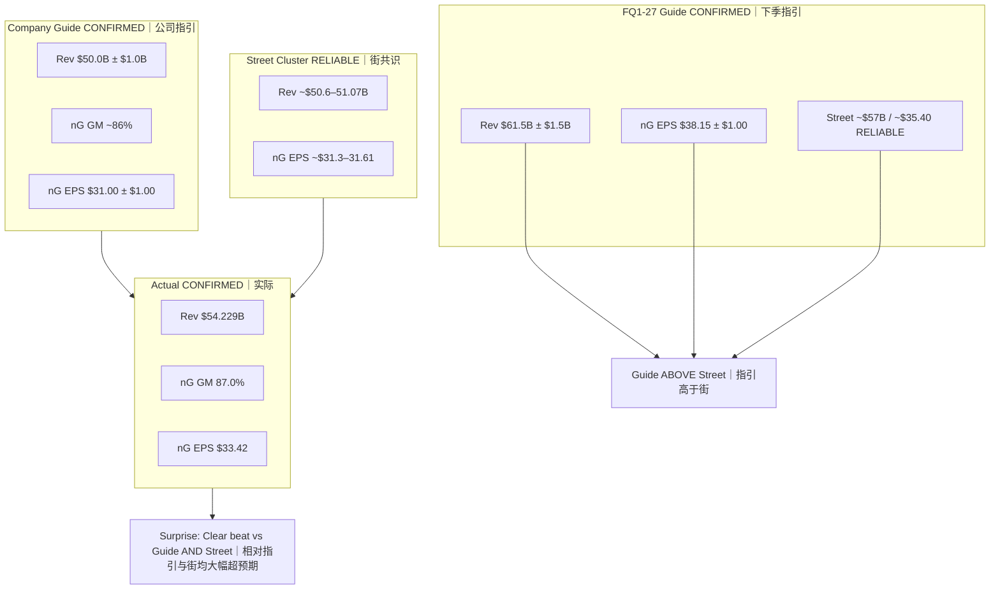

# Actual vs Expected — MU FY2026 Q4
# 实际 vs 预期 — 美光 FY2026 Q4

**As-of:** Thu 2026-10-01 ~09:05 MYT  
**Claim class:** CONFIRMED (actuals/guide) + RELIABLE (Street cluster)  
**Source:** GlobeNewswire PR + SEC 8-K Ex. 99.1; PRE Street cluster  
**Thinking caption:** Observe beats vs **guide** and **Street** separately → Why: Street was already above guide mid → Falsifier: treating guide-beat alone as Bull.

## Mermaid

| Metric | Guide mid | Street | Actual | vs Guide | vs Street |
|--------|-----------|--------|--------|----------|-----------|
| Rev $B | 50.0 | ~50.6–51.07 | **54.229** | +4.229 | ~+3.2–3.6 |
| nG GM % | ~86 | — | **87.0** | +~1 pp | — |
| nG EPS $ | 31.00 | ~31.3–31.61 | **33.42** | +2.42 | ~+1.8–2.1 |
| FQ1 Rev $B | — | ~57 | Guide **61.5±1.5** | — | Guide > Street |
| FQ1 nG EPS $ | — | ~35.40 | Guide **38.15±1** | — | Guide > Street |

**EN:** Actual cleared both locks. Primary open gap pre-event (FQ1) printed as a **positive guide surprise**.  
**中文：** 实际同时越过指引与街两道门槛；会前最大缺口（下季指引）兑现为**正向指引惊喜**。
