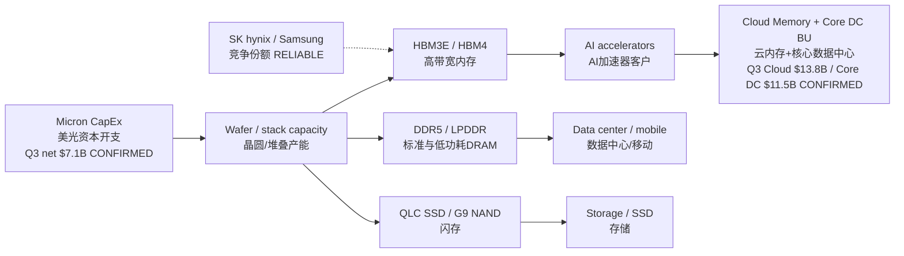

# MU FY26 Q4 — CapEx → HBM / DRAM / NAND / AI Demand Map｜资本开支→需求地图
**As-of:** Tue 2026-09-29 ~09:00 MYT  
**Claim class:** CONFIRMED (Q3 CapEx/IR product) + RELIABLE (HBM share) + INFERENCE (map links)

| Node | Fact / note | Class | Source |
|------|-------------|-------|--------|
| Q3 CapEx, net | **$7.1B** investments in CapEx, net | CONFIRMED | SEC Ex-99.1 2026-06-24 |
| Q3 adj. FCF | **$18.3B** | CONFIRMED | same |
| Cash + mkt + restricted | **$30.2B** end Q3 | CONFIRMED | same |
| HBM4 | High-volume shipments for lead customer; samples to multiple end-customers (1-beta) | CONFIRMED | same product highlights |
| HBM4E | 1-gamma development; volume production expected **calendar 2027** | CONFIRMED | same |
| HBM rev share Q2’26 | SK hynix **50%** / Samsung **33%** / Micron **18%** | RELIABLE REPORTING | Counterpoint via CTOL/Aju ~Sep 2026 |
| AI demand | HBM/server DRAM tied to accelerator build-outs; SCAs cited by CEO | CONFIRMED (company claim) / RELIABLE (industry) | SEC PR + industry wires |

**Thinking caption｜思维说明**
- Observe: CapEx discipline vs HBM sold-out language on the call.｜盯电话会上扩产纪律 vs HBM售罄表述。
- Why: Capacity adds can close ASP/GM upside with a lag.｜扩产会滞后压缩价格/毛利上行空间。
- Falsifier: CapEx cut **while** claiming sold-out HBM (inconsistent) or CapEx surge with soft guide.｜证伪：一边说售罄一边砍资本开支，或大扩产配弱指引。
