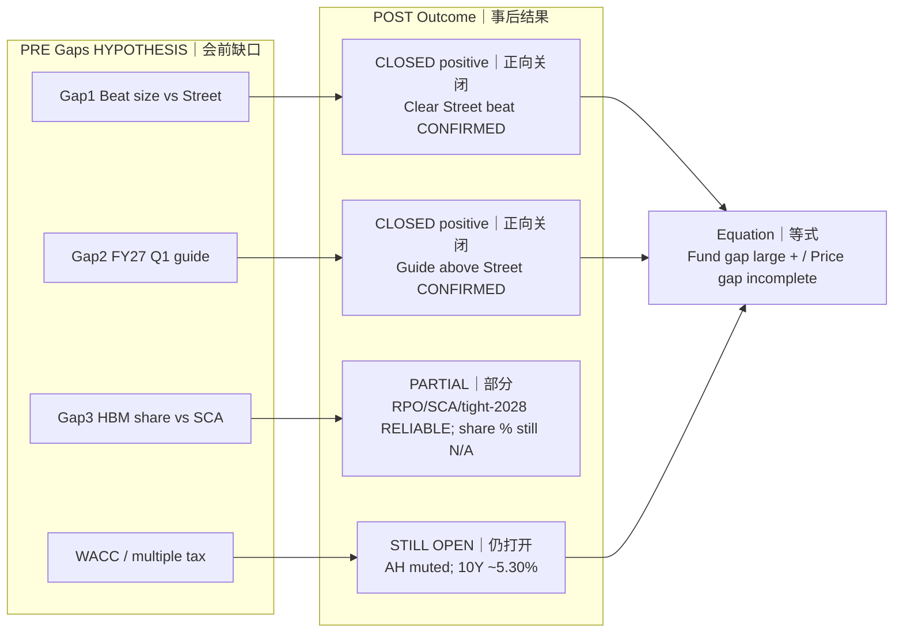

# Expectation Gap Post — MU FY2026 Q4
# 预期差（事后）— 美光 FY2026 Q4

**As-of:** Thu 2026-10-01 ~09:05 MYT  
**Claim class:** INFERENCE / HYPOTHESIS on gap closure; CONFIRMED on actuals  
**Source:** Locked PRE gap map; PR/8-K; Morning  
**Thinking caption:** Observe which gaps closed → Why FY27 Q1 was the big one → Watch multiple gap still open under WACC.

| Gap | Pre hypothesis | Post status |
|-----|----------------|-------------|
| Beat size vs Street | Could be small/negative if only guide-mid beat | **Closed +** (large beat) |
| FY27 Q1 | Largest open gap | **Closed +** (guide > Street) |
| HBM / SCA durability | Share fight vs scarcity | **Partial +** (RPO/SCA/tight; share $ N/A) |
| Multiple / WACC | Tax even on good print | **Still binding** |

**EN:** Fundamental gaps closed bullishly; market-implied multiple gap did **not** fully close at T+0.  
**中文：** 基本面缺口正向关闭；市场隐含倍数缺口在T+0**未完全**关闭。
