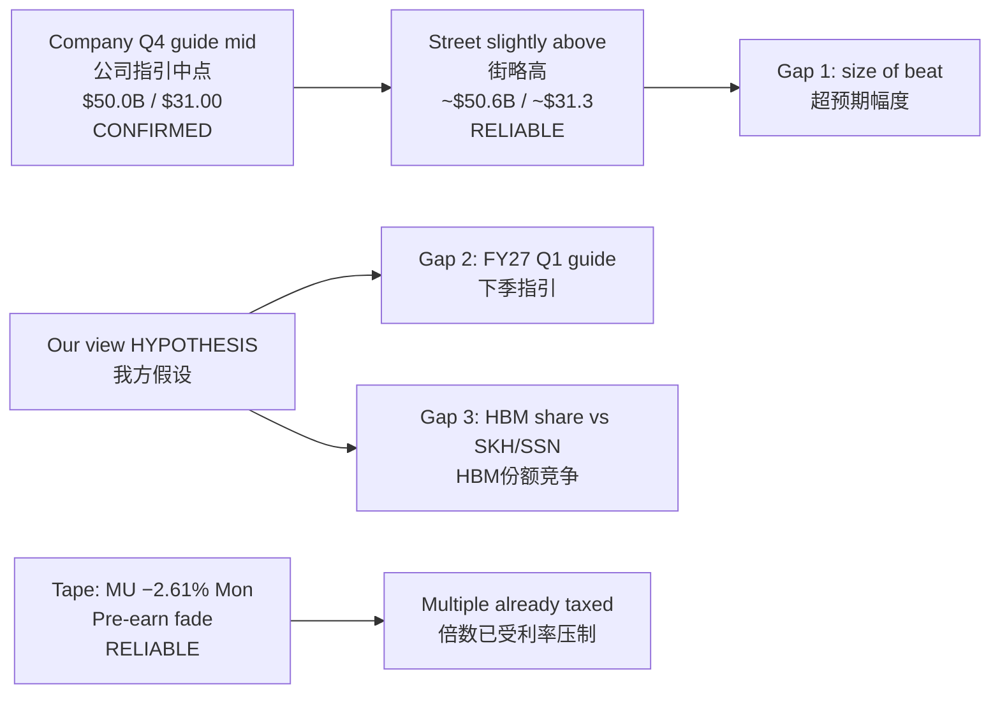

# MU FY26 Q4 — Expectation Gap｜预期差
**As-of:** Tue 2026-09-29 ~09:00 MYT  
**Claim class:** CONFIRMED (company guide) + RELIABLE (Street cluster) + HYPOTHESIS (our view / gaps)  
**Lifecycle:** PRE only — Actual column LOCKED EMPTY until print

| Layer | Content | Class |
|-------|---------|-------|
| Company guide (mid) | Rev **$50.0B** / GM **~86%** / non-GAAP EPS **$31.00** (± bands) | CONFIRMED FACT (SEC 2026-06-24) |
| Street consensus cluster | Rev ~**$50.4–50.8B** / non-GAAP EPS ~**$31.1–31.5** (mid ~$50.6B / ~$31.3) | RELIABLE REPORTING (multi-wire ~Sep 21–28) |
| Market-implied | MU Mon close **$1,053.98 (−2.61%)**; options expected move ~**7–10%** (source variance) | RELIABLE REPORTING |
| Our fundamentals | Modest beat vs guide mid plausible; **primary gap = FY27 Q1 guide + HBM mix durability**, not binary Q4 miss | HYPOTHESIS |
| **Expectation Gap** | Street > guide mid already; price embeds AI-memory bull case under **rates tax** (10Y ~5.23%, SOX −1.61% Mon) | HYPOTHESIS |

**Top 3 gaps｜三大预期差 (HYPOTHESIS)**
1. **Beat bar already raised** — Street > guide midpoint; “in-line to guide mid” can disappoint.｜街已高于指引中点，“贴中点”也可能令人失望。
2. **Guide > print** — FY27 Q1 revenue/GM/EPS commentary likely dominates reaction vs Q4 alone.｜下季指引可能主导反应。
3. **HBM competitive share** — Counterpoint Q2’26 HBM rev share MU **18%** vs SK hynix **50%** / Samsung **33%** (RELIABLE); durability of Micron’s SCA / HBM4 ramp vs share loss narrative.｜份额与扩产叙事之差。
