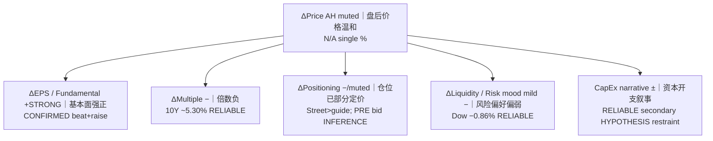

# Reaction Decomposition — MU FY2026 Q4
# 反应分解 — 美光 FY2026 Q4

**As-of:** Thu 2026-10-01 ~09:05 MYT  
**Claim class:** ILLUSTRATIVE / INFERENCE (conceptual; AH % N/A)  
**Source:** PR fundamentals CONFIRMED; 10Y/Wed tape RELIABLE; AH qualitative RELIABLE  
**Thinking caption:** Observe ΔEPS vs ΔMultiple vs Positioning → Why: beat ≠ melt-up at 5.3% 10Y → Falsifier: inventing a precise elasticity without verified AH %.

| Component | Sign | Evidence | Class |
|-----------|------|----------|-------|
| Fundamental / EPS | Strong + | $54.229B / $33.42 / FQ1 raise | CONFIRMED |
| Multiple / WACC | − | 10Y ~5.29–5.30% | RELIABLE → INFERENCE |
| Positioning | − / muted | Elevated bar; Tue/Wed PRE bid | INFERENCE |
| Liquidity / breadth | Mild − | Dow fade, VIX 16.34 | RELIABLE |
| CapEx narrative | ± | FY27 CapEx higher | RELIABLE / HYPOTHESIS |
| Net AH | Modest | Qualitative only | RELIABLE / N/A % |

**EN:** Conceptual identity: `ΔPrice ≈ ΔEPS + ΔMultiple(Rates) + ΔPositioning (+ Liquidity)`. Exact abnormal return **N/A** without verified AH % and factor model.  
**中文：** 概念恒等式成立；无核实AH%与因子模型时，异常收益标 **N/A**。
