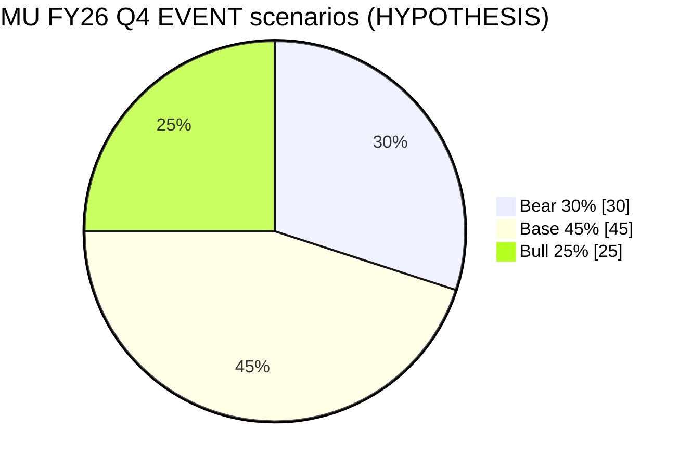

# MU FY26 Q4 — Scenario Probability｜情景概率
**As-of:** Tue 2026-09-29 ~09:00 MYT  
**Claim class:** HYPOTHESIS (scenarios sum ~100%; not forecasts sold as fact)  
**Note:** Probabilities are planning weights for research, not trading advice.

| Scenario | Prob | One-liner EN | 一句话中文 |
|----------|------|--------------|------------|
| **BEAR** | **30%** | Soft vs Street / guide cut or HBM caution → multiple compression under rates | 相对街/指引偏软或HBM谨慎 → 利率下倍数压缩 |
| **BASE** | **45%** | Modest beat vs guide mid, FY27 Q1 roughly in-line with raised bar; choppy two-way | 相对指引中点小幅超预期，下季大体贴抬高后的门槛；双向震荡 |
| **BULL** | **25%** | Clear beat + strong FY27 Q1 + HBM booked-out commentary → squeeze vs pre-earn fade | 明确超预期 + 强下季 + HBM订满表述 → 相对财报前软的挤压 |

**Thinking caption｜思维说明**
- Observe: which scenario’s falsifiers trip first after print.｜观察哪条证伪条件先被触发。
- Why: Pre-earn fade (−2.61% Mon) already embeds some risk; Base is modal.｜财报前软已部分计价风险；基准为众数。
- Falsifier of Base: large guide cut **or** blowout guide that Street still calls “not enough.”｜证伪基准：大幅下修指引，或爆表指引仍被街视为不够。
