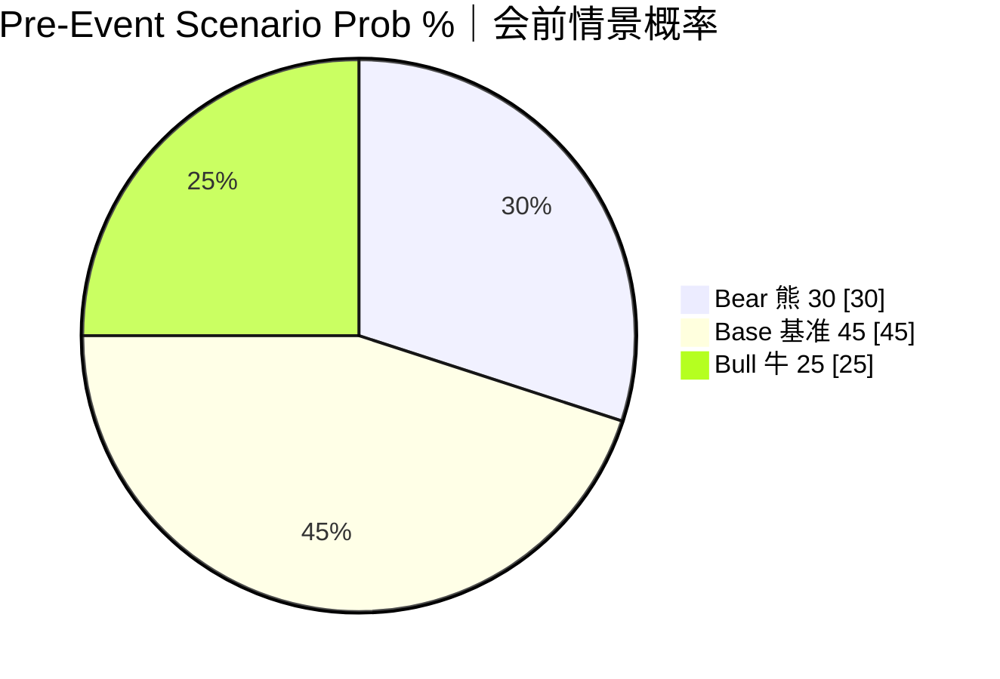
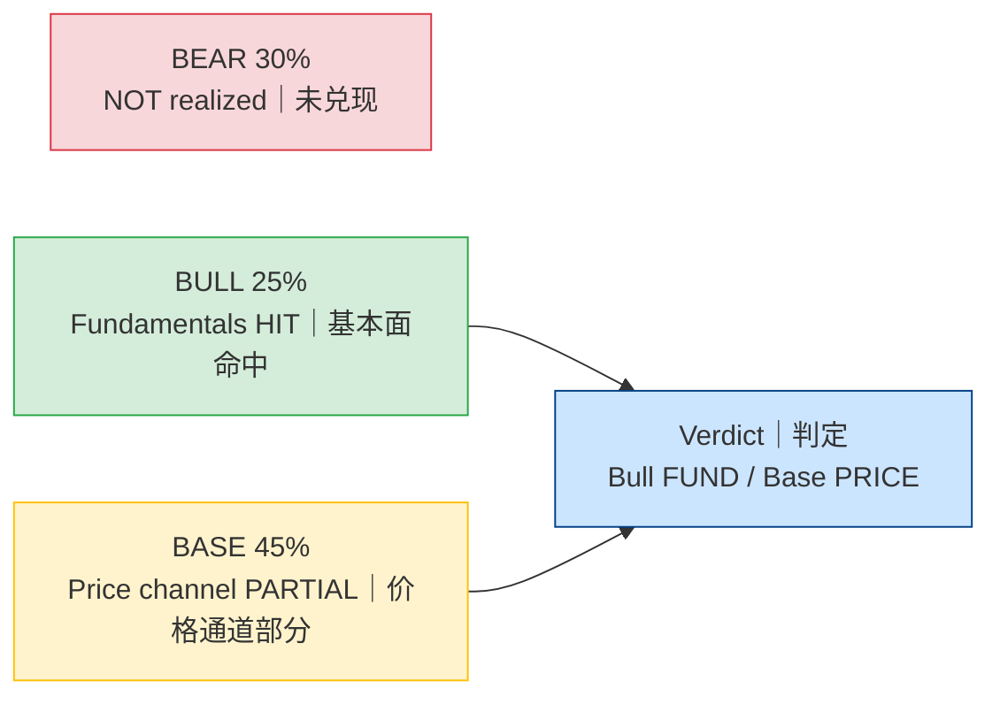
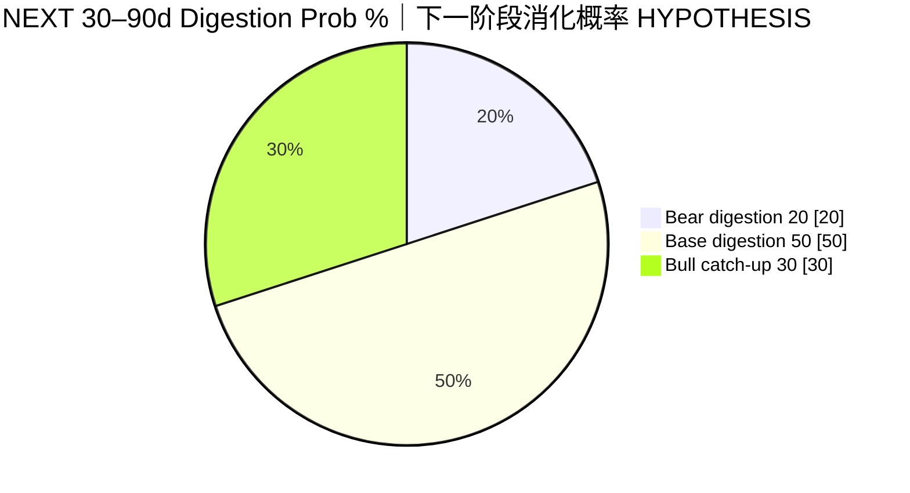

# Scenario Realization — MU FY2026 Q4
# 情景实现 — 美光 FY2026 Q4

**As-of:** Thu 2026-10-01 ~09:05 MYT  
**Claim class:** HYPOTHESIS (probs) + INFERENCE (realization) + CONFIRMED (triggers evidence)  
**Source:** Locked PRE scenarios 30/45/25; PR/8-K actuals; Morning AH qualitative  
**Thinking caption:** What to observe: fund triggers vs price reaction separately → Why: they can diverge under WACC → Watch: next 20/50/30 digestion probs.

| Pre scenario | Prob | Fund realized? | Price realized? |
|--------------|------|----------------|-----------------|
| Bear | 30% | No | No |
| Base | 45% | Exceeded (too modest) | Yes — muted/two-way |
| Bull | 25% | **Yes** | Incomplete at T+0 |

**EN:** Do not force a single scenario label when fundamentals and price diverge.  
**中文：** 基本面与价格分叉时，勿强行单一情景标签。
