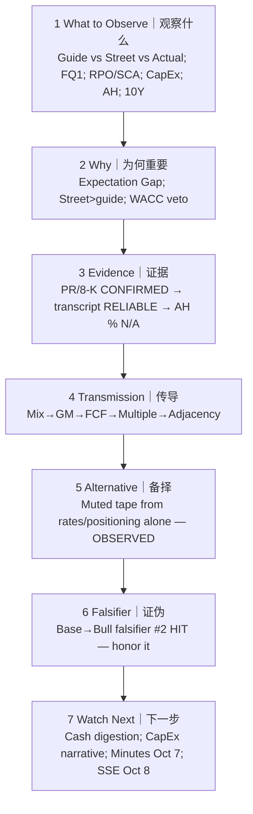

# Thinking Tutorial Flow Post — MU FY2026 Q4
# 思维教程流（事后）— 美光 FY2026 Q4

**As-of:** Thu 2026-10-01 ~09:05 MYT  
**Claim class:** ILLUSTRATIVE teaching (process) + evidence classes inside nodes  
**Source:** Research OS master Thinking Tutorial standard; this event actuals  
**Thinking caption:** Replay the 7 steps on a beat+raise with muted AH — separate fund from price.

| Step | This-event application｜本事件应用 |
|------|-----------------------------------|
| Observe | $54.229B / $33.42 / FQ1 $61.5B; AH muted; 10Y 5.30% |
| Why | Gap closed on EPS; not on multiple |
| Evidence | No invented AH % |
| Transmission | Bull fund path; WACC lid |
| Alternative | Confirmed by tape |
| Falsifier | Shift to Bull fund realized |
| Watch Next | Digestion 20/50/30 |

**Common mistake｜常见错误:** Equating Bull fundamentals with Bull same-session price.  
**纠偏:** Split channels; score probability calibration on fund path separately from reaction call.
