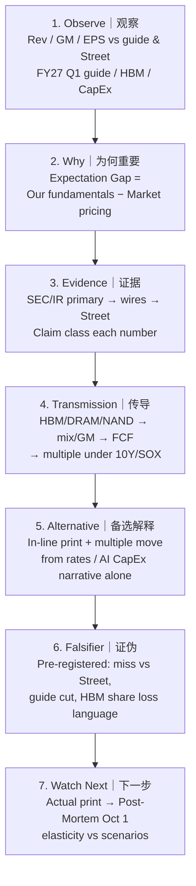

# MU FY26 Q4 — Thinking Tutorial Flow｜思维教程流
**As-of:** Tue 2026-09-29 ~09:00 MYT  
**Claim class:** ILLUSTRATIVE (teaching) + HYPOTHESIS (application)

**Bilingual teaching strip｜双语教学条**
| Step | EN | 中文 |
|------|----|------|
| Observe | Print vs **company guide** and **Street cluster** separately | 分别对照**公司指引**与**街共识区间** |
| Why | Gap lives in **guide + HBM durability**, not only Q4 EPS | 预期差在**指引+HBM可持续性**，不只在当季EPS |
| Evidence | Prefer SEC Ex-99.1 / IR; label wires RELIABLE | 优先SEC/IR；电讯标为可靠报道 |
| Transmission | Mix → GM → FCF → WACC-taxed multiple | 结构→毛利→自由现金流→受利率压制的倍数 |
| Alternative | Tape can move without fundamental surprise | 无基本面惊喜也可因盘面/利率波动 |
| Falsifier | Pre-register before print; do not move goalposts | 公布前预登记；不事后挪动球门 |
| Watch Next | Actual → Reaction → Post-Mortem (do not overwrite PRE) | 实际→反应→复盘（不覆写会前快照） |
