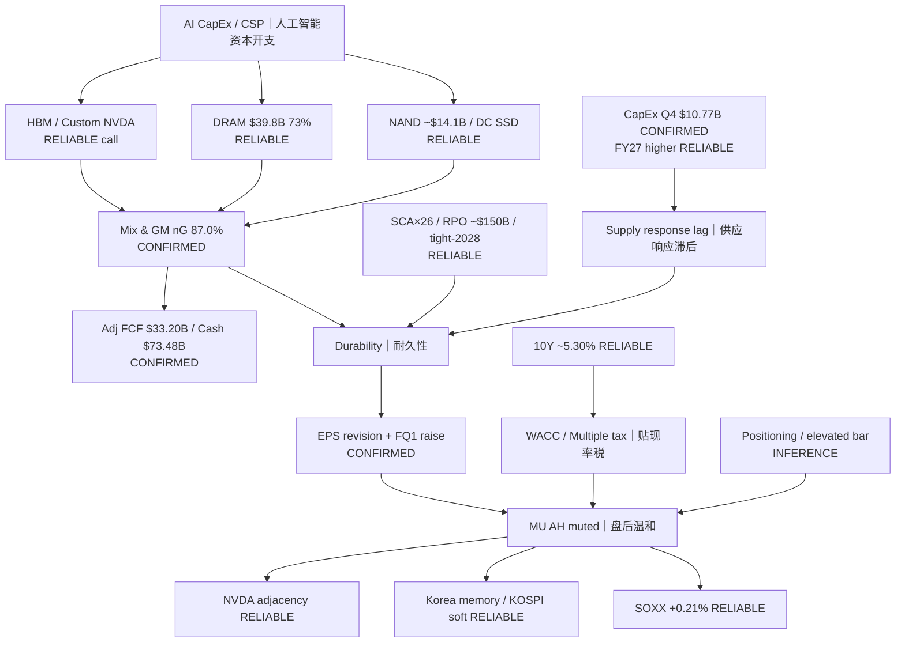

# Transmission Chain Post — MU FY2026 Q4
# 传导链（事后）— 美光 FY2026 Q4

**As-of:** Thu 2026-10-01 ~09:05 MYT  
**Claim class:** INFERENCE on chain; node evidence CONFIRMED/RELIABLE as labeled  
**Source:** PR BU/GM/FCF; call DRAM/RPO; Morning rates/SOXX/KOSPI  
**Thinking caption:** Trace AI demand → memory mix → FCF → WACC veto → adjacency → Why muted AH is consistent → Watch CapEx narrative branch.

**EN:** Transmission **fired** on fundamentals; **price transmission pending** first FULL cash digestion under still-tight WACC.  
**中文：** 基本面传导已触发；价格传导仍待完整现金交易日消化，且WACC仍紧。
