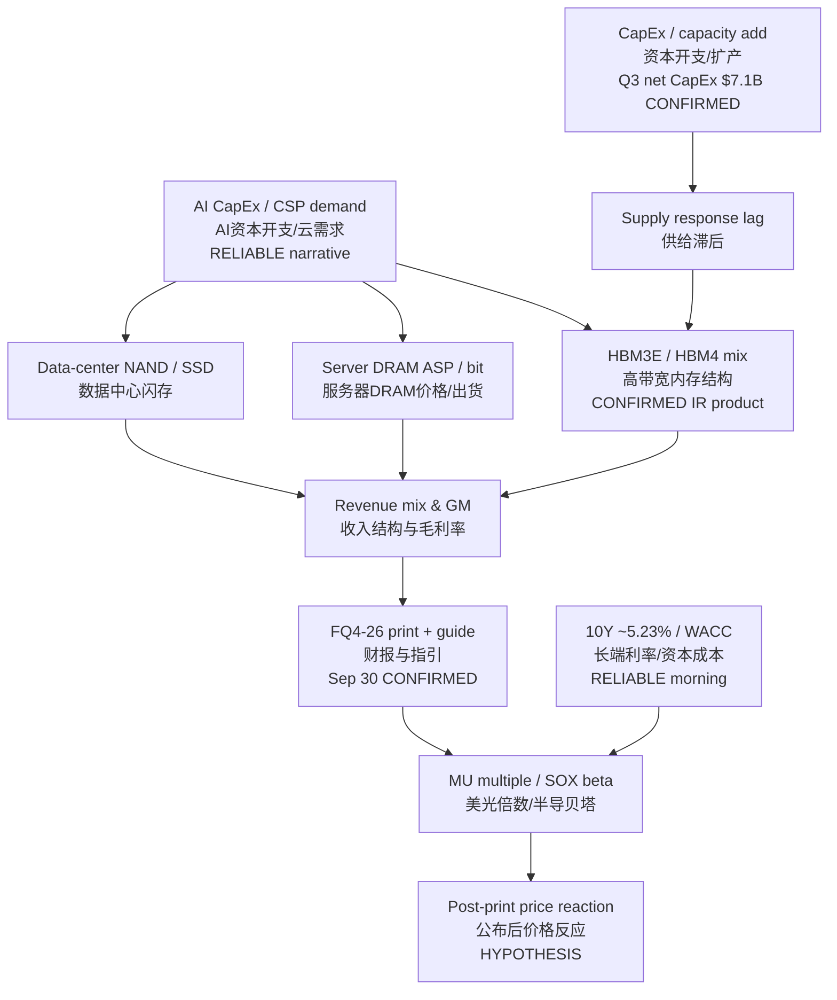

# MU FY26 Q4 — Transmission Chain｜传导链
**As-of:** Tue 2026-09-29 ~09:00 MYT  
**Claim class:** CONFIRMED (IR/SEC guide & Q3) + RELIABLE (tape) + INFERENCE (links) + HYPOTHESIS (reaction)  
**Sources:** SEC Ex-99.1 Q3 FY26 (2026-06-24); Micron IR event page; AI Factory Morning 2026-09-29-0830

**Thinking caption｜思维说明**
- Observe: Q4 print vs guide midpoint, FY27 Q1 guide, HBM commentary, CapEx.｜盯相对指引中点、下季指引、HBM表述、资本开支。
- Why: Street already sits modestly above guide midpoint; residual = guide + mix durability under rates tax.｜街已略高过指引中点；残差在指引与结构可持续性。
- Alternative: Multiple can move on 10Y/SOX even if print “in-line.”｜备选：即便数字贴指引，倍数仍可因利率/半导贝塔波动。
- Falsifier: Beat + strong FY27 Q1 guide but MU sells off on multiple compression alone.｜证伪：大超预期仍因倍数压缩下跌。
- Next: Actual print ~04:30 MYT Oct 1; Post-Mortem routine Oct 1.｜下一步：实际公布与复盘。
