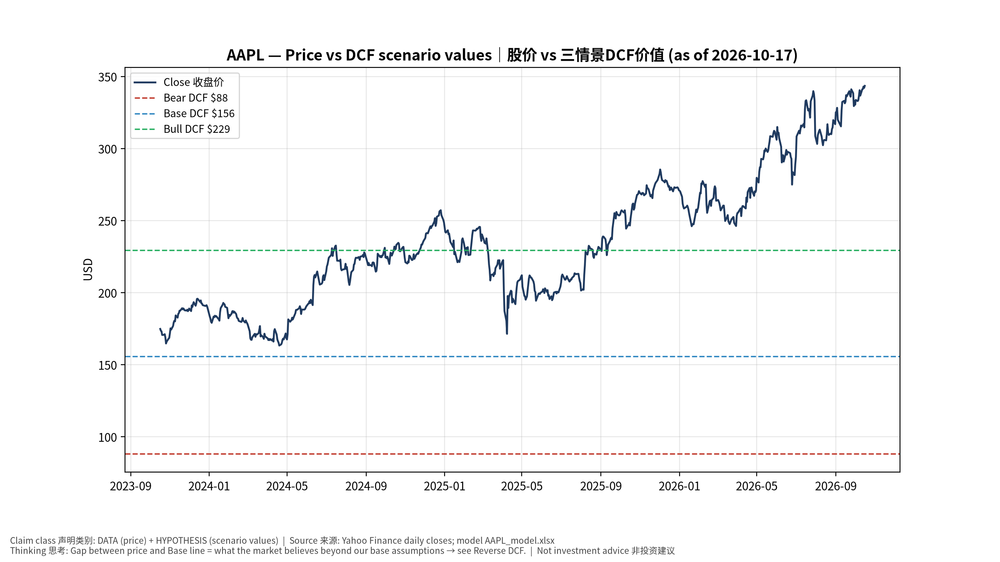
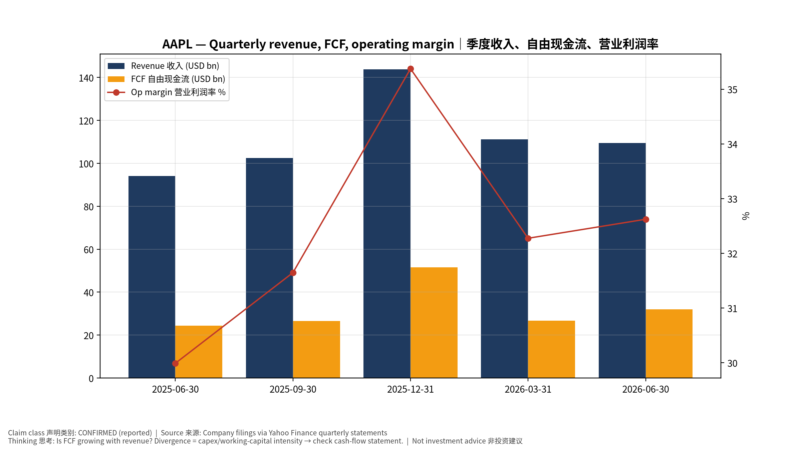
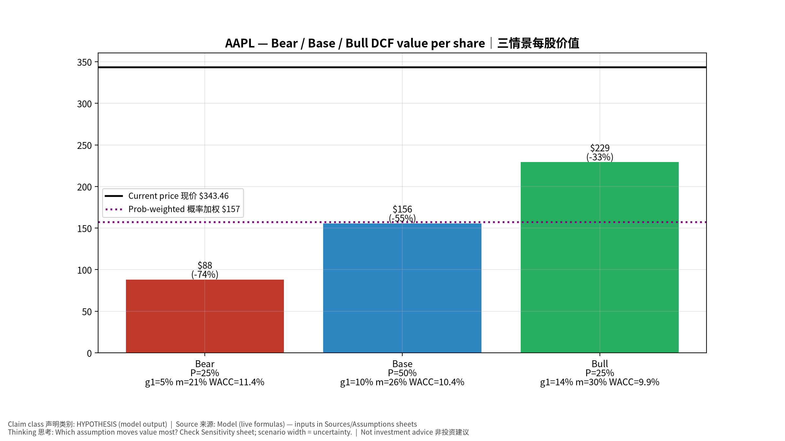
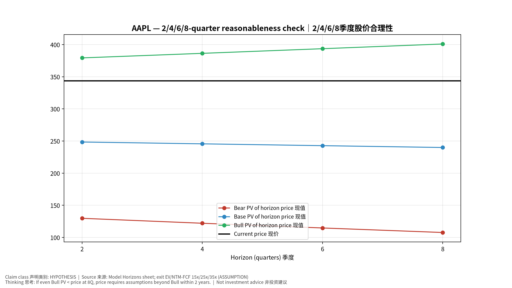
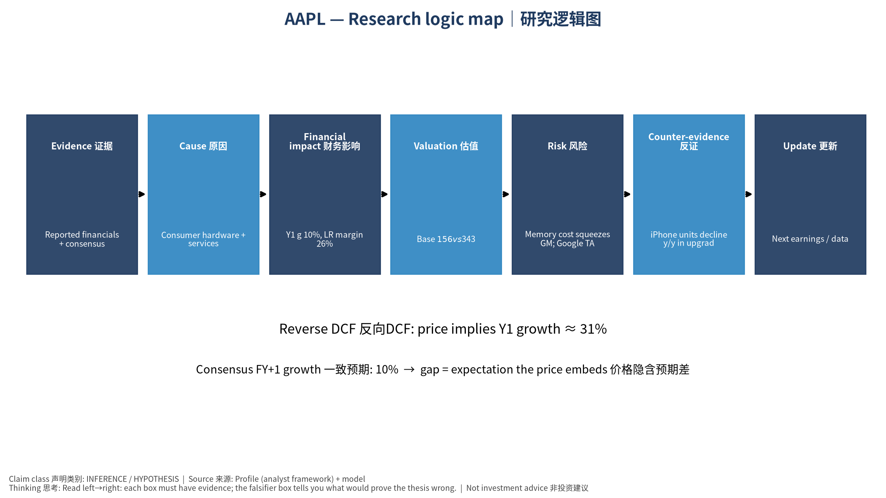

# AAPL Apple Inc. — 个股深度研究 (专业中文版) v20261017-0755
> 数据截至 2026-10-17 07:55 SGT｜价格 $343.46｜市值 5,012.5 bn USD｜财报货币 USD｜非投资建议。事实=CONFIRMED/DATA；推断=INFERENCE；假设=ASSUMPTION/HYPOTHESIS。

## 1. 投资论点 Investment Thesis (HYPOTHESIS)
苹果是高质量现金流+回购的复利机器；AI(Apple Intelligence)换机周期是主要上行变量，存储成本上涨与服务业务监管是主要压力。

- **多头驱动**: AI upgrade supercycle; services growth sustains; margin holds despite memory costs｜AI换机潮；服务持续增长；毛利率扛住存储成本
- **空头驱动**: Memory cost squeezes GM; Google TAC payment ruling; China share loss｜存储成本压毛利；谷歌分成裁决；中国份额流失
- **证伪条件 Falsifiers**: iPhone units decline y/y in upgrade cycle; services growth <10%; GM guide down｜换机年iPhone仍同比下滑；服务增速<10%；毛利指引下调

## 2. 产品、客户与收入模式
- 主题 Theme: Consumer hardware + services ecosystem 消费电子+服务生态
- 业务分部 Segments: iPhone；Services 服务；Mac；iPad；Wearables/Home 可穿戴
- 公司描述 (DATA, Yahoo/公司申报): Apple Inc. designs, manufactures, and markets smartphones, personal computers, tablets, wearables, and accessories worldwide. The company offers iPhone, a line of smartphones; Mac, a line of personal computers; iPad, a line of multi-purpose tablets; and wearables, home, and accessories comprising AirPods, Apple Vision Pro, Apple TV, Apple Watch, Beats products, and HomePod, as well as Apple branded and third-party accessories. It also provides AppleCare support and cloud services; and operates various platforms, including the App Store that allows customers to discover and download applications and digital content, such as books, music, video, games, and podcasts, as well as advertising services include third-party licensing arrangements and its own advertising platforms. In addition, the company offers various subscription-based services, such as Apple Arcade, a game subscription servic
- 主要客户: Global consumers; carriers; enterprises｜全球消费者、运营商、企业

## 3. 行业、竞争、监管与供应链 (ANALYST FRAMEWORK)
- 供应商/上游: TSMC (A/M chips), Foxconn/Luxshare (assembly), Samsung/LG/BOE (displays), Micron/Kioxia (memory), Corning (glass)｜台积电、富士康/立讯、面板厂、存储厂、康宁
- 竞争者 (含业外): Samsung, Chinese Android OEMs (Huawei, Xiaomi), Google｜三星、华为/小米、谷歌
- 瓶颈/监管: Memory cost inflation, tariffs/China supply chain, App Store regulation (DMA, US antitrust), Google search payments｜存储涨价、关税/中国供应链、App Store监管、谷歌搜索分成
- 关键KPI: iPhone revenue, Services growth, GM%, buybacks, China revenue｜iPhone收入、服务增速、毛利率、回购、大中华区收入
- 零部件现货/合约价: 本版未接入付费价格源(TrendForce/DRAMeXchange等)——标注 **UNAVAILABLE**，在KPI监控中以定性方式跟踪。

## 4. 历史财务与现金流 (CONFIRMED, 季度, USD)
| 季度 | 收入 | 毛利 | 营业利润 | 净利润 | FCF | 营业利润率 |
|---|---|---|---|---|---|---|
| 2026-06-30 | 109.4 bn USD | 54.8 bn USD | 35.7 bn USD | 29.8 bn USD | 31.9 bn USD | 32.6% |
| 2026-03-31 | 111.2 bn USD | 54.8 bn USD | 35.9 bn USD | 29.6 bn USD | 26.7 bn USD | 32.3% |
| 2025-12-31 | 143.8 bn USD | 69.2 bn USD | 50.9 bn USD | 42.1 bn USD | 51.6 bn USD | 35.4% |
| 2025-09-30 | 102.5 bn USD | 48.3 bn USD | 32.4 bn USD | 27.5 bn USD | 26.5 bn USD | 31.6% |
| 2025-06-30 | 94.0 bn USD | 43.7 bn USD | 28.2 bn USD | 23.4 bn USD | 24.4 bn USD | 30.0% |

资产负债: 现金 62.4 bn USD；总负债 84.3 bn USD；净现金 -21.9 bn USD。TTM FCF 136.7 bn USD（FCF率 29.3%）。

## 5. 最新财报: 实际 vs 一致预期 vs 指引
| 季度 | EPS实际 | EPS一致预期 | 超预期% |
|---|---|---|---|
| 2025-09-30 | 1.85 | 1.76993 | 0.0452 |
| 2025-12-31 | 2.84 | 2.6708 | 0.0634 |
| 2026-03-31 | 2.01 | 1.94275 | 0.0346 |
| 2026-06-30 | 2.02 | 1.89243 | 0.0674 |

- 管理层指引 Guidance: 自动数据源不含指引——**UNAVAILABLE（待从公司IR新闻稿录入）**。
- 下次财报日 (Yahoo, TENTATIVE 直至公司确认): **2026-11-03**；本季EPS一致预期 1.97842（27位分析师）；收入一致预期 113.6 bn USD。

## 6. 未来2/4/6/8季度驱动与价格合理性
| 期限 | 情景 | 期限价格现值 | 相对现价 |
|---|---|---|---|
| 2Q | Bear | $129.72 | -62.2% |
| 2Q | Base | $248.42 | -27.7% |
| 2Q | Bull | $379.28 | 10.4% |
| 4Q | Bear | $122.03 | -64.5% |
| 4Q | Base | $245.58 | -28.5% |
| 4Q | Bull | $386.37 | 12.5% |
| 6Q | Bear | $114.68 | -66.6% |
| 6Q | Base | $242.74 | -29.3% |
| 6Q | Bull | $393.58 | 14.6% |
| 8Q | Bear | $107.64 | -68.7% |
| 8Q | Base | $239.89 | -30.2% |
| 8Q | Bull | $400.92 | 16.7% |

现价隐含的 EV/NTM-FCF (Base 路径): | 期限 | 隐含倍数 |
|---|---|
| 2Q | 32.8x |
| 4Q | 31.6x |
| 6Q | 30.4x |
| 8Q | 29.3x |

解读: 如果8季度后Base情景所需倍数仍远高于25x，说明价格依赖更远期的增长。

## 7. 三情景 Bear / Base / Bull (HYPOTHESIS)
| 情景 | Y1增速 | 长期FCF率 | WACC | 永续g | 概率 | 每股价值 | 相对现价 |
|---|---|---|---|---|---|---|---|
| Bear | 5.2% | 20.8% | 11.4% | 2.5% | 25.0% | $88.19 | -74.3% |
| Base | 10.4% | 26.0% | 10.4% | 3.0% | 50.0% | $155.72 | -54.7% |
| Bull | 13.6% | 29.9% | 9.9% | 3.5% | 25.0% | $229.34 | -33.2% |

概率加权价值 **$157.24**（相对现价 -54.2%）。

## 8. 估值: DCF / Reverse DCF / ROIC-WACC / 同业 / 敏感度
- DCF Base: EV 2,294.6 bn USD；终值占比 51.8%。
- **Reverse DCF 反向DCF**: 在Base利润率与WACC下，现价隐含Y1收入增速 ≈ **31.1%**；一致预期FY+1增速 10.4%。
- WACC (CAPM) = rf 5.1% + β 1.07 × ERP 5.0% = 10.4%。
- SOTP segments 分部: iPhone; Services 服务; Mac; iPad; Wearables/Home 可穿戴. **Status: framework only** — segment revenues are INPUT REQUIRED from the latest 10-K/10-Q segment note (not auto-fed, left blank to avoid fabrication)｜分部收入需按最新财报手动录入，未自动填充以避免编造。
- 同业比较 Comps (DATA):
| Ticker | 市值 | EV/Sales | Fwd P/E | 收入增速 | 毛利率 | FCF收益率 |
|---|---|---|---|---|---|---|
| AAPL | 5,012.5 bn USD | 10.8x | 35.9x | 16.4% | 48.7% | 2.7% |
| MSFT | 3,928.5 bn USD | 12.0x | 22.3x | 17.7% | 67.9% | 0.4% |
| GOOGL | 4,165.4 bn USD | 9.1x | 22.3x | 24.2% | 60.9% | 0.5% |
| 005930.KS | 1,403,319.4 bn USD | 2.6x | 3.0x | 130.0% | 57.5% | 5.0% |

- 敏感度: 见Excel `Sensitivity` 表 (WACC × 永续增长率)。

## 9. 风险、反方论证与证伪
- 反方观点 Counter-thesis: Memory cost squeezes GM; Google TAC payment ruling; China share loss｜存储成本压毛利；谷歌分成裁决；中国份额流失
- 证伪指标: iPhone units decline y/y in upgrade cycle; services growth <10%; GM guide down｜换机年iPhone仍同比下滑；服务增速<10%；毛利指引下调
- 模型风险: 长期利润率与WACC为假设；终值占比高时估值对假设极敏感。

## 10. Source Ledger 来源账本
| Item | Value | Source/time |
|---|---|---|
| Price 股价 | 343.5 | Yahoo Finance quote, fetched 2026-10-17T07:55 SGT |
| Market cap 市值 | 5.013e+12 | Yahoo info.marketCap 2026-10-17T07:55 |
| Cash 现金 | 6.24e+10 | Yahoo info.totalCash (latest filing) 2026-10-17T07:55 |
| Debt 负债 | 8.434e+10 | Yahoo info.totalDebt (latest filing) 2026-10-17T07:55 |
| Revenue TTM 收入 | 4.668e+11 | Yahoo info.totalRevenue (TTM, USD) 2026-10-17T07:55 |
| FCF TTM 自由现金流 | 1.367e+11 | Sum of last 4 quarterly FCF (q_cash); quarters ['2026-06-30', '2026-03-31', '2025-12-31', '2025-09-30'] (USD) |
| Beta | 1.069 | Yahoo info.beta (5Y monthly) |
| Risk-free 10Y 无风险利率 | 0.051 | FRED DGS10 2026-10-15 |
| FX USD per USD | 1 | n/a (USD) |
| Consensus rev growth FY0 | 0.1491 | Yahoo revenue_estimate 0y |
| Consensus rev growth FY+1 | 0.1043 | Yahoo revenue_estimate +1y |

## 11. Assumption Register 假设登记表
| Assumption | Value | Rationale |
|---|---|---|
| ERP 股权风险溢价 | 0.05 | ASSUMPTION: 5.0% house mature-market ERP |
| Beta clamp | [0.8,1.6] → 1.07 | ASSUMPTION: limit extreme betas |
| Tax rate (ROIC) | 0.18 | ASSUMPTION: blended cash tax 18% |
| Year-1 growth (Base) | 0.1043 | Consensus FY+1 revenue growth (Yahoo revenue_estimate '+1y'); capped at 100% |
| Growth fade | linear Y1→terminal by Y10 | ASSUMPTION |
| Starting FCF margin | 0.2928 | DATA: FCF TTM / Revenue TTM, floored -50% |
| Long-run FCF margin (Base) | 0.26 | ASSUMPTION (analyst framework, reached by Y5; see profile) |
| Bear/Bull Y1 growth multiplier | 0.5x / 1.3x | ASSUMPTION |
| Bear/Bull margin multiplier | 0.8x / 1.15x | ASSUMPTION |
| WACC adj Bear/Bull | +1.0pp / -0.5pp | ASSUMPTION |
| Terminal g Bear/Base/Bull | 2.5% / 3.0% / 3.5% | ASSUMPTION |
| Scenario probabilities | 25% / 50% / 25% | ASSUMPTION |
| Horizon exit EV/NTM-FCF Bear/Base/Bull | 15x / 25x / 35x | ASSUMPTION |
| Per-share conversion | value × fx ÷ market cap × price | METHOD: avoids ADR/share-class mismatch |

## 12. Model Provenance 模型溯源
- Model file: `AAPL_model_v20261017-0755.xlsx` (live formulas; sheets Inputs→Scenarios→DCF→ReverseDCF→Sensitivity→Horizons→SOTP→Comps→ROIC_WACC→History→Sources→Assumptions)
- Engine: `production/pipeline/model.py` (Python mirror; values in this report = Python mirror, verified against LibreOffice recalculation of the xlsx)
- Data snapshot: `data/snapshots/20261017-0755` (immutable) | Fetched 2026-10-17 07:55 SGT | Generated 2026-10-17 07:56 SGT
- Version: v20261017-0755. Prior versions are never overwritten (see company history page).

## 13. 版本与事件时间轴
- v20261017-0755: 首版生产系统报告 (27家同步)。下一事件: 财报 2026-11-03 (TENTATIVE)。

## 图片报告 Image Report

*股价vs三情景价值 Price vs scenario values*

*季度财务 Quarterly financials*

*三情景 Scenarios*

*2/4/6/8季度检验 Horizon check*

*研究逻辑图 Logic map*

---

# AAPL Apple Inc. — Equity Deep Dive (Professional English) v20261017-0755
> Data as of 2026-10-17 07:55 SGT | Price $343.46 | Mkt cap 5,012.5 bn USD | Reporting currency USD | Not investment advice.

## 1. Investment thesis (HYPOTHESIS)
Apple is a high-quality cash-flow and buyback compounder; an AI-driven upgrade cycle is the main upside variable, while memory-cost inflation and services regulation are the main pressures.

- **Bull drivers**: AI upgrade supercycle; services growth sustains; margin holds despite memory costs｜AI换机潮；服务持续增长；毛利率扛住存储成本
- **Bear drivers**: Memory cost squeezes GM; Google TAC payment ruling; China share loss｜存储成本压毛利；谷歌分成裁决；中国份额流失
- **Falsifiers**: iPhone units decline y/y in upgrade cycle; services growth <10%; GM guide down｜换机年iPhone仍同比下滑；服务增速<10%；毛利指引下调

## 2. Products, customers, revenue model
- Theme: Consumer hardware + services ecosystem 消费电子+服务生态 | Segments: iPhone; Services 服务; Mac; iPad; Wearables/Home 可穿戴
- Business description (DATA): Apple Inc. designs, manufactures, and markets smartphones, personal computers, tablets, wearables, and accessories worldwide. The company offers iPhone, a line of smartphones; Mac, a line of personal computers; iPad, a line of multi-purpose tablets; and wearables, home, and accessories comprising AirPods, Apple Vision Pro, Apple TV, Apple Watch, Beats products, and HomePod, as well as Apple branded and third-party accessories. It also provides AppleCare support and cloud services; and operates various platforms, including the App Store that allows customers to discover and download applications and digital content, such as books, music, video, games, and podcasts, as well as advertising services include third-party licensing arrangements and its own advertising platforms. In addition, the company offers various subscription-based services, such as Apple Arcade, a game subscription servic
- Customers: Global consumers; carriers; enterprises｜全球消费者、运营商、企业

## 3. Industry, competition, regulation, supply chain (ANALYST FRAMEWORK)
- Suppliers: TSMC (A/M chips), Foxconn/Luxshare (assembly), Samsung/LG/BOE (displays), Micron/Kioxia (memory), Corning (glass)｜台积电、富士康/立讯、面板厂、存储厂、康宁
- Competitors: Samsung, Chinese Android OEMs (Huawei, Xiaomi), Google｜三星、华为/小米、谷歌
- Bottlenecks/regulation: Memory cost inflation, tariffs/China supply chain, App Store regulation (DMA, US antitrust), Google search payments｜存储涨价、关税/中国供应链、App Store监管、谷歌搜索分成
- KPIs: iPhone revenue, Services growth, GM%, buybacks, China revenue｜iPhone收入、服务增速、毛利率、回购、大中华区收入
- Component spot/contract prices: paid feeds not connected — **UNAVAILABLE**, tracked qualitatively.

## 4. Historical financials & cash flow (CONFIRMED, quarterly, USD)
| Quarter | Revenue | Gross profit | Op income | Net income | FCF | Op margin |
|---|---|---|---|---|---|---|
| 2026-06-30 | 109.4 bn USD | 54.8 bn USD | 35.7 bn USD | 29.8 bn USD | 31.9 bn USD | 32.6% |
| 2026-03-31 | 111.2 bn USD | 54.8 bn USD | 35.9 bn USD | 29.6 bn USD | 26.7 bn USD | 32.3% |
| 2025-12-31 | 143.8 bn USD | 69.2 bn USD | 50.9 bn USD | 42.1 bn USD | 51.6 bn USD | 35.4% |
| 2025-09-30 | 102.5 bn USD | 48.3 bn USD | 32.4 bn USD | 27.5 bn USD | 26.5 bn USD | 31.6% |
| 2025-06-30 | 94.0 bn USD | 43.7 bn USD | 28.2 bn USD | 23.4 bn USD | 24.4 bn USD | 30.0% |

Cash 62.4 bn USD; debt 84.3 bn USD; TTM FCF 136.7 bn USD (FCF margin 29.3%).

## 5. Latest earnings: actual vs consensus vs guidance
| Quarter | EPS actual | EPS consensus | Surprise |
|---|---|---|---|
| 2025-09-30 | 1.85 | 1.76993 | 0.0452 |
| 2025-12-31 | 2.84 | 2.6708 | 0.0634 |
| 2026-03-31 | 2.01 | 1.94275 | 0.0346 |
| 2026-06-30 | 2.02 | 1.89243 | 0.0674 |

- Management guidance: not in automated feed — **UNAVAILABLE (to be entered from IR release)**.
- Next earnings (Yahoo; TENTATIVE until company-confirmed): **2026-11-03**; current-quarter EPS consensus 1.97842 (27 analysts); revenue consensus 113.6 bn USD.

## 6. 2/4/6/8-quarter drivers & price reasonableness
| Horizon | Scenario | PV of horizon price | vs current |
|---|---|---|---|
| 2Q | Bear | $129.72 | -62.2% |
| 2Q | Base | $248.42 | -27.7% |
| 2Q | Bull | $379.28 | 10.4% |
| 4Q | Bear | $122.03 | -64.5% |
| 4Q | Base | $245.58 | -28.5% |
| 4Q | Bull | $386.37 | 12.5% |
| 6Q | Bear | $114.68 | -66.6% |
| 6Q | Base | $242.74 | -29.3% |
| 6Q | Bull | $393.58 | 14.6% |
| 8Q | Bear | $107.64 | -68.7% |
| 8Q | Base | $239.89 | -30.2% |
| 8Q | Bull | $400.92 | 16.7% |

Current-price implied EV/NTM-FCF on Base path: | Horizon | Implied multiple |
|---|---|
| 2Q | 32.8x |
| 4Q | 31.6x |
| 6Q | 30.4x |
| 8Q | 29.3x |

## 7. Bear / Base / Bull (HYPOTHESIS)
| Scenario | Y1 growth | LR FCF margin | WACC | Terminal g | Prob. | Value/share | vs price |
|---|---|---|---|---|---|---|---|
| Bear | 5.2% | 20.8% | 11.4% | 2.5% | 25.0% | $88.19 | -74.3% |
| Base | 10.4% | 26.0% | 10.4% | 3.0% | 50.0% | $155.72 | -54.7% |
| Bull | 13.6% | 29.9% | 9.9% | 3.5% | 25.0% | $229.34 | -33.2% |

Probability-weighted value **$157.24** (-54.2% vs price).

## 8. Valuation: DCF / Reverse DCF / ROIC-WACC / comps / sensitivity
- Base DCF EV 2,294.6 bn USD; terminal share 51.8%.
- **Reverse DCF**: at Base margin/WACC the price implies Y1 revenue growth ≈ **31.1%** vs consensus FY+1 10.4%.
- WACC (CAPM) = rf 5.1% + β 1.07 × ERP 5.0% = 10.4%.
- SOTP segments: iPhone; Services 服务; Mac; iPad; Wearables/Home 可穿戴 — framework only; segment revenue inputs pending from filings.
- Comps (DATA): see table in Chinese section / Excel `Comps`.
- Sensitivity: Excel `Sensitivity` (WACC × terminal g).

## 9. Risks, counterarguments, falsifiers
Memory cost squeezes GM; Google TAC payment ruling; China share loss｜存储成本压毛利；谷歌分成裁决；中国份额流失 | Falsifiers: iPhone units decline y/y in upgrade cycle; services growth <10%; GM guide down｜换机年iPhone仍同比下滑；服务增速<10%；毛利指引下调

## 10–12. Source Ledger / Assumption Register / Model Provenance
See tables above (shared, bilingual). - Model file: `AAPL_model_v20261017-0755.xlsx` (live formulas; sheets Inputs→Scenarios→DCF→ReverseDCF→Sensitivity→Horizons→SOTP→Comps→ROIC_WACC→History→Sources→Assumptions)
- Engine: `production/pipeline/model.py` (Python mirror; values in this report = Python mirror, verified against LibreOffice recalculation of the xlsx)
- Data snapshot: `data/snapshots/20261017-0755` (immutable) | Fetched 2026-10-17 07:55 SGT | Generated 2026-10-17 07:56 SGT
- Version: v20261017-0755. Prior versions are never overwritten (see company history page).
