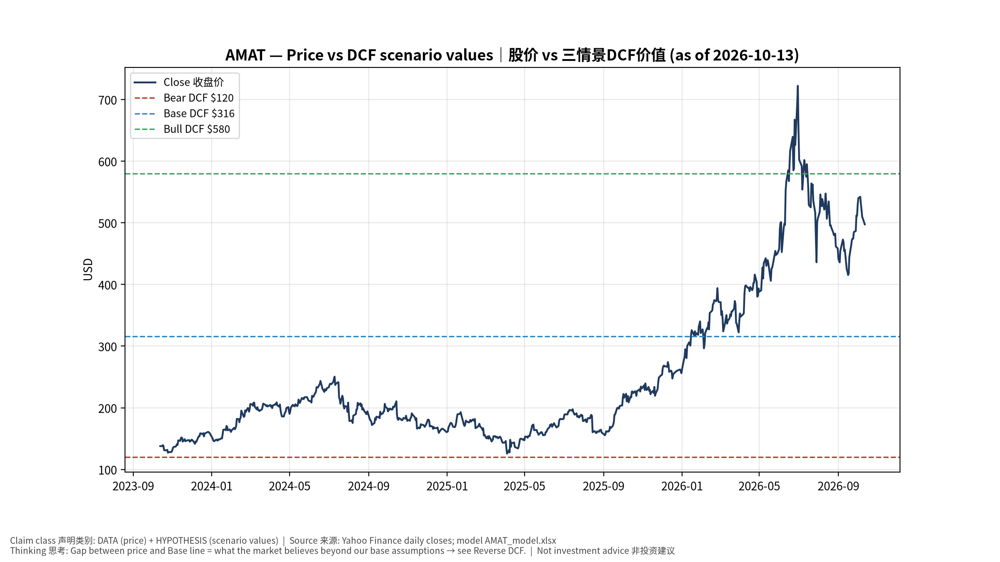
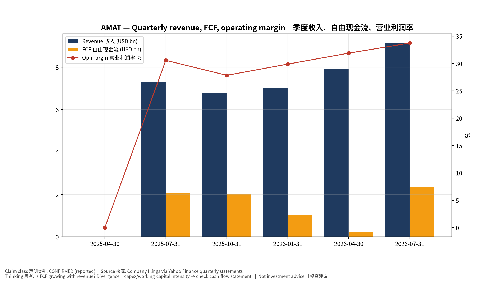
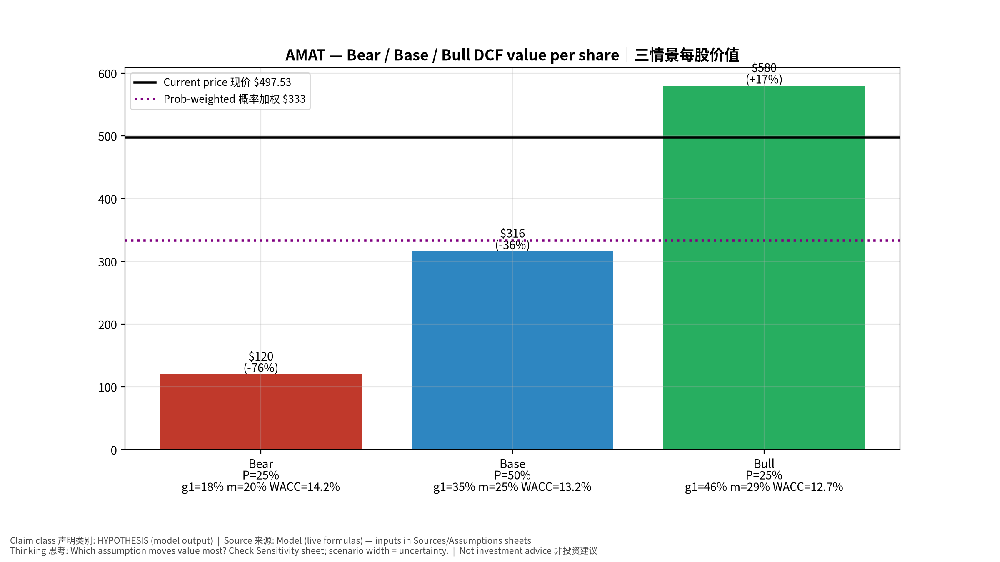
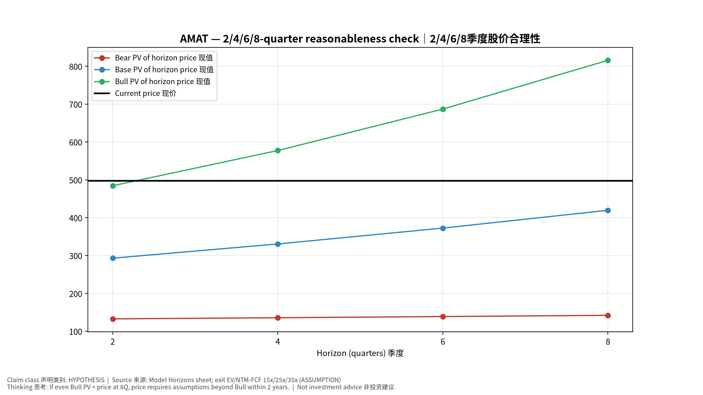
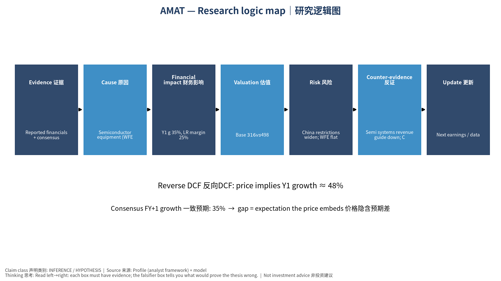

# AMAT Applied Materials, Inc. — 个股深度研究 (专业中文版) v20261013-1622
> 数据截至 2026-10-13 16:22 SGT｜价格 $497.53｜市值 394.8 bn USD｜财报货币 USD｜非投资建议。事实=CONFIRMED/DATA；推断=INFERENCE；假设=ASSUMPTION/HYPOTHESIS。

## 1. 投资论点 Investment Thesis (HYPOTHESIS)
应用材料是GAA、背面供电、HBM与先进封装材料工程转折的广谱受益者；中国收入占比与出口管制是主要变数。

- **多头驱动**: DRAM/HBM capex surge; leading-logic ramps; services growth｜DRAM/HBM Capex激增；先进逻辑；服务增长
- **空头驱动**: China restrictions widen; WFE flat 2027｜管制扩大；2027 WFE持平
- **证伪条件 Falsifiers**: Semi systems revenue guide down; China share drops without offset｜系统收入指引下修；中国下滑无补偿

## 2. 产品、客户与收入模式
- 主题 Theme: Semiconductor equipment (WFE) 半导体设备
- 业务分部 Segments: Semiconductor Systems 半导体系统；Applied Global Services 服务；Display 显示
- 公司描述 (DATA, Yahoo/公司申报): Applied Materials, Inc. provides materials engineering solutions, equipment, services, and software to the semiconductor and related industries in the United States, China, Korea, Taiwan, Japan, Southeast Asia, Europe, and internationally. The company operates through Semiconductor Systems and Applied Global Services (AGS) segments. The Semiconductor Systems segment includes semiconductor capital equipment to enable materials engineering steps, including etch, rapid thermal processing, deposition, chemical mechanical planarization, metrology and inspection, wafer packaging, and ion implantation. The AGS segment offers integrated solutions to optimize equipment and fab performance and productivity comprising spares, upgrades, services, and 200 millimeter and other equipment and factory automation software for semiconductor and other products. It serves manufacturers of semiconductor wafer
- 主要客户: TSMC, Samsung, Intel, memory makers, Chinese fabs｜台积电、三星、英特尔、存储厂、中国厂

## 3. 行业、竞争、监管与供应链 (ANALYST FRAMEWORK)
- 供应商/上游: Precision components, RF power, vacuum parts｜精密部件、射频电源、真空件
- 竞争者 (含业外): Lam Research, TEL, ASML, KLA, Chinese domestic (Naura, AMEC)｜Lam、TEL、ASML、KLA、北方华创、中微
- 瓶颈/监管: China export rules, GAA/backside power transitions, DRAM capex｜出口管制、GAA/背面供电、DRAM Capex
- 关键KPI: Semi systems revenue, AGS, GM%, China %｜系统收入、服务、毛利率、中国占比
- 零部件现货/合约价: 本版未接入付费价格源(TrendForce/DRAMeXchange等)——标注 **UNAVAILABLE**，在KPI监控中以定性方式跟踪。

## 4. 历史财务与现金流 (CONFIRMED, 季度, USD)
| 季度 | 收入 | 毛利 | 营业利润 | 净利润 | FCF | 营业利润率 |
|---|---|---|---|---|---|---|
| 2026-07-31 | 9.1 bn USD | 4.6 bn USD | 3.1 bn USD | 2.5 bn USD | 2.3 bn USD | 33.7% |
| 2026-04-30 | 7.9 bn USD | 3.9 bn USD | 2.5 bn USD | 2.8 bn USD | 0.2 bn USD | 31.9% |
| 2026-01-31 | 7.0 bn USD | 3.4 bn USD | 2.1 bn USD | 2.0 bn USD | 1.0 bn USD | 29.9% |
| 2025-10-31 | 6.8 bn USD | 3.3 bn USD | 1.9 bn USD | 1.9 bn USD | 2.0 bn USD | 27.8% |
| 2025-07-31 | 7.3 bn USD | 3.6 bn USD | 2.2 bn USD | 1.8 bn USD | 2.0 bn USD | 30.6% |
| 2025-04-30 | N/A | N/A | N/A | N/A | N/A | N/A |

资产负债: 现金 9.2 bn USD；总负债 7.3 bn USD；净现金 1.9 bn USD。TTM FCF 5.6 bn USD（FCF率 18.2%）。

## 5. 最新财报: 实际 vs 一致预期 vs 指引
| 季度 | EPS实际 | EPS一致预期 | 超预期% |
|---|---|---|---|
| 2025-10-31 | 2.17 | 2.09366 | 0.0365 |
| 2026-01-31 | 2.38 | 2.206 | 0.0789 |
| 2026-04-30 | 2.86 | 2.68545 | 0.065 |
| 2026-07-31 | 3.5 | 3.3944 | 0.0311 |

- 管理层指引 Guidance: 自动数据源不含指引——**UNAVAILABLE（待从公司IR新闻稿录入）**。
- 下次财报日 (Yahoo, TENTATIVE 直至公司确认): **2026-11-13**；本季EPS一致预期 4.05576（25位分析师）；收入一致预期 10.3 bn USD。

## 6. 未来2/4/6/8季度驱动与价格合理性
| 期限 | 情景 | 期限价格现值 | 相对现价 |
|---|---|---|---|
| 2Q | Bear | $132.74 | -73.3% |
| 2Q | Base | $293.06 | -41.1% |
| 2Q | Bull | $484.37 | -2.6% |
| 4Q | Bear | $135.78 | -72.7% |
| 4Q | Base | $330.56 | -33.6% |
| 4Q | Bull | $577.38 | 16.0% |
| 6Q | Bear | $138.90 | -72.1% |
| 6Q | Base | $372.54 | -25.1% |
| 6Q | Bull | $686.89 | 38.1% |
| 8Q | Bear | $142.09 | -71.4% |
| 8Q | Base | $419.53 | -15.7% |
| 8Q | Bull | $815.66 | 63.9% |

现价隐含的 EV/NTM-FCF (Base 路径): | 期限 | 隐含倍数 |
|---|---|
| 2Q | 40.0x |
| 4Q | 33.3x |
| 6Q | 27.7x |
| 8Q | 23.1x |

解读: 如果8季度后Base情景所需倍数仍远高于25x，说明价格依赖更远期的增长。

## 7. 三情景 Bear / Base / Bull (HYPOTHESIS)
| 情景 | Y1增速 | 长期FCF率 | WACC | 永续g | 概率 | 每股价值 | 相对现价 |
|---|---|---|---|---|---|---|---|
| Bear | 17.6% | 20.0% | 14.2% | 2.5% | 25.0% | $119.98 | -75.9% |
| Base | 35.2% | 25.0% | 13.2% | 3.0% | 50.0% | $315.95 | -36.5% |
| Bull | 45.7% | 28.7% | 12.7% | 3.5% | 25.0% | $580.04 | 16.6% |

概率加权价值 **$332.98**（相对现价 -33.1%）。

## 8. 估值: DCF / Reverse DCF / ROIC-WACC / 同业 / 敏感度
- DCF Base: EV 248.8 bn USD；终值占比 50.3%。
- **Reverse DCF 反向DCF**: 在Base利润率与WACC下，现价隐含Y1收入增速 ≈ **48.4%**；一致预期FY+1增速 35.2%。
- WACC (CAPM) = rf 5.2% + β 1.59 × ERP 5.0% = 13.2%。
- SOTP segments 分部: Semiconductor Systems 半导体系统; Applied Global Services 服务; Display 显示. **Status: framework only** — segment revenues are INPUT REQUIRED from the latest 10-K/10-Q segment note (not auto-fed, left blank to avoid fabrication)｜分部收入需按最新财报手动录入，未自动填充以避免编造。
- 同业比较 Comps (DATA):
| Ticker | 市值 | EV/Sales | Fwd P/E | 收入增速 | 毛利率 | FCF收益率 |
|---|---|---|---|---|---|---|
| AMAT | 394.8 bn USD | 12.7x | 26.9x | 24.8% | 49.4% | 1.4% |
| LRCX | 387.4 bn USD | 16.6x | 26.3x | 30.0% | 50.5% | 0.8% |
| KLAC | 248.1 bn USD | 18.4x | 28.2x | 15.2% | 61.3% | 1.1% |
| ASML | 672.3 bn USD | 1057.0x | 30.1x | 21.3% | 52.7% | 1.3% |
| 8035.T | 27,040.6 bn USD | 10.6x | 9.0x | 33.3% | 45.6% | 1.1% |

- 敏感度: 见Excel `Sensitivity` 表 (WACC × 永续增长率)。

## 9. 风险、反方论证与证伪
- 反方观点 Counter-thesis: China restrictions widen; WFE flat 2027｜管制扩大；2027 WFE持平
- 证伪指标: Semi systems revenue guide down; China share drops without offset｜系统收入指引下修；中国下滑无补偿
- 模型风险: 长期利润率与WACC为假设；终值占比高时估值对假设极敏感。

## 10. Source Ledger 来源账本
| Item | Value | Source/time |
|---|---|---|
| Price 股价 | 497.5 | Yahoo Finance quote, fetched 2026-10-13T16:22 SGT |
| Market cap 市值 | 3.948e+11 | Yahoo info.marketCap 2026-10-13T16:22 |
| Cash 现金 | 9.233e+09 | Yahoo info.totalCash (latest filing) 2026-10-13T16:22 |
| Debt 负债 | 7.346e+09 | Yahoo info.totalDebt (latest filing) 2026-10-13T16:22 |
| Revenue TTM 收入 | 3.084e+10 | Yahoo info.totalRevenue (TTM, USD) 2026-10-13T16:22 |
| FCF TTM 自由现金流 | 5.623e+09 | Sum of last 4 quarterly FCF (q_cash); quarters ['2026-07-31', '2026-04-30', '2026-01-31', '2025-10-31'] (USD) |
| Beta | 1.591 | Yahoo info.beta (5Y monthly) |
| Risk-free 10Y 无风险利率 | 0.0522 | FRED DGS10 2026-10-08 |
| FX USD per USD | 1 | n/a (USD) |
| Consensus rev growth FY0 | 0.2077 | Yahoo revenue_estimate 0y |
| Consensus rev growth FY+1 | 0.3518 | Yahoo revenue_estimate +1y |

## 11. Assumption Register 假设登记表
| Assumption | Value | Rationale |
|---|---|---|
| ERP 股权风险溢价 | 0.05 | ASSUMPTION: 5.0% house mature-market ERP |
| Beta clamp | [0.8,1.6] → 1.59 | ASSUMPTION: limit extreme betas |
| Tax rate (ROIC) | 0.18 | ASSUMPTION: blended cash tax 18% |
| Year-1 growth (Base) | 0.3518 | Consensus FY+1 revenue growth (Yahoo revenue_estimate '+1y'); capped at 100% |
| Growth fade | linear Y1→terminal by Y10 | ASSUMPTION |
| Starting FCF margin | 0.1823 | DATA: FCF TTM / Revenue TTM, floored -50% |
| Long-run FCF margin (Base) | 0.25 | ASSUMPTION (analyst framework, reached by Y5; see profile) |
| Bear/Bull Y1 growth multiplier | 0.5x / 1.3x | ASSUMPTION |
| Bear/Bull margin multiplier | 0.8x / 1.15x | ASSUMPTION |
| WACC adj Bear/Bull | +1.0pp / -0.5pp | ASSUMPTION |
| Terminal g Bear/Base/Bull | 2.5% / 3.0% / 3.5% | ASSUMPTION |
| Scenario probabilities | 25% / 50% / 25% | ASSUMPTION |
| Horizon exit EV/NTM-FCF Bear/Base/Bull | 15x / 25x / 35x | ASSUMPTION |
| Per-share conversion | value × fx ÷ market cap × price | METHOD: avoids ADR/share-class mismatch |

## 12. Model Provenance 模型溯源
- Model file: `AMAT_model_v20261013-1622.xlsx` (live formulas; sheets Inputs→Scenarios→DCF→ReverseDCF→Sensitivity→Horizons→SOTP→Comps→ROIC_WACC→History→Sources→Assumptions)
- Engine: `production/pipeline/model.py` (Python mirror; values in this report = Python mirror, verified against LibreOffice recalculation of the xlsx)
- Data snapshot: `data/snapshots/20261013-1622` (immutable) | Fetched 2026-10-13 16:22 SGT | Generated 2026-10-13 16:23 SGT
- Version: v20261013-1622. Prior versions are never overwritten (see company history page).

## 13. 版本与事件时间轴
- v20261013-1622: 首版生产系统报告 (27家同步)。下一事件: 财报 2026-11-13 (TENTATIVE)。

## 图片报告 Image Report

*股价vs三情景价值 Price vs scenario values*

*季度财务 Quarterly financials*

*三情景 Scenarios*

*2/4/6/8季度检验 Horizon check*

*研究逻辑图 Logic map*

---

# AMAT Applied Materials, Inc. — Equity Deep Dive (Professional English) v20261013-1622
> Data as of 2026-10-13 16:22 SGT | Price $497.53 | Mkt cap 394.8 bn USD | Reporting currency USD | Not investment advice.

## 1. Investment thesis (HYPOTHESIS)
Applied Materials is a broad beneficiary of materials-engineering inflections (GAA, backside power, HBM, advanced packaging); China mix and export controls are the key swing factors.

- **Bull drivers**: DRAM/HBM capex surge; leading-logic ramps; services growth｜DRAM/HBM Capex激增；先进逻辑；服务增长
- **Bear drivers**: China restrictions widen; WFE flat 2027｜管制扩大；2027 WFE持平
- **Falsifiers**: Semi systems revenue guide down; China share drops without offset｜系统收入指引下修；中国下滑无补偿

## 2. Products, customers, revenue model
- Theme: Semiconductor equipment (WFE) 半导体设备 | Segments: Semiconductor Systems 半导体系统; Applied Global Services 服务; Display 显示
- Business description (DATA): Applied Materials, Inc. provides materials engineering solutions, equipment, services, and software to the semiconductor and related industries in the United States, China, Korea, Taiwan, Japan, Southeast Asia, Europe, and internationally. The company operates through Semiconductor Systems and Applied Global Services (AGS) segments. The Semiconductor Systems segment includes semiconductor capital equipment to enable materials engineering steps, including etch, rapid thermal processing, deposition, chemical mechanical planarization, metrology and inspection, wafer packaging, and ion implantation. The AGS segment offers integrated solutions to optimize equipment and fab performance and productivity comprising spares, upgrades, services, and 200 millimeter and other equipment and factory automation software for semiconductor and other products. It serves manufacturers of semiconductor wafer
- Customers: TSMC, Samsung, Intel, memory makers, Chinese fabs｜台积电、三星、英特尔、存储厂、中国厂

## 3. Industry, competition, regulation, supply chain (ANALYST FRAMEWORK)
- Suppliers: Precision components, RF power, vacuum parts｜精密部件、射频电源、真空件
- Competitors: Lam Research, TEL, ASML, KLA, Chinese domestic (Naura, AMEC)｜Lam、TEL、ASML、KLA、北方华创、中微
- Bottlenecks/regulation: China export rules, GAA/backside power transitions, DRAM capex｜出口管制、GAA/背面供电、DRAM Capex
- KPIs: Semi systems revenue, AGS, GM%, China %｜系统收入、服务、毛利率、中国占比
- Component spot/contract prices: paid feeds not connected — **UNAVAILABLE**, tracked qualitatively.

## 4. Historical financials & cash flow (CONFIRMED, quarterly, USD)
| Quarter | Revenue | Gross profit | Op income | Net income | FCF | Op margin |
|---|---|---|---|---|---|---|
| 2026-07-31 | 9.1 bn USD | 4.6 bn USD | 3.1 bn USD | 2.5 bn USD | 2.3 bn USD | 33.7% |
| 2026-04-30 | 7.9 bn USD | 3.9 bn USD | 2.5 bn USD | 2.8 bn USD | 0.2 bn USD | 31.9% |
| 2026-01-31 | 7.0 bn USD | 3.4 bn USD | 2.1 bn USD | 2.0 bn USD | 1.0 bn USD | 29.9% |
| 2025-10-31 | 6.8 bn USD | 3.3 bn USD | 1.9 bn USD | 1.9 bn USD | 2.0 bn USD | 27.8% |
| 2025-07-31 | 7.3 bn USD | 3.6 bn USD | 2.2 bn USD | 1.8 bn USD | 2.0 bn USD | 30.6% |
| 2025-04-30 | N/A | N/A | N/A | N/A | N/A | N/A |

Cash 9.2 bn USD; debt 7.3 bn USD; TTM FCF 5.6 bn USD (FCF margin 18.2%).

## 5. Latest earnings: actual vs consensus vs guidance
| Quarter | EPS actual | EPS consensus | Surprise |
|---|---|---|---|
| 2025-10-31 | 2.17 | 2.09366 | 0.0365 |
| 2026-01-31 | 2.38 | 2.206 | 0.0789 |
| 2026-04-30 | 2.86 | 2.68545 | 0.065 |
| 2026-07-31 | 3.5 | 3.3944 | 0.0311 |

- Management guidance: not in automated feed — **UNAVAILABLE (to be entered from IR release)**.
- Next earnings (Yahoo; TENTATIVE until company-confirmed): **2026-11-13**; current-quarter EPS consensus 4.05576 (25 analysts); revenue consensus 10.3 bn USD.

## 6. 2/4/6/8-quarter drivers & price reasonableness
| Horizon | Scenario | PV of horizon price | vs current |
|---|---|---|---|
| 2Q | Bear | $132.74 | -73.3% |
| 2Q | Base | $293.06 | -41.1% |
| 2Q | Bull | $484.37 | -2.6% |
| 4Q | Bear | $135.78 | -72.7% |
| 4Q | Base | $330.56 | -33.6% |
| 4Q | Bull | $577.38 | 16.0% |
| 6Q | Bear | $138.90 | -72.1% |
| 6Q | Base | $372.54 | -25.1% |
| 6Q | Bull | $686.89 | 38.1% |
| 8Q | Bear | $142.09 | -71.4% |
| 8Q | Base | $419.53 | -15.7% |
| 8Q | Bull | $815.66 | 63.9% |

Current-price implied EV/NTM-FCF on Base path: | Horizon | Implied multiple |
|---|---|
| 2Q | 40.0x |
| 4Q | 33.3x |
| 6Q | 27.7x |
| 8Q | 23.1x |

## 7. Bear / Base / Bull (HYPOTHESIS)
| Scenario | Y1 growth | LR FCF margin | WACC | Terminal g | Prob. | Value/share | vs price |
|---|---|---|---|---|---|---|---|
| Bear | 17.6% | 20.0% | 14.2% | 2.5% | 25.0% | $119.98 | -75.9% |
| Base | 35.2% | 25.0% | 13.2% | 3.0% | 50.0% | $315.95 | -36.5% |
| Bull | 45.7% | 28.7% | 12.7% | 3.5% | 25.0% | $580.04 | 16.6% |

Probability-weighted value **$332.98** (-33.1% vs price).

## 8. Valuation: DCF / Reverse DCF / ROIC-WACC / comps / sensitivity
- Base DCF EV 248.8 bn USD; terminal share 50.3%.
- **Reverse DCF**: at Base margin/WACC the price implies Y1 revenue growth ≈ **48.4%** vs consensus FY+1 35.2%.
- WACC (CAPM) = rf 5.2% + β 1.59 × ERP 5.0% = 13.2%.
- SOTP segments: Semiconductor Systems 半导体系统; Applied Global Services 服务; Display 显示 — framework only; segment revenue inputs pending from filings.
- Comps (DATA): see table in Chinese section / Excel `Comps`.
- Sensitivity: Excel `Sensitivity` (WACC × terminal g).

## 9. Risks, counterarguments, falsifiers
China restrictions widen; WFE flat 2027｜管制扩大；2027 WFE持平 | Falsifiers: Semi systems revenue guide down; China share drops without offset｜系统收入指引下修；中国下滑无补偿

## 10–12. Source Ledger / Assumption Register / Model Provenance
See tables above (shared, bilingual). - Model file: `AMAT_model_v20261013-1622.xlsx` (live formulas; sheets Inputs→Scenarios→DCF→ReverseDCF→Sensitivity→Horizons→SOTP→Comps→ROIC_WACC→History→Sources→Assumptions)
- Engine: `production/pipeline/model.py` (Python mirror; values in this report = Python mirror, verified against LibreOffice recalculation of the xlsx)
- Data snapshot: `data/snapshots/20261013-1622` (immutable) | Fetched 2026-10-13 16:22 SGT | Generated 2026-10-13 16:23 SGT
- Version: v20261013-1622. Prior versions are never overwritten (see company history page).
