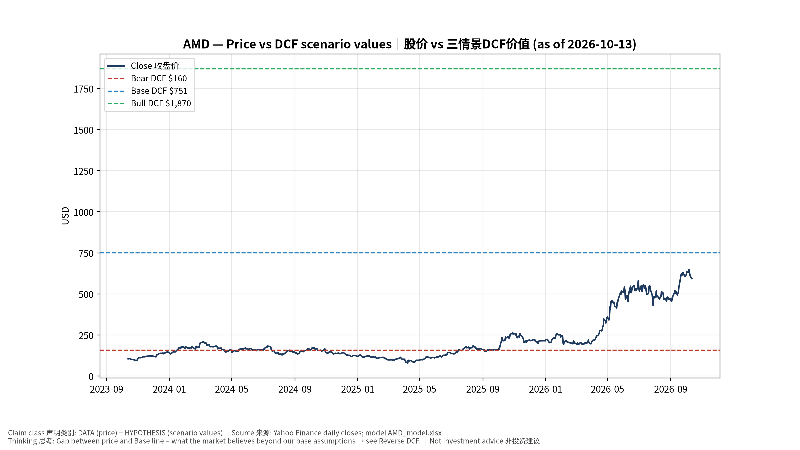
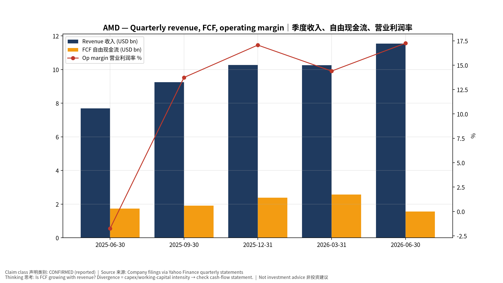
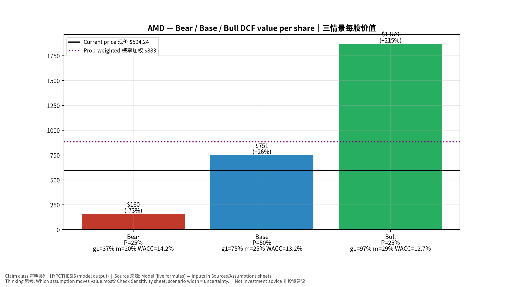
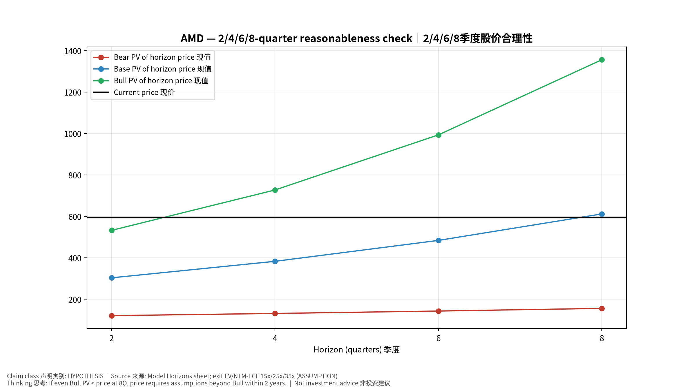
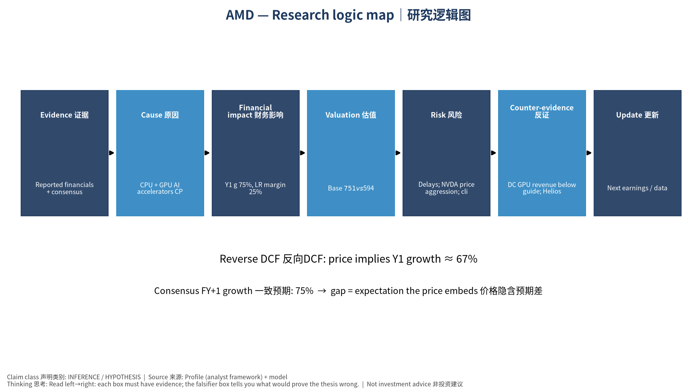

# AMD Advanced Micro Devices, Inc. — 个股深度研究 (专业中文版) v20261013-1622
> 数据截至 2026-10-13 16:22 SGT｜价格 $594.24｜市值 970.1 bn USD｜财报货币 USD｜非投资建议。事实=CONFIRMED/DATA；推断=INFERENCE；假设=ASSUMPTION/HYPOTHESIS。

## 1. 投资论点 Investment Thesis (HYPOTHESIS)
AMD在服务器CPU持续夺份额，并以MI400/Helios机架争夺AI GPU第二供应商地位；OpenAI合作是验证点，执行风险高。

- **多头驱动**: MI450 ramps on time with multiple gigawatt customers｜MI450按期多客户放量
- **空头驱动**: Delays; NVDA price aggression; client PC slowdown from memory costs｜延期；NVDA压价；存储涨价拖累PC
- **证伪条件 Falsifiers**: DC GPU revenue below guide; Helios slips past 2H26｜DC GPU收入低于指引；Helios延后

## 2. 产品、客户与收入模式
- 主题 Theme: CPU + GPU AI accelerators CPU+AI GPU
- 业务分部 Segments: Data Center (EPYC+Instinct) 数据中心；Client 客户端；Gaming 游戏；Embedded 嵌入式
- 公司描述 (DATA, Yahoo/公司申报): Advanced Micro Devices, Inc. operates as a semiconductor company internationally. It operates in three segments: Data Center, Client and Gaming, and Embedded. The company offers artificial intelligence (AI) accelerators, microprocessors, and graphics processing units (GPUs) as standalone devices or as incorporated into accelerated processing units, chipsets, and data center and professional GPUs; and embedded processors and semi-custom system-on-chip (SoC) products, microprocessor and SoC development services and technology, data processing units, field programmable gate arrays (FPGA), system on modules, AI network interface cards, and adaptive SoC products. It provides processors under the AMD Ryzen, AMD Ryzen AI, AMD Ryzen PRO, AMD Ryzen Threadripper, AMD Ryzen Threadripper PRO, AMD Athlon, and AMD PRO A-Series brands; graphics under the AMD Radeon graphics and AMD Embedded Radeon grap
- 主要客户: Hyperscalers, OpenAI (MI450 deal), Oracle, Meta, PC OEMs｜云厂、OpenAI、甲骨文、Meta、PC厂

## 3. 行业、竞争、监管与供应链 (ANALYST FRAMEWORK)
- 供应商/上游: TSMC (N3/N2, CoWoS), HBM vendors, ZT Systems (rack design)｜台积电、HBM、ZT Systems
- 竞争者 (含业外): NVDA, Intel, ARM-based CPUs, custom ASICs｜NVDA、英特尔、ARM CPU、ASIC
- 瓶颈/监管: Rack-scale (Helios) execution, ROCm software maturity, CoWoS supply｜机架级Helios执行、ROCm软件、CoWoS
- 关键KPI: DC revenue, Instinct revenue, server CPU share, GM%｜DC收入、Instinct收入、服务器份额、毛利率
- 零部件现货/合约价: 本版未接入付费价格源(TrendForce/DRAMeXchange等)——标注 **UNAVAILABLE**，在KPI监控中以定性方式跟踪。

## 4. 历史财务与现金流 (CONFIRMED, 季度, USD)
| 季度 | 收入 | 毛利 | 营业利润 | 净利润 | FCF | 营业利润率 |
|---|---|---|---|---|---|---|
| 2026-06-30 | 11.5 bn USD | 6.2 bn USD | 2.0 bn USD | 2.3 bn USD | 1.6 bn USD | 17.3% |
| 2026-03-31 | 10.3 bn USD | 5.4 bn USD | 1.5 bn USD | 1.4 bn USD | 2.6 bn USD | 14.4% |
| 2025-12-31 | 10.3 bn USD | 5.6 bn USD | 1.8 bn USD | 1.5 bn USD | 2.4 bn USD | 17.1% |
| 2025-09-30 | 9.2 bn USD | 4.8 bn USD | 1.3 bn USD | 1.2 bn USD | 1.9 bn USD | 13.7% |
| 2025-06-30 | 7.7 bn USD | 3.1 bn USD | -0.1 bn USD | 0.9 bn USD | 1.7 bn USD | -1.7% |

资产负债: 现金 13.1 bn USD；总负债 4.3 bn USD；净现金 8.8 bn USD。TTM FCF 8.4 bn USD（FCF率 20.3%）。

## 5. 最新财报: 实际 vs 一致预期 vs 指引
| 季度 | EPS实际 | EPS一致预期 | 超预期% |
|---|---|---|---|
| 2025-09-30 | 1.2 | 1.171 | 0.0248 |
| 2025-12-31 | 1.53 | 1.31917 | 0.1598 |
| 2026-03-31 | 1.37 | 1.29468 | 0.0582 |
| 2026-06-30 | 1.66 | 1.60841 | 0.0321 |

- 管理层指引 Guidance: 自动数据源不含指引——**UNAVAILABLE（待从公司IR新闻稿录入）**。
- 下次财报日 (Yahoo, TENTATIVE 直至公司确认): **2026-11-04**；本季EPS一致预期 1.92939（40位分析师）；收入一致预期 13.1 bn USD。

## 6. 未来2/4/6/8季度驱动与价格合理性
| 期限 | 情景 | 期限价格现值 | 相对现价 |
|---|---|---|---|
| 2Q | Bear | $120.68 | -79.7% |
| 2Q | Base | $303.19 | -49.0% |
| 2Q | Bull | $532.22 | -10.4% |
| 4Q | Bear | $131.28 | -77.9% |
| 4Q | Base | $382.86 | -35.6% |
| 4Q | Bull | $727.17 | 22.4% |
| 6Q | Bear | $142.93 | -75.9% |
| 6Q | Base | $483.81 | -18.6% |
| 6Q | Bull | $993.21 | 67.1% |
| 8Q | Bear | $155.73 | -73.8% |
| 8Q | Base | $611.62 | 2.9% |
| 8Q | Bull | $1,355.87 | 128.2% |

现价隐含的 EV/NTM-FCF (Base 路径): | 期限 | 隐含倍数 |
|---|---|
| 2Q | 46.4x |
| 4Q | 34.4x |
| 6Q | 25.5x |
| 8Q | 18.9x |

解读: 如果8季度后Base情景所需倍数仍远高于25x，说明价格依赖更远期的增长。

## 7. 三情景 Bear / Base / Bull (HYPOTHESIS)
| 情景 | Y1增速 | 长期FCF率 | WACC | 永续g | 概率 | 每股价值 | 相对现价 |
|---|---|---|---|---|---|---|---|
| Bear | 37.3% | 20.0% | 14.2% | 2.5% | 25.0% | $159.63 | -73.1% |
| Base | 74.6% | 25.0% | 13.2% | 3.0% | 50.0% | $750.68 | 26.3% |
| Bull | 96.9% | 28.7% | 12.7% | 3.5% | 25.0% | $1,870.23 | 214.7% |

概率加权价值 **$882.80**（相对现价 48.6%）。

## 8. 估值: DCF / Reverse DCF / ROIC-WACC / 同业 / 敏感度
- DCF Base: EV 1,216.6 bn USD；终值占比 57.0%。
- **Reverse DCF 反向DCF**: 在Base利润率与WACC下，现价隐含Y1收入增速 ≈ **67.0%**；一致预期FY+1增速 74.6%。
- WACC (CAPM) = rf 5.2% + β 1.60 × ERP 5.0% = 13.2%。
- SOTP segments 分部: Data Center (EPYC+Instinct) 数据中心; Client 客户端; Gaming 游戏; Embedded 嵌入式. **Status: framework only** — segment revenues are INPUT REQUIRED from the latest 10-K/10-Q segment note (not auto-fed, left blank to avoid fabrication)｜分部收入需按最新财报手动录入，未自动填充以避免编造。
- 同业比较 Comps (DATA):
| Ticker | 市值 | EV/Sales | Fwd P/E | 收入增速 | 毛利率 | FCF收益率 |
|---|---|---|---|---|---|---|
| AMD | 970.1 bn USD | 23.3x | 37.8x | 50.1% | 55.7% | 0.9% |
| NVDA | 5,464.9 bn USD | 17.9x | 14.2x | 105.9% | 74.7% | 0.8% |
| INTC | 535.7 bn USD | 9.6x | 48.7x | 25.4% | 38.9% | 0.9% |
| AVGO | 1,693.3 bn USD | 19.4x | 18.3x | 85.5% | 75.5% | 1.8% |
| ARM | 272.6 bn USD | 52.2x | 83.3x | 22.4% | 97.5% | 0.5% |

- 敏感度: 见Excel `Sensitivity` 表 (WACC × 永续增长率)。

## 9. 风险、反方论证与证伪
- 反方观点 Counter-thesis: Delays; NVDA price aggression; client PC slowdown from memory costs｜延期；NVDA压价；存储涨价拖累PC
- 证伪指标: DC GPU revenue below guide; Helios slips past 2H26｜DC GPU收入低于指引；Helios延后
- 模型风险: 长期利润率与WACC为假设；终值占比高时估值对假设极敏感。

## 10. Source Ledger 来源账本
| Item | Value | Source/time |
|---|---|---|
| Price 股价 | 594.2 | Yahoo Finance quote, fetched 2026-10-13T16:22 SGT |
| Market cap 市值 | 9.701e+11 | Yahoo info.marketCap 2026-10-13T16:22 |
| Cash 现金 | 1.311e+10 | Yahoo info.totalCash (latest filing) 2026-10-13T16:22 |
| Debt 负债 | 4.276e+09 | Yahoo info.totalDebt (latest filing) 2026-10-13T16:22 |
| Revenue TTM 收入 | 4.131e+10 | Yahoo info.totalRevenue (TTM, USD) 2026-10-13T16:22 |
| FCF TTM 自由现金流 | 8.403e+09 | Sum of last 4 quarterly FCF (q_cash); quarters ['2026-06-30', '2026-03-31', '2025-12-31', '2025-09-30'] (USD) |
| Beta | 2.454 | Yahoo info.beta (5Y monthly) |
| Risk-free 10Y 无风险利率 | 0.0522 | FRED DGS10 2026-10-08 |
| FX USD per USD | 1 | n/a (USD) |
| Consensus rev growth FY0 | 0.4708 | Yahoo revenue_estimate 0y |
| Consensus rev growth FY+1 | 0.7457 | Yahoo revenue_estimate +1y |

## 11. Assumption Register 假设登记表
| Assumption | Value | Rationale |
|---|---|---|
| ERP 股权风险溢价 | 0.05 | ASSUMPTION: 5.0% house mature-market ERP |
| Beta clamp | [0.8,1.6] → 1.60 | ASSUMPTION: limit extreme betas |
| Tax rate (ROIC) | 0.18 | ASSUMPTION: blended cash tax 18% |
| Year-1 growth (Base) | 0.7457 | Consensus FY+1 revenue growth (Yahoo revenue_estimate '+1y'); capped at 100% |
| Growth fade | linear Y1→terminal by Y10 | ASSUMPTION |
| Starting FCF margin | 0.2034 | DATA: FCF TTM / Revenue TTM, floored -50% |
| Long-run FCF margin (Base) | 0.25 | ASSUMPTION (analyst framework, reached by Y5; see profile) |
| Bear/Bull Y1 growth multiplier | 0.5x / 1.3x | ASSUMPTION |
| Bear/Bull margin multiplier | 0.8x / 1.15x | ASSUMPTION |
| WACC adj Bear/Bull | +1.0pp / -0.5pp | ASSUMPTION |
| Terminal g Bear/Base/Bull | 2.5% / 3.0% / 3.5% | ASSUMPTION |
| Scenario probabilities | 25% / 50% / 25% | ASSUMPTION |
| Horizon exit EV/NTM-FCF Bear/Base/Bull | 15x / 25x / 35x | ASSUMPTION |
| Per-share conversion | value × fx ÷ market cap × price | METHOD: avoids ADR/share-class mismatch |

## 12. Model Provenance 模型溯源
- Model file: `AMD_model_v20261013-1622.xlsx` (live formulas; sheets Inputs→Scenarios→DCF→ReverseDCF→Sensitivity→Horizons→SOTP→Comps→ROIC_WACC→History→Sources→Assumptions)
- Engine: `production/pipeline/model.py` (Python mirror; values in this report = Python mirror, verified against LibreOffice recalculation of the xlsx)
- Data snapshot: `data/snapshots/20261013-1622` (immutable) | Fetched 2026-10-13 16:22 SGT | Generated 2026-10-13 16:23 SGT
- Version: v20261013-1622. Prior versions are never overwritten (see company history page).

## 13. 版本与事件时间轴
- v20261013-1622: 首版生产系统报告 (27家同步)。下一事件: 财报 2026-11-04 (TENTATIVE)。

## 图片报告 Image Report

*股价vs三情景价值 Price vs scenario values*

*季度财务 Quarterly financials*

*三情景 Scenarios*

*2/4/6/8季度检验 Horizon check*

*研究逻辑图 Logic map*

---

# AMD Advanced Micro Devices, Inc. — Equity Deep Dive (Professional English) v20261013-1622
> Data as of 2026-10-13 16:22 SGT | Price $594.24 | Mkt cap 970.1 bn USD | Reporting currency USD | Not investment advice.

## 1. Investment thesis (HYPOTHESIS)
AMD keeps taking server-CPU share and is fighting to be the No.2 AI GPU supplier with MI400/Helios racks; the OpenAI partnership is the proof point, with high execution risk.

- **Bull drivers**: MI450 ramps on time with multiple gigawatt customers｜MI450按期多客户放量
- **Bear drivers**: Delays; NVDA price aggression; client PC slowdown from memory costs｜延期；NVDA压价；存储涨价拖累PC
- **Falsifiers**: DC GPU revenue below guide; Helios slips past 2H26｜DC GPU收入低于指引；Helios延后

## 2. Products, customers, revenue model
- Theme: CPU + GPU AI accelerators CPU+AI GPU | Segments: Data Center (EPYC+Instinct) 数据中心; Client 客户端; Gaming 游戏; Embedded 嵌入式
- Business description (DATA): Advanced Micro Devices, Inc. operates as a semiconductor company internationally. It operates in three segments: Data Center, Client and Gaming, and Embedded. The company offers artificial intelligence (AI) accelerators, microprocessors, and graphics processing units (GPUs) as standalone devices or as incorporated into accelerated processing units, chipsets, and data center and professional GPUs; and embedded processors and semi-custom system-on-chip (SoC) products, microprocessor and SoC development services and technology, data processing units, field programmable gate arrays (FPGA), system on modules, AI network interface cards, and adaptive SoC products. It provides processors under the AMD Ryzen, AMD Ryzen AI, AMD Ryzen PRO, AMD Ryzen Threadripper, AMD Ryzen Threadripper PRO, AMD Athlon, and AMD PRO A-Series brands; graphics under the AMD Radeon graphics and AMD Embedded Radeon grap
- Customers: Hyperscalers, OpenAI (MI450 deal), Oracle, Meta, PC OEMs｜云厂、OpenAI、甲骨文、Meta、PC厂

## 3. Industry, competition, regulation, supply chain (ANALYST FRAMEWORK)
- Suppliers: TSMC (N3/N2, CoWoS), HBM vendors, ZT Systems (rack design)｜台积电、HBM、ZT Systems
- Competitors: NVDA, Intel, ARM-based CPUs, custom ASICs｜NVDA、英特尔、ARM CPU、ASIC
- Bottlenecks/regulation: Rack-scale (Helios) execution, ROCm software maturity, CoWoS supply｜机架级Helios执行、ROCm软件、CoWoS
- KPIs: DC revenue, Instinct revenue, server CPU share, GM%｜DC收入、Instinct收入、服务器份额、毛利率
- Component spot/contract prices: paid feeds not connected — **UNAVAILABLE**, tracked qualitatively.

## 4. Historical financials & cash flow (CONFIRMED, quarterly, USD)
| Quarter | Revenue | Gross profit | Op income | Net income | FCF | Op margin |
|---|---|---|---|---|---|---|
| 2026-06-30 | 11.5 bn USD | 6.2 bn USD | 2.0 bn USD | 2.3 bn USD | 1.6 bn USD | 17.3% |
| 2026-03-31 | 10.3 bn USD | 5.4 bn USD | 1.5 bn USD | 1.4 bn USD | 2.6 bn USD | 14.4% |
| 2025-12-31 | 10.3 bn USD | 5.6 bn USD | 1.8 bn USD | 1.5 bn USD | 2.4 bn USD | 17.1% |
| 2025-09-30 | 9.2 bn USD | 4.8 bn USD | 1.3 bn USD | 1.2 bn USD | 1.9 bn USD | 13.7% |
| 2025-06-30 | 7.7 bn USD | 3.1 bn USD | -0.1 bn USD | 0.9 bn USD | 1.7 bn USD | -1.7% |

Cash 13.1 bn USD; debt 4.3 bn USD; TTM FCF 8.4 bn USD (FCF margin 20.3%).

## 5. Latest earnings: actual vs consensus vs guidance
| Quarter | EPS actual | EPS consensus | Surprise |
|---|---|---|---|
| 2025-09-30 | 1.2 | 1.171 | 0.0248 |
| 2025-12-31 | 1.53 | 1.31917 | 0.1598 |
| 2026-03-31 | 1.37 | 1.29468 | 0.0582 |
| 2026-06-30 | 1.66 | 1.60841 | 0.0321 |

- Management guidance: not in automated feed — **UNAVAILABLE (to be entered from IR release)**.
- Next earnings (Yahoo; TENTATIVE until company-confirmed): **2026-11-04**; current-quarter EPS consensus 1.92939 (40 analysts); revenue consensus 13.1 bn USD.

## 6. 2/4/6/8-quarter drivers & price reasonableness
| Horizon | Scenario | PV of horizon price | vs current |
|---|---|---|---|
| 2Q | Bear | $120.68 | -79.7% |
| 2Q | Base | $303.19 | -49.0% |
| 2Q | Bull | $532.22 | -10.4% |
| 4Q | Bear | $131.28 | -77.9% |
| 4Q | Base | $382.86 | -35.6% |
| 4Q | Bull | $727.17 | 22.4% |
| 6Q | Bear | $142.93 | -75.9% |
| 6Q | Base | $483.81 | -18.6% |
| 6Q | Bull | $993.21 | 67.1% |
| 8Q | Bear | $155.73 | -73.8% |
| 8Q | Base | $611.62 | 2.9% |
| 8Q | Bull | $1,355.87 | 128.2% |

Current-price implied EV/NTM-FCF on Base path: | Horizon | Implied multiple |
|---|---|
| 2Q | 46.4x |
| 4Q | 34.4x |
| 6Q | 25.5x |
| 8Q | 18.9x |

## 7. Bear / Base / Bull (HYPOTHESIS)
| Scenario | Y1 growth | LR FCF margin | WACC | Terminal g | Prob. | Value/share | vs price |
|---|---|---|---|---|---|---|---|
| Bear | 37.3% | 20.0% | 14.2% | 2.5% | 25.0% | $159.63 | -73.1% |
| Base | 74.6% | 25.0% | 13.2% | 3.0% | 50.0% | $750.68 | 26.3% |
| Bull | 96.9% | 28.7% | 12.7% | 3.5% | 25.0% | $1,870.23 | 214.7% |

Probability-weighted value **$882.80** (48.6% vs price).

## 8. Valuation: DCF / Reverse DCF / ROIC-WACC / comps / sensitivity
- Base DCF EV 1,216.6 bn USD; terminal share 57.0%.
- **Reverse DCF**: at Base margin/WACC the price implies Y1 revenue growth ≈ **67.0%** vs consensus FY+1 74.6%.
- WACC (CAPM) = rf 5.2% + β 1.60 × ERP 5.0% = 13.2%.
- SOTP segments: Data Center (EPYC+Instinct) 数据中心; Client 客户端; Gaming 游戏; Embedded 嵌入式 — framework only; segment revenue inputs pending from filings.
- Comps (DATA): see table in Chinese section / Excel `Comps`.
- Sensitivity: Excel `Sensitivity` (WACC × terminal g).

## 9. Risks, counterarguments, falsifiers
Delays; NVDA price aggression; client PC slowdown from memory costs｜延期；NVDA压价；存储涨价拖累PC | Falsifiers: DC GPU revenue below guide; Helios slips past 2H26｜DC GPU收入低于指引；Helios延后

## 10–12. Source Ledger / Assumption Register / Model Provenance
See tables above (shared, bilingual). - Model file: `AMD_model_v20261013-1622.xlsx` (live formulas; sheets Inputs→Scenarios→DCF→ReverseDCF→Sensitivity→Horizons→SOTP→Comps→ROIC_WACC→History→Sources→Assumptions)
- Engine: `production/pipeline/model.py` (Python mirror; values in this report = Python mirror, verified against LibreOffice recalculation of the xlsx)
- Data snapshot: `data/snapshots/20261013-1622` (immutable) | Fetched 2026-10-13 16:22 SGT | Generated 2026-10-13 16:23 SGT
- Version: v20261013-1622. Prior versions are never overwritten (see company history page).
