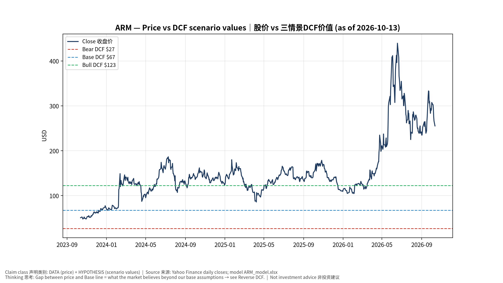
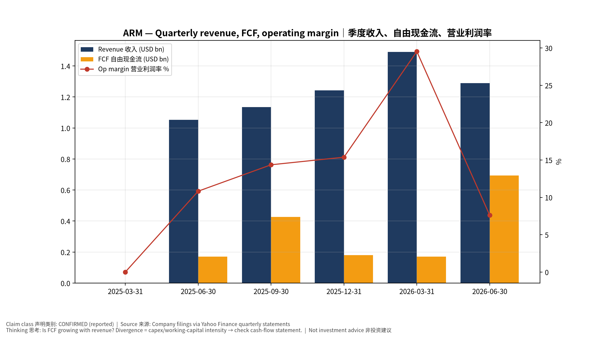
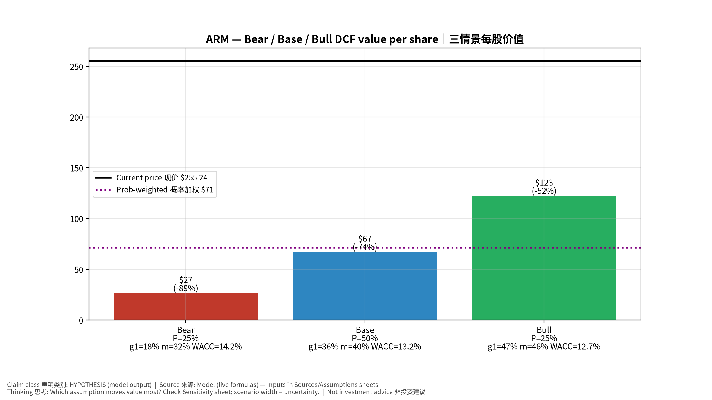
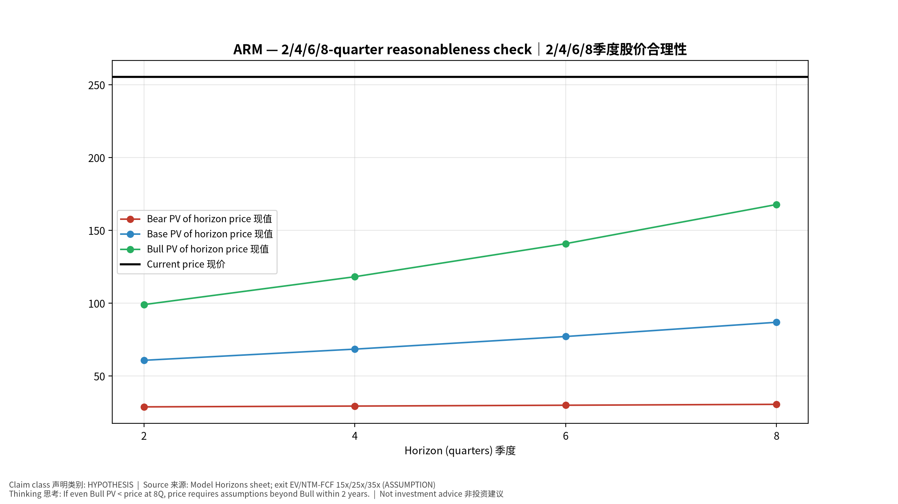
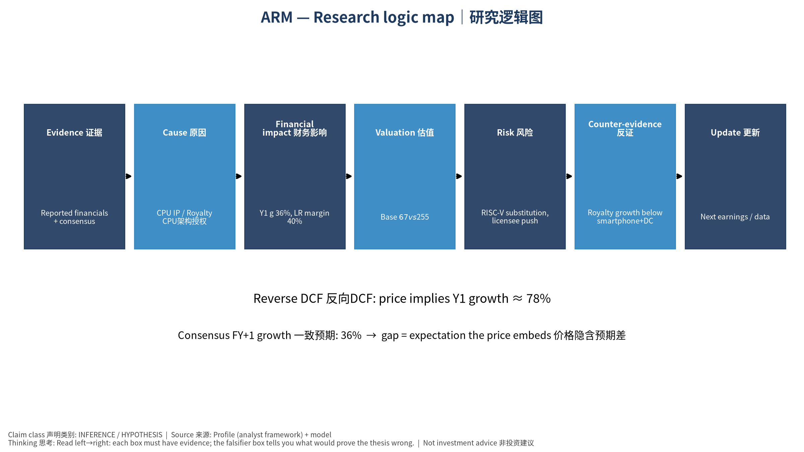

# ARM Arm Holdings plc — 个股深度研究 (专业中文版) v20261013-1622
> 数据截至 2026-10-13 16:22 SGT｜价格 $255.24｜市值 272.6 bn USD｜财报货币 USD｜非投资建议。事实=CONFIRMED/DATA；推断=INFERENCE；假设=ASSUMPTION/HYPOTHESIS。

## 1. 投资论点 Investment Thesis (HYPOTHESIS)
ARM通过v9与CSS提升每颗芯片版税，并扩展到数据中心CPU；估值极高，市场隐含长期高增长，任何智能手机周期或客户冲突(如与高通诉讼、自研芯片与客户竞争)都会冲击预期。

- **多头驱动**: DC CPU share rises fast; CSS adoption; own-silicon wins｜DC CPU份额快升；CSS普及；自研芯片获单
- **空头驱动**: RISC-V substitution, licensee pushback, SoftBank overhang｜RISC-V替代、客户反弹、软银持股压力
- **证伪条件 Falsifiers**: Royalty growth below smartphone+DC unit growth; licensing lumpiness without backlog support｜版税增速低于出货增速；授权收入无RPO支持

## 2. 产品、客户与收入模式
- 主题 Theme: CPU IP / Royalty CPU架构授权
- 业务分部 Segments: Royalty 版税；Licensing 授权；Compute subsystems/own silicon 计算子系统/自研芯片
- 公司描述 (DATA, Yahoo/公司申报): Arm Holdings plc researches, develops, licenses, and markets central processing unit (CPU) intellectual property (IP), graphics processing unit IP, systems IP, compute subsystems (CSS), and associated software, tools and related services. The company provides a product portfolio, including CPU IP, GPU and neural processing unit (NPU) accelerators, system IP such as interconnects, compute platform products including pre-integrated CSSs, and development tools and software. The company serves semiconductor companies, original equipment manufacturers (OEMs), cloud service providers (CSPs), and organizations developing chips for end markets such as smartphones, consumer electronics, industrial IoT, embedded systems, cloud data centers, networking, automotive, and robotics. It provides its products and services in the United States, China, Japan, Taiwan, Korea, and internationally. The company
- 主要客户: Apple, Qualcomm, MediaTek, NVDA (Grace/Vera), AWS (Graviton), Google (Axion), MSFT (Cobalt), SoftBank｜苹果、高通、联发科、NVDA、各大云厂自研CPU

## 3. 行业、竞争、监管与供应链 (ANALYST FRAMEWORK)
- 供应商/上游: IP business: engineers; own-chip effort relies on TSMC｜IP业务依赖工程师；自研芯片依赖台积电
- 竞争者 (含业外): x86 (Intel/AMD), RISC-V (SiFive, Chinese vendors)｜x86、RISC-V
- 瓶颈/监管: Royalty-rate uplift (v9/CSS) adoption; data-center CPU share｜v9/CSS版税率提升速度；数据中心CPU份额
- 关键KPI: Royalty revenue, licensing revenue, RPO, v9 mix｜版税收入、授权收入、RPO、v9占比
- 零部件现货/合约价: 本版未接入付费价格源(TrendForce/DRAMeXchange等)——标注 **UNAVAILABLE**，在KPI监控中以定性方式跟踪。

## 4. 历史财务与现金流 (CONFIRMED, 季度, USD)
| 季度 | 收入 | 毛利 | 营业利润 | 净利润 | FCF | 营业利润率 |
|---|---|---|---|---|---|---|
| 2026-06-30 | 1.3 bn USD | 1.3 bn USD | 98.0 mn USD | 0.3 bn USD | 0.7 bn USD | 7.6% |
| 2026-03-31 | 1.5 bn USD | 1.5 bn USD | 0.4 bn USD | 0.3 bn USD | 0.2 bn USD | 29.5% |
| 2025-12-31 | 1.2 bn USD | 1.2 bn USD | 0.2 bn USD | 0.2 bn USD | 0.2 bn USD | 15.4% |
| 2025-09-30 | 1.1 bn USD | 1.1 bn USD | 0.2 bn USD | 0.2 bn USD | 0.4 bn USD | 14.4% |
| 2025-06-30 | 1.1 bn USD | 1.0 bn USD | 0.1 bn USD | 0.1 bn USD | 0.2 bn USD | 10.8% |
| 2025-03-31 | N/A | N/A | N/A | N/A | N/A | N/A |

资产负债: 现金 3.9 bn USD；总负债 0.5 bn USD；净现金 3.4 bn USD。TTM FCF 1.5 bn USD（FCF率 28.5%）。

## 5. 最新财报: 实际 vs 一致预期 vs 指引
| 季度 | EPS实际 | EPS一致预期 | 超预期% |
|---|---|---|---|
| 2025-09-30 | 0.39 | 0.33134 | 0.177 |
| 2025-12-31 | 0.43 | 0.40919 | 0.0509 |
| 2026-03-31 | 0.6 | 0.5793 | 0.0357 |
| 2026-06-30 | 0.45 | 0.4038 | 0.1144 |

- 管理层指引 Guidance: 自动数据源不含指引——**UNAVAILABLE（待从公司IR新闻稿录入）**。
- 下次财报日 (Yahoo, TENTATIVE 直至公司确认): **2026-11-05**；本季EPS一致预期 0.47338（28位分析师）；收入一致预期 1.4 bn USD。

## 6. 未来2/4/6/8季度驱动与价格合理性
| 期限 | 情景 | 期限价格现值 | 相对现价 |
|---|---|---|---|
| 2Q | Bear | $28.71 | -88.8% |
| 2Q | Base | $60.68 | -76.2% |
| 2Q | Bull | $98.93 | -61.2% |
| 4Q | Bear | $29.26 | -88.5% |
| 4Q | Base | $68.36 | -73.2% |
| 4Q | Bull | $118.07 | -53.7% |
| 6Q | Bear | $29.84 | -88.3% |
| 6Q | Base | $77.02 | -69.8% |
| 6Q | Bull | $140.78 | -44.8% |
| 8Q | Bear | $30.45 | -88.1% |
| 8Q | Base | $86.80 | -66.0% |
| 8Q | Bull | $167.67 | -34.3% |

现价隐含的 EV/NTM-FCF (Base 路径): | 期限 | 隐含倍数 |
|---|---|
| 2Q | 102.7x |
| 4Q | 84.9x |
| 6Q | 70.3x |
| 8Q | 58.3x |

解读: 如果8季度后Base情景所需倍数仍远高于25x，说明价格依赖更远期的增长。

## 7. 三情景 Bear / Base / Bull (HYPOTHESIS)
| 情景 | Y1增速 | 长期FCF率 | WACC | 永续g | 概率 | 每股价值 | 相对现价 |
|---|---|---|---|---|---|---|---|
| Bear | 18.1% | 32.0% | 14.2% | 2.5% | 25.0% | $26.85 | -89.5% |
| Base | 36.2% | 40.0% | 13.2% | 3.0% | 50.0% | $67.44 | -73.6% |
| Bull | 47.1% | 46.0% | 12.7% | 3.5% | 25.0% | $122.70 | -51.9% |

概率加权价值 **$71.11**（相对现价 -72.1%）。

## 8. 估值: DCF / Reverse DCF / ROIC-WACC / 同业 / 敏感度
- DCF Base: EV 68.6 bn USD；终值占比 50.4%。
- **Reverse DCF 反向DCF**: 在Base利润率与WACC下，现价隐含Y1收入增速 ≈ **78.1%**；一致预期FY+1增速 36.2%。
- WACC (CAPM) = rf 5.2% + β 1.60 × ERP 5.0% = 13.2%。
- SOTP segments 分部: Royalty 版税; Licensing 授权; Compute subsystems/own silicon 计算子系统/自研芯片. **Status: framework only** — segment revenues are INPUT REQUIRED from the latest 10-K/10-Q segment note (not auto-fed, left blank to avoid fabrication)｜分部收入需按最新财报手动录入，未自动填充以避免编造。
- 同业比较 Comps (DATA):
| Ticker | 市值 | EV/Sales | Fwd P/E | 收入增速 | 毛利率 | FCF收益率 |
|---|---|---|---|---|---|---|
| ARM | 272.6 bn USD | 52.2x | 83.3x | 22.4% | 97.5% | 0.5% |
| QCOM | 186.3 bn USD | 4.3x | 17.1x | -4.0% | 54.2% | 5.5% |
| CDNS | 96.0 bn USD | 16.6x | 36.4x | 24.2% | 85.9% | 1.7% |
| SNPS | 96.3 bn USD | 11.0x | 27.0x | 42.4% | 82.9% | 3.6% |

- 敏感度: 见Excel `Sensitivity` 表 (WACC × 永续增长率)。

## 9. 风险、反方论证与证伪
- 反方观点 Counter-thesis: RISC-V substitution, licensee pushback, SoftBank overhang｜RISC-V替代、客户反弹、软银持股压力
- 证伪指标: Royalty growth below smartphone+DC unit growth; licensing lumpiness without backlog support｜版税增速低于出货增速；授权收入无RPO支持
- 模型风险: 长期利润率与WACC为假设；终值占比高时估值对假设极敏感。

## 10. Source Ledger 来源账本
| Item | Value | Source/time |
|---|---|---|
| Price 股价 | 255.2 | Yahoo Finance quote, fetched 2026-10-13T16:22 SGT |
| Market cap 市值 | 2.726e+11 | Yahoo info.marketCap 2026-10-13T16:22 |
| Cash 现金 | 3.888e+09 | Yahoo info.totalCash (latest filing) 2026-10-13T16:22 |
| Debt 负债 | 4.85e+08 | Yahoo info.totalDebt (latest filing) 2026-10-13T16:22 |
| Revenue TTM 收入 | 5.156e+09 | Yahoo info.totalRevenue (TTM, USD) 2026-10-13T16:22 |
| FCF TTM 自由现金流 | 1.472e+09 | Sum of last 4 quarterly FCF (q_cash); quarters ['2026-06-30', '2026-03-31', '2025-12-31', '2025-09-30'] (USD) |
| Beta | 3.789 | Yahoo info.beta (5Y monthly) |
| Risk-free 10Y 无风险利率 | 0.0522 | FRED DGS10 2026-10-08 |
| FX USD per USD | 1 | n/a (USD) |
| Consensus rev growth FY0 | 0.2314 | Yahoo revenue_estimate 0y |
| Consensus rev growth FY+1 | 0.3623 | Yahoo revenue_estimate +1y |

## 11. Assumption Register 假设登记表
| Assumption | Value | Rationale |
|---|---|---|
| ERP 股权风险溢价 | 0.05 | ASSUMPTION: 5.0% house mature-market ERP |
| Beta clamp | [0.8,1.6] → 1.60 | ASSUMPTION: limit extreme betas |
| Tax rate (ROIC) | 0.18 | ASSUMPTION: blended cash tax 18% |
| Year-1 growth (Base) | 0.3623 | Consensus FY+1 revenue growth (Yahoo revenue_estimate '+1y'); capped at 100% |
| Growth fade | linear Y1→terminal by Y10 | ASSUMPTION |
| Starting FCF margin | 0.2855 | DATA: FCF TTM / Revenue TTM, floored -50% |
| Long-run FCF margin (Base) | 0.4 | ASSUMPTION (analyst framework, reached by Y5; see profile) |
| Bear/Bull Y1 growth multiplier | 0.5x / 1.3x | ASSUMPTION |
| Bear/Bull margin multiplier | 0.8x / 1.15x | ASSUMPTION |
| WACC adj Bear/Bull | +1.0pp / -0.5pp | ASSUMPTION |
| Terminal g Bear/Base/Bull | 2.5% / 3.0% / 3.5% | ASSUMPTION |
| Scenario probabilities | 25% / 50% / 25% | ASSUMPTION |
| Horizon exit EV/NTM-FCF Bear/Base/Bull | 15x / 25x / 35x | ASSUMPTION |
| Per-share conversion | value × fx ÷ market cap × price | METHOD: avoids ADR/share-class mismatch |

## 12. Model Provenance 模型溯源
- Model file: `ARM_model_v20261013-1622.xlsx` (live formulas; sheets Inputs→Scenarios→DCF→ReverseDCF→Sensitivity→Horizons→SOTP→Comps→ROIC_WACC→History→Sources→Assumptions)
- Engine: `production/pipeline/model.py` (Python mirror; values in this report = Python mirror, verified against LibreOffice recalculation of the xlsx)
- Data snapshot: `data/snapshots/20261013-1622` (immutable) | Fetched 2026-10-13 16:22 SGT | Generated 2026-10-13 16:23 SGT
- Version: v20261013-1622. Prior versions are never overwritten (see company history page).

## 13. 版本与事件时间轴
- v20261013-1622: 首版生产系统报告 (27家同步)。下一事件: 财报 2026-11-05 (TENTATIVE)。

## 图片报告 Image Report

*股价vs三情景价值 Price vs scenario values*

*季度财务 Quarterly financials*

*三情景 Scenarios*

*2/4/6/8季度检验 Horizon check*

*研究逻辑图 Logic map*

---

# ARM Arm Holdings plc — Equity Deep Dive (Professional English) v20261013-1622
> Data as of 2026-10-13 16:22 SGT | Price $255.24 | Mkt cap 272.6 bn USD | Reporting currency USD | Not investment advice.

## 1. Investment thesis (HYPOTHESIS)
ARM lifts per-chip royalties via v9 and CSS and is expanding into data-center CPUs. The valuation is very rich and implies long-duration high growth; smartphone cycles or customer conflicts (QCOM litigation, own silicon competing with licensees) can hit expectations.

- **Bull drivers**: DC CPU share rises fast; CSS adoption; own-silicon wins｜DC CPU份额快升；CSS普及；自研芯片获单
- **Bear drivers**: RISC-V substitution, licensee pushback, SoftBank overhang｜RISC-V替代、客户反弹、软银持股压力
- **Falsifiers**: Royalty growth below smartphone+DC unit growth; licensing lumpiness without backlog support｜版税增速低于出货增速；授权收入无RPO支持

## 2. Products, customers, revenue model
- Theme: CPU IP / Royalty CPU架构授权 | Segments: Royalty 版税; Licensing 授权; Compute subsystems/own silicon 计算子系统/自研芯片
- Business description (DATA): Arm Holdings plc researches, develops, licenses, and markets central processing unit (CPU) intellectual property (IP), graphics processing unit IP, systems IP, compute subsystems (CSS), and associated software, tools and related services. The company provides a product portfolio, including CPU IP, GPU and neural processing unit (NPU) accelerators, system IP such as interconnects, compute platform products including pre-integrated CSSs, and development tools and software. The company serves semiconductor companies, original equipment manufacturers (OEMs), cloud service providers (CSPs), and organizations developing chips for end markets such as smartphones, consumer electronics, industrial IoT, embedded systems, cloud data centers, networking, automotive, and robotics. It provides its products and services in the United States, China, Japan, Taiwan, Korea, and internationally. The company
- Customers: Apple, Qualcomm, MediaTek, NVDA (Grace/Vera), AWS (Graviton), Google (Axion), MSFT (Cobalt), SoftBank｜苹果、高通、联发科、NVDA、各大云厂自研CPU

## 3. Industry, competition, regulation, supply chain (ANALYST FRAMEWORK)
- Suppliers: IP business: engineers; own-chip effort relies on TSMC｜IP业务依赖工程师；自研芯片依赖台积电
- Competitors: x86 (Intel/AMD), RISC-V (SiFive, Chinese vendors)｜x86、RISC-V
- Bottlenecks/regulation: Royalty-rate uplift (v9/CSS) adoption; data-center CPU share｜v9/CSS版税率提升速度；数据中心CPU份额
- KPIs: Royalty revenue, licensing revenue, RPO, v9 mix｜版税收入、授权收入、RPO、v9占比
- Component spot/contract prices: paid feeds not connected — **UNAVAILABLE**, tracked qualitatively.

## 4. Historical financials & cash flow (CONFIRMED, quarterly, USD)
| Quarter | Revenue | Gross profit | Op income | Net income | FCF | Op margin |
|---|---|---|---|---|---|---|
| 2026-06-30 | 1.3 bn USD | 1.3 bn USD | 98.0 mn USD | 0.3 bn USD | 0.7 bn USD | 7.6% |
| 2026-03-31 | 1.5 bn USD | 1.5 bn USD | 0.4 bn USD | 0.3 bn USD | 0.2 bn USD | 29.5% |
| 2025-12-31 | 1.2 bn USD | 1.2 bn USD | 0.2 bn USD | 0.2 bn USD | 0.2 bn USD | 15.4% |
| 2025-09-30 | 1.1 bn USD | 1.1 bn USD | 0.2 bn USD | 0.2 bn USD | 0.4 bn USD | 14.4% |
| 2025-06-30 | 1.1 bn USD | 1.0 bn USD | 0.1 bn USD | 0.1 bn USD | 0.2 bn USD | 10.8% |
| 2025-03-31 | N/A | N/A | N/A | N/A | N/A | N/A |

Cash 3.9 bn USD; debt 0.5 bn USD; TTM FCF 1.5 bn USD (FCF margin 28.5%).

## 5. Latest earnings: actual vs consensus vs guidance
| Quarter | EPS actual | EPS consensus | Surprise |
|---|---|---|---|
| 2025-09-30 | 0.39 | 0.33134 | 0.177 |
| 2025-12-31 | 0.43 | 0.40919 | 0.0509 |
| 2026-03-31 | 0.6 | 0.5793 | 0.0357 |
| 2026-06-30 | 0.45 | 0.4038 | 0.1144 |

- Management guidance: not in automated feed — **UNAVAILABLE (to be entered from IR release)**.
- Next earnings (Yahoo; TENTATIVE until company-confirmed): **2026-11-05**; current-quarter EPS consensus 0.47338 (28 analysts); revenue consensus 1.4 bn USD.

## 6. 2/4/6/8-quarter drivers & price reasonableness
| Horizon | Scenario | PV of horizon price | vs current |
|---|---|---|---|
| 2Q | Bear | $28.71 | -88.8% |
| 2Q | Base | $60.68 | -76.2% |
| 2Q | Bull | $98.93 | -61.2% |
| 4Q | Bear | $29.26 | -88.5% |
| 4Q | Base | $68.36 | -73.2% |
| 4Q | Bull | $118.07 | -53.7% |
| 6Q | Bear | $29.84 | -88.3% |
| 6Q | Base | $77.02 | -69.8% |
| 6Q | Bull | $140.78 | -44.8% |
| 8Q | Bear | $30.45 | -88.1% |
| 8Q | Base | $86.80 | -66.0% |
| 8Q | Bull | $167.67 | -34.3% |

Current-price implied EV/NTM-FCF on Base path: | Horizon | Implied multiple |
|---|---|
| 2Q | 102.7x |
| 4Q | 84.9x |
| 6Q | 70.3x |
| 8Q | 58.3x |

## 7. Bear / Base / Bull (HYPOTHESIS)
| Scenario | Y1 growth | LR FCF margin | WACC | Terminal g | Prob. | Value/share | vs price |
|---|---|---|---|---|---|---|---|
| Bear | 18.1% | 32.0% | 14.2% | 2.5% | 25.0% | $26.85 | -89.5% |
| Base | 36.2% | 40.0% | 13.2% | 3.0% | 50.0% | $67.44 | -73.6% |
| Bull | 47.1% | 46.0% | 12.7% | 3.5% | 25.0% | $122.70 | -51.9% |

Probability-weighted value **$71.11** (-72.1% vs price).

## 8. Valuation: DCF / Reverse DCF / ROIC-WACC / comps / sensitivity
- Base DCF EV 68.6 bn USD; terminal share 50.4%.
- **Reverse DCF**: at Base margin/WACC the price implies Y1 revenue growth ≈ **78.1%** vs consensus FY+1 36.2%.
- WACC (CAPM) = rf 5.2% + β 1.60 × ERP 5.0% = 13.2%.
- SOTP segments: Royalty 版税; Licensing 授权; Compute subsystems/own silicon 计算子系统/自研芯片 — framework only; segment revenue inputs pending from filings.
- Comps (DATA): see table in Chinese section / Excel `Comps`.
- Sensitivity: Excel `Sensitivity` (WACC × terminal g).

## 9. Risks, counterarguments, falsifiers
RISC-V substitution, licensee pushback, SoftBank overhang｜RISC-V替代、客户反弹、软银持股压力 | Falsifiers: Royalty growth below smartphone+DC unit growth; licensing lumpiness without backlog support｜版税增速低于出货增速；授权收入无RPO支持

## 10–12. Source Ledger / Assumption Register / Model Provenance
See tables above (shared, bilingual). - Model file: `ARM_model_v20261013-1622.xlsx` (live formulas; sheets Inputs→Scenarios→DCF→ReverseDCF→Sensitivity→Horizons→SOTP→Comps→ROIC_WACC→History→Sources→Assumptions)
- Engine: `production/pipeline/model.py` (Python mirror; values in this report = Python mirror, verified against LibreOffice recalculation of the xlsx)
- Data snapshot: `data/snapshots/20261013-1622` (immutable) | Fetched 2026-10-13 16:22 SGT | Generated 2026-10-13 16:23 SGT
- Version: v20261013-1622. Prior versions are never overwritten (see company history page).
