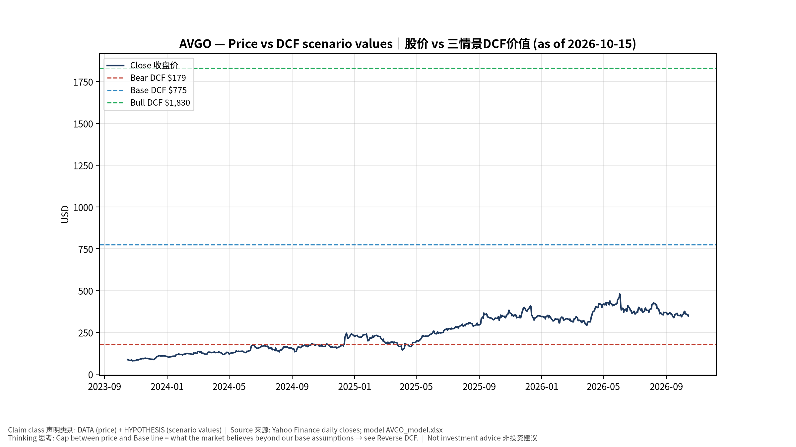
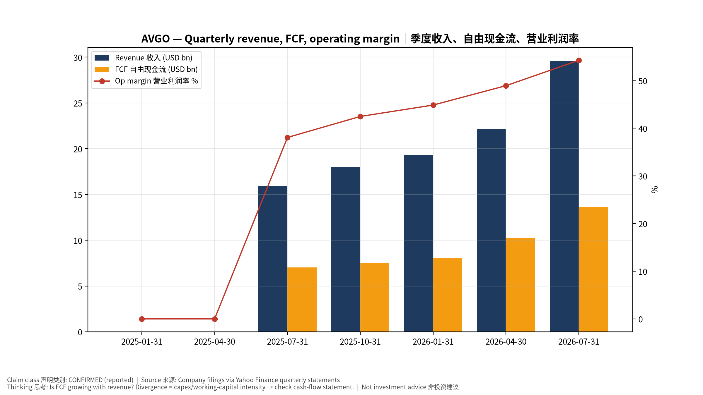
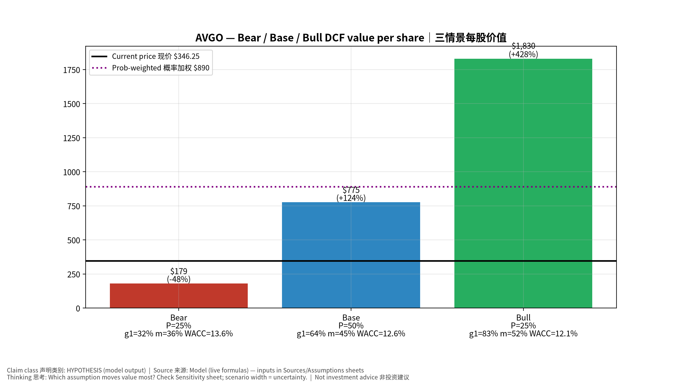
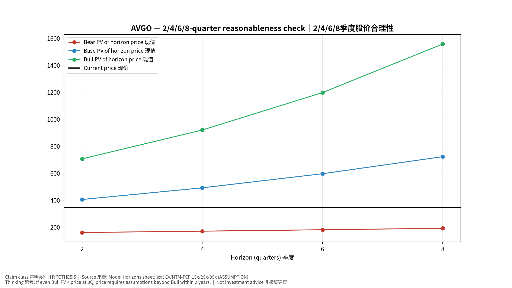
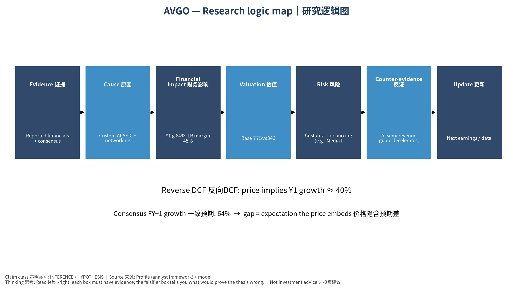

# AVGO Broadcom Inc. — 个股深度研究 (专业中文版) v20261015-0757
> 数据截至 2026-10-15 07:57 SGT｜价格 $346.25｜市值 1,652.9 bn USD｜财报货币 USD｜非投资建议。事实=CONFIRMED/DATA；推断=INFERENCE；假设=ASSUMPTION/HYPOTHESIS。

## 1. 投资论点 Investment Thesis (HYPOTHESIS)
博通是'XPU/TPU替代GPU'趋势的核心受益者，加上Tomahawk/Jericho以太网与VMware现金流；高客户集中度意味着单一客户项目变动影响巨大。

- **多头驱动**: Multiple XPU customers in volume; Ethernet scale-up/out wins; software stable｜多XPU客户放量；以太网胜出；软件稳定
- **空头驱动**: Customer in-sourcing (e.g., MediaTek on TPU), lumpy AI revenue, debt from VMware｜客户转单、AI收入波动、VMware债务
- **证伪条件 Falsifiers**: AI semi revenue guide decelerates; key XPU customer shifts vendor; VMware revenue declines｜AI半导体指引放缓；主要XPU客户转供应商；VMware收入下降

## 2. 产品、客户与收入模式
- 主题 Theme: Custom AI ASIC + networking + infrastructure software 定制AI芯片+网络+软件
- 业务分部 Segments: AI semiconductors (XPU+networking) AI半导体；Non-AI semis 非AI半导体；Infrastructure software (VMware) 基础软件
- 公司描述 (DATA, Yahoo/公司申报): Broadcom Inc. designs, develops, and supplies various semiconductor devices and infrastructure software solutions internationally. The company operates in two segments: Semiconductor Solutions and Infrastructure Software. The company offers networking connectivity, such as custom silicon solutions, ethernet switching & routing, ethernet NIC controllers, physical layer devices, and fiber optic components; wireless device connectivity, including RF semiconductor devices, connectivity solutions, custom touch controllers, and inductive charging ASICS; servers and storage system solutions, such as PCIE switches, SAS & raid products, fibre channel products, and HDD & SSD solutions; broadband solutions, includes set-top box, and broadband access; and industrial. The company also offers a private cloud software portfolio, including the VMware Cloud Foundation, Edge, vSphere foundation, telco clo
- 主要客户: Google (TPU), Meta, ByteDance, OpenAI, Anthropic, Apple; enterprises (VMware)｜谷歌TPU、Meta、字节、OpenAI、Anthropic、苹果；企业(VMware)

## 3. 行业、竞争、监管与供应链 (ANALYST FRAMEWORK)
- 供应商/上游: TSMC (N3/N2, CoWoS), HBM vendors, substrate makers｜台积电、HBM、载板
- 竞争者 (含业外): NVDA, Marvell, Alchip/GUC/MediaTek (ASIC), Arista/Cisco (switching)｜NVDA、Marvell、世芯/创意/联发科、Arista/思科
- 瓶颈/监管: CoWoS allocation, customer concentration, VMware renewal cycle｜CoWoS配额、客户集中度、VMware续约
- 关键KPI: AI revenue, XPU customers count, software revenue, FCF, net debt｜AI收入、XPU客户数、软件收入、FCF、净负债
- 零部件现货/合约价: 本版未接入付费价格源(TrendForce/DRAMeXchange等)——标注 **UNAVAILABLE**，在KPI监控中以定性方式跟踪。

## 4. 历史财务与现金流 (CONFIRMED, 季度, USD)
| 季度 | 收入 | 毛利 | 营业利润 | 净利润 | FCF | 营业利润率 |
|---|---|---|---|---|---|---|
| 2026-07-31 | 29.6 bn USD | 20.5 bn USD | 16.1 bn USD | 13.1 bn USD | 13.7 bn USD | 54.3% |
| 2026-04-30 | 22.2 bn USD | 15.4 bn USD | 10.9 bn USD | 9.3 bn USD | 10.3 bn USD | 48.9% |
| 2026-01-31 | 19.3 bn USD | 13.2 bn USD | 8.7 bn USD | 7.3 bn USD | 8.0 bn USD | 44.9% |
| 2025-10-31 | 18.0 bn USD | 12.2 bn USD | 7.7 bn USD | 8.5 bn USD | 7.5 bn USD | 42.5% |
| 2025-07-31 | 16.0 bn USD | 10.7 bn USD | 6.1 bn USD | 4.1 bn USD | 7.0 bn USD | 38.1% |
| 2025-04-30 | N/A | N/A | N/A | N/A | N/A | N/A |
| 2025-01-31 | N/A | N/A | N/A | N/A | N/A | N/A |

资产负债: 现金 24.0 bn USD；总负债 59.4 bn USD；净现金 -35.4 bn USD。TTM FCF 39.4 bn USD（FCF率 44.2%）。

## 5. 最新财报: 实际 vs 一致预期 vs 指引
| 季度 | EPS实际 | EPS一致预期 | 超预期% |
|---|---|---|---|
| 2025-10-31 | 1.95 | 1.86817 | 0.0438 |
| 2026-01-31 | 2.05 | 2.02326 | 0.013200001 |
| 2026-04-30 | 2.44 | 2.39835 | 0.0174 |
| 2026-07-31 | 3.32 | 3.238 | 0.0253 |

- 管理层指引 Guidance: 自动数据源不含指引——**UNAVAILABLE（待从公司IR新闻稿录入）**。
- 下次财报日 (Yahoo, TENTATIVE 直至公司确认): **2026-12-10**；本季EPS一致预期 3.82768（40位分析师）；收入一致预期 34.9 bn USD。

## 6. 未来2/4/6/8季度驱动与价格合理性
| 期限 | 情景 | 期限价格现值 | 相对现价 |
|---|---|---|---|
| 2Q | Bear | $159.51 | -53.9% |
| 2Q | Base | $404.10 | 16.7% |
| 2Q | Bull | $705.16 | 103.7% |
| 4Q | Bear | $169.44 | -51.1% |
| 4Q | Base | $490.62 | 41.7% |
| 4Q | Bull | $919.02 | 165.4% |
| 6Q | Bear | $179.80 | -48.1% |
| 6Q | Base | $595.16 | 71.9% |
| 6Q | Bull | $1,196.54 | 245.6% |
| 8Q | Bear | $190.62 | -44.9% |
| 8Q | Base | $721.50 | 108.4% |
| 8Q | Bull | $1,556.64 | 349.6% |

现价隐含的 EV/NTM-FCF (Base 路径): | 期限 | 隐含倍数 |
|---|---|
| 2Q | 20.3x |
| 4Q | 15.8x |
| 6Q | 12.3x |
| 8Q | 9.6x |

解读: 如果8季度后Base情景所需倍数仍远高于25x，说明价格依赖更远期的增长。

## 7. 三情景 Bear / Base / Bull (HYPOTHESIS)
| 情景 | Y1增速 | 长期FCF率 | WACC | 永续g | 概率 | 每股价值 | 相对现价 |
|---|---|---|---|---|---|---|---|
| Bear | 32.1% | 36.0% | 13.6% | 2.5% | 25.0% | $179.24 | -48.2% |
| Base | 64.1% | 45.0% | 12.6% | 3.0% | 50.0% | $775.38 | 123.9% |
| Bull | 83.4% | 51.7% | 12.1% | 3.5% | 25.0% | $1,829.68 | 428.4% |

概率加权价值 **$889.92**（相对现价 157.0%）。

## 8. 估值: DCF / Reverse DCF / ROIC-WACC / 同业 / 敏感度
- DCF Base: EV 3,736.8 bn USD；终值占比 57.1%。
- **Reverse DCF 反向DCF**: 在Base利润率与WACC下，现价隐含Y1收入增速 ≈ **40.2%**；一致预期FY+1增速 64.1%。
- WACC (CAPM) = rf 5.2% + β 1.48 × ERP 5.0% = 12.6%。
- SOTP segments 分部: AI semiconductors (XPU+networking) AI半导体; Non-AI semis 非AI半导体; Infrastructure software (VMware) 基础软件. **Status: framework only** — segment revenues are INPUT REQUIRED from the latest 10-K/10-Q segment note (not auto-fed, left blank to avoid fabrication)｜分部收入需按最新财报手动录入，未自动填充以避免编造。
- 同业比较 Comps (DATA):
| Ticker | 市值 | EV/Sales | Fwd P/E | 收入增速 | 毛利率 | FCF收益率 |
|---|---|---|---|---|---|---|
| AVGO | 1,652.9 bn USD | 18.9x | 17.9x | 85.5% | 75.5% | 2.4% |
| MRVL | 220.4 bn USD | 22.9x | 33.6x | 36.5% | 52.2% | 1.1% |
| NVDA | 5,343.7 bn USD | 17.5x | 13.9x | 105.9% | 74.7% | 0.8% |
| ANET | 246.5 bn USD | 22.1x | 37.4x | 37.7% | 63.0% | 1.6% |
| QCOM | 184.3 bn USD | 4.3x | 16.9x | -4.0% | 54.2% | 5.6% |

- 敏感度: 见Excel `Sensitivity` 表 (WACC × 永续增长率)。

## 9. 风险、反方论证与证伪
- 反方观点 Counter-thesis: Customer in-sourcing (e.g., MediaTek on TPU), lumpy AI revenue, debt from VMware｜客户转单、AI收入波动、VMware债务
- 证伪指标: AI semi revenue guide decelerates; key XPU customer shifts vendor; VMware revenue declines｜AI半导体指引放缓；主要XPU客户转供应商；VMware收入下降
- 模型风险: 长期利润率与WACC为假设；终值占比高时估值对假设极敏感。

## 10. Source Ledger 来源账本
| Item | Value | Source/time |
|---|---|---|
| Price 股价 | 346.2 | Yahoo Finance quote, fetched 2026-10-15T07:57 SGT |
| Market cap 市值 | 1.653e+12 | Yahoo info.marketCap 2026-10-15T07:57 |
| Cash 现金 | 2.398e+10 | Yahoo info.totalCash (latest filing) 2026-10-15T07:57 |
| Debt 负债 | 5.942e+10 | Yahoo info.totalDebt (latest filing) 2026-10-15T07:57 |
| Revenue TTM 收入 | 8.91e+10 | Yahoo info.totalRevenue (TTM, USD) 2026-10-15T07:57 |
| FCF TTM 自由现金流 | 3.94e+10 | Sum of last 4 quarterly FCF (q_cash); quarters ['2026-07-31', '2026-04-30', '2026-01-31', '2025-10-31'] (USD) |
| Beta | 1.476 | Yahoo info.beta (5Y monthly) |
| Risk-free 10Y 无风险利率 | 0.0521 | FRED DGS10 2026-10-13 |
| FX USD per USD | 1 | n/a (USD) |
| Consensus rev growth FY0 | 0.6588 | Yahoo revenue_estimate 0y |
| Consensus rev growth FY+1 | 0.6413 | Yahoo revenue_estimate +1y |

## 11. Assumption Register 假设登记表
| Assumption | Value | Rationale |
|---|---|---|
| ERP 股权风险溢价 | 0.05 | ASSUMPTION: 5.0% house mature-market ERP |
| Beta clamp | [0.8,1.6] → 1.48 | ASSUMPTION: limit extreme betas |
| Tax rate (ROIC) | 0.18 | ASSUMPTION: blended cash tax 18% |
| Year-1 growth (Base) | 0.6413 | Consensus FY+1 revenue growth (Yahoo revenue_estimate '+1y'); capped at 100% |
| Growth fade | linear Y1→terminal by Y10 | ASSUMPTION |
| Starting FCF margin | 0.4422 | DATA: FCF TTM / Revenue TTM, floored -50% |
| Long-run FCF margin (Base) | 0.45 | ASSUMPTION (analyst framework, reached by Y5; see profile) |
| Bear/Bull Y1 growth multiplier | 0.5x / 1.3x | ASSUMPTION |
| Bear/Bull margin multiplier | 0.8x / 1.15x | ASSUMPTION |
| WACC adj Bear/Bull | +1.0pp / -0.5pp | ASSUMPTION |
| Terminal g Bear/Base/Bull | 2.5% / 3.0% / 3.5% | ASSUMPTION |
| Scenario probabilities | 25% / 50% / 25% | ASSUMPTION |
| Horizon exit EV/NTM-FCF Bear/Base/Bull | 15x / 25x / 35x | ASSUMPTION |
| Per-share conversion | value × fx ÷ market cap × price | METHOD: avoids ADR/share-class mismatch |

## 12. Model Provenance 模型溯源
- Model file: `AVGO_model_v20261015-0757.xlsx` (live formulas; sheets Inputs→Scenarios→DCF→ReverseDCF→Sensitivity→Horizons→SOTP→Comps→ROIC_WACC→History→Sources→Assumptions)
- Engine: `production/pipeline/model.py` (Python mirror; values in this report = Python mirror, verified against LibreOffice recalculation of the xlsx)
- Data snapshot: `data/snapshots/20261015-0757` (immutable) | Fetched 2026-10-15 07:57 SGT | Generated 2026-10-15 07:58 SGT
- Version: v20261015-0757. Prior versions are never overwritten (see company history page).

## 13. 版本与事件时间轴
- v20261015-0757: 首版生产系统报告 (27家同步)。下一事件: 财报 2026-12-10 (TENTATIVE)。

## 图片报告 Image Report

*股价vs三情景价值 Price vs scenario values*

*季度财务 Quarterly financials*

*三情景 Scenarios*

*2/4/6/8季度检验 Horizon check*

*研究逻辑图 Logic map*

---

# AVGO Broadcom Inc. — Equity Deep Dive (Professional English) v20261015-0757
> Data as of 2026-10-15 07:57 SGT | Price $346.25 | Mkt cap 1,652.9 bn USD | Reporting currency USD | Not investment advice.

## 1. Investment thesis (HYPOTHESIS)
Broadcom is the core beneficiary of the XPU/TPU-vs-GPU substitution trend, plus Tomahawk/Jericho Ethernet and VMware cash flow; high customer concentration means single-program shifts matter a lot.

- **Bull drivers**: Multiple XPU customers in volume; Ethernet scale-up/out wins; software stable｜多XPU客户放量；以太网胜出；软件稳定
- **Bear drivers**: Customer in-sourcing (e.g., MediaTek on TPU), lumpy AI revenue, debt from VMware｜客户转单、AI收入波动、VMware债务
- **Falsifiers**: AI semi revenue guide decelerates; key XPU customer shifts vendor; VMware revenue declines｜AI半导体指引放缓；主要XPU客户转供应商；VMware收入下降

## 2. Products, customers, revenue model
- Theme: Custom AI ASIC + networking + infrastructure software 定制AI芯片+网络+软件 | Segments: AI semiconductors (XPU+networking) AI半导体; Non-AI semis 非AI半导体; Infrastructure software (VMware) 基础软件
- Business description (DATA): Broadcom Inc. designs, develops, and supplies various semiconductor devices and infrastructure software solutions internationally. The company operates in two segments: Semiconductor Solutions and Infrastructure Software. The company offers networking connectivity, such as custom silicon solutions, ethernet switching & routing, ethernet NIC controllers, physical layer devices, and fiber optic components; wireless device connectivity, including RF semiconductor devices, connectivity solutions, custom touch controllers, and inductive charging ASICS; servers and storage system solutions, such as PCIE switches, SAS & raid products, fibre channel products, and HDD & SSD solutions; broadband solutions, includes set-top box, and broadband access; and industrial. The company also offers a private cloud software portfolio, including the VMware Cloud Foundation, Edge, vSphere foundation, telco clo
- Customers: Google (TPU), Meta, ByteDance, OpenAI, Anthropic, Apple; enterprises (VMware)｜谷歌TPU、Meta、字节、OpenAI、Anthropic、苹果；企业(VMware)

## 3. Industry, competition, regulation, supply chain (ANALYST FRAMEWORK)
- Suppliers: TSMC (N3/N2, CoWoS), HBM vendors, substrate makers｜台积电、HBM、载板
- Competitors: NVDA, Marvell, Alchip/GUC/MediaTek (ASIC), Arista/Cisco (switching)｜NVDA、Marvell、世芯/创意/联发科、Arista/思科
- Bottlenecks/regulation: CoWoS allocation, customer concentration, VMware renewal cycle｜CoWoS配额、客户集中度、VMware续约
- KPIs: AI revenue, XPU customers count, software revenue, FCF, net debt｜AI收入、XPU客户数、软件收入、FCF、净负债
- Component spot/contract prices: paid feeds not connected — **UNAVAILABLE**, tracked qualitatively.

## 4. Historical financials & cash flow (CONFIRMED, quarterly, USD)
| Quarter | Revenue | Gross profit | Op income | Net income | FCF | Op margin |
|---|---|---|---|---|---|---|
| 2026-07-31 | 29.6 bn USD | 20.5 bn USD | 16.1 bn USD | 13.1 bn USD | 13.7 bn USD | 54.3% |
| 2026-04-30 | 22.2 bn USD | 15.4 bn USD | 10.9 bn USD | 9.3 bn USD | 10.3 bn USD | 48.9% |
| 2026-01-31 | 19.3 bn USD | 13.2 bn USD | 8.7 bn USD | 7.3 bn USD | 8.0 bn USD | 44.9% |
| 2025-10-31 | 18.0 bn USD | 12.2 bn USD | 7.7 bn USD | 8.5 bn USD | 7.5 bn USD | 42.5% |
| 2025-07-31 | 16.0 bn USD | 10.7 bn USD | 6.1 bn USD | 4.1 bn USD | 7.0 bn USD | 38.1% |
| 2025-04-30 | N/A | N/A | N/A | N/A | N/A | N/A |
| 2025-01-31 | N/A | N/A | N/A | N/A | N/A | N/A |

Cash 24.0 bn USD; debt 59.4 bn USD; TTM FCF 39.4 bn USD (FCF margin 44.2%).

## 5. Latest earnings: actual vs consensus vs guidance
| Quarter | EPS actual | EPS consensus | Surprise |
|---|---|---|---|
| 2025-10-31 | 1.95 | 1.86817 | 0.0438 |
| 2026-01-31 | 2.05 | 2.02326 | 0.013200001 |
| 2026-04-30 | 2.44 | 2.39835 | 0.0174 |
| 2026-07-31 | 3.32 | 3.238 | 0.0253 |

- Management guidance: not in automated feed — **UNAVAILABLE (to be entered from IR release)**.
- Next earnings (Yahoo; TENTATIVE until company-confirmed): **2026-12-10**; current-quarter EPS consensus 3.82768 (40 analysts); revenue consensus 34.9 bn USD.

## 6. 2/4/6/8-quarter drivers & price reasonableness
| Horizon | Scenario | PV of horizon price | vs current |
|---|---|---|---|
| 2Q | Bear | $159.51 | -53.9% |
| 2Q | Base | $404.10 | 16.7% |
| 2Q | Bull | $705.16 | 103.7% |
| 4Q | Bear | $169.44 | -51.1% |
| 4Q | Base | $490.62 | 41.7% |
| 4Q | Bull | $919.02 | 165.4% |
| 6Q | Bear | $179.80 | -48.1% |
| 6Q | Base | $595.16 | 71.9% |
| 6Q | Bull | $1,196.54 | 245.6% |
| 8Q | Bear | $190.62 | -44.9% |
| 8Q | Base | $721.50 | 108.4% |
| 8Q | Bull | $1,556.64 | 349.6% |

Current-price implied EV/NTM-FCF on Base path: | Horizon | Implied multiple |
|---|---|
| 2Q | 20.3x |
| 4Q | 15.8x |
| 6Q | 12.3x |
| 8Q | 9.6x |

## 7. Bear / Base / Bull (HYPOTHESIS)
| Scenario | Y1 growth | LR FCF margin | WACC | Terminal g | Prob. | Value/share | vs price |
|---|---|---|---|---|---|---|---|
| Bear | 32.1% | 36.0% | 13.6% | 2.5% | 25.0% | $179.24 | -48.2% |
| Base | 64.1% | 45.0% | 12.6% | 3.0% | 50.0% | $775.38 | 123.9% |
| Bull | 83.4% | 51.7% | 12.1% | 3.5% | 25.0% | $1,829.68 | 428.4% |

Probability-weighted value **$889.92** (157.0% vs price).

## 8. Valuation: DCF / Reverse DCF / ROIC-WACC / comps / sensitivity
- Base DCF EV 3,736.8 bn USD; terminal share 57.1%.
- **Reverse DCF**: at Base margin/WACC the price implies Y1 revenue growth ≈ **40.2%** vs consensus FY+1 64.1%.
- WACC (CAPM) = rf 5.2% + β 1.48 × ERP 5.0% = 12.6%.
- SOTP segments: AI semiconductors (XPU+networking) AI半导体; Non-AI semis 非AI半导体; Infrastructure software (VMware) 基础软件 — framework only; segment revenue inputs pending from filings.
- Comps (DATA): see table in Chinese section / Excel `Comps`.
- Sensitivity: Excel `Sensitivity` (WACC × terminal g).

## 9. Risks, counterarguments, falsifiers
Customer in-sourcing (e.g., MediaTek on TPU), lumpy AI revenue, debt from VMware｜客户转单、AI收入波动、VMware债务 | Falsifiers: AI semi revenue guide decelerates; key XPU customer shifts vendor; VMware revenue declines｜AI半导体指引放缓；主要XPU客户转供应商；VMware收入下降

## 10–12. Source Ledger / Assumption Register / Model Provenance
See tables above (shared, bilingual). - Model file: `AVGO_model_v20261015-0757.xlsx` (live formulas; sheets Inputs→Scenarios→DCF→ReverseDCF→Sensitivity→Horizons→SOTP→Comps→ROIC_WACC→History→Sources→Assumptions)
- Engine: `production/pipeline/model.py` (Python mirror; values in this report = Python mirror, verified against LibreOffice recalculation of the xlsx)
- Data snapshot: `data/snapshots/20261015-0757` (immutable) | Fetched 2026-10-15 07:57 SGT | Generated 2026-10-15 07:58 SGT
- Version: v20261015-0757. Prior versions are never overwritten (see company history page).
