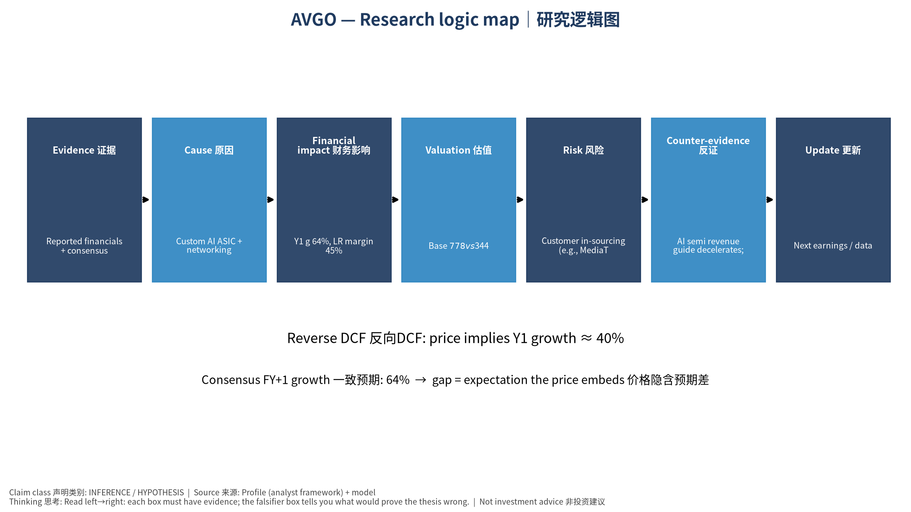

# AVGO 初学者教学版 (中文) v20261016-0756
## ① 一句话
Broadcom Inc. 是一家 Custom AI ASIC + networking + infrastructure software 定制AI芯片+网络+软件 公司。现在股价 $344.33。我们的Base模型认为每股价值约 $778（126.0%）。

## ② 发生了什么
最近一季财报EPS实际 vs 预期: ['2026-07-31', '3.32', '3.238', '0.0253']（实际、预期、超预期%）。下次财报约 2026-12-10。

## ③ 术语 Glossary
- DCF (Discounted Cash Flow｜现金流折现): 把未来每年能拿到的现金，按"时间成本"折回今天加总。
- FCF (Free Cash Flow｜自由现金流) = 经营现金流 − 资本开支。
- WACC (Weighted Average Cost of Capital｜加权平均资本成本): 投资人要求的年回报率，用作折现率。
- Reverse DCF (反向DCF): 反过来问"现价要求公司增长多快"。
- Consensus (一致预期): 分析师预测的平均值。
- Falsifier (证伪指标): 一旦出现就说明论点错了的信号。

## ④ 生活比喻
买这家公司股票≈买一棵果树。DCF就是估算果树未来每年结多少果(FCF)，再考虑"明年的一斤果不如今天的一斤果值钱"(WACC折现)。

## ⑤ 因果箭头
Custom AI ASIC + networking + infrastructure software 定制AI芯片+网络+软件 需求 → 收入增长 (g) → 自由现金流 (FCF = 收入 × FCF率) → 折现 (÷(1+WACC)^t) → 每股价值 → 与股价比较 → 预期差

## ⑥ 数字例题（符号定义）
设 R₀ = 过去12个月收入 = 89.1 bn USD；g₁ = 第一年增速 = 64.2%；m = 长期FCF率 = 45.0%；W = WACC = 12.6%。
第一年收入 R₁ = R₀ × (1+g₁) = 146.3 bn USD。
若第5年FCF率达到 m，则第1年FCF ≈ R₁ × m₁（m₁ 由当前 44.2% 向 45.0% 线性过渡）= 64.9 bn USD；
折现到今天: FCF₁ ÷ (1+W)¹ = 57.7 bn USD。十年加总 + 终值 = EV 3,750.5 bn USD。

## ⑦ 事实 / 预测 / 市场预期
- 事实: 过去财务数据(第4节)、现价。
- 预测(我们的假设): 长期FCF率 45.0%、三情景。
- 市场预期: 一致预期增速 64.2%；价格隐含增速 39.9%。

## ⑧ 三情景
Bear $180 / Base $778 / Bull $1,837；概率加权 $893。

## ⑨ 反方观点与失效条件
反方: Customer in-sourcing (e.g., MediaTek on TPU), lumpy AI revenue, debt from VMware｜客户转单、AI收入波动、VMware债务
失效条件: AI semi revenue guide decelerates; key XPU customer shifts vendor; VMware revenue declines｜AI半导体指引放缓；主要XPU客户转供应商；VMware收入下降

## 自我检验题
1. 如果WACC上升1个百分点，价值会升还是降？为什么？（提示：分母变大）
2. 反向DCF隐含增速高于一致预期意味着什么？

---

# AVGO Beginner Teaching Edition (English) v20261016-0756
## ① In one line
Broadcom Inc. is a Custom AI ASIC + networking + infrastructure software 定制AI芯片+网络+软件 company. Price $344.33; our Base model value ≈ $778 (126.0%).
## ② What happened
Last quarter EPS actual vs consensus: ['2026-07-31', '3.32', '3.238', '0.0253']. Next earnings ≈ 2026-12-10 (TENTATIVE).
## ③ Glossary
DCF (Discounted Cash Flow｜现金流折现); FCF (Free Cash Flow｜自由现金流) = operating cash flow − capex; WACC (Weighted Average Cost of Capital｜加权平均资本成本) = the yearly return investors demand; Reverse DCF (反向DCF) = what growth the price requires; Consensus (一致预期); Falsifier (证伪指标).
## ④ Analogy
Owning the stock ≈ owning a fruit tree: DCF estimates future fruit (FCF) and discounts it because fruit next year is worth less than fruit today.
## ⑤ Causal arrows
Demand → revenue growth (g) → FCF (= revenue × FCF margin) → discounting ÷(1+WACC)^t → value/share → compare with price → expectation gap
## ⑥ Worked example (symbols)
R₀ = TTM revenue = 89.1 bn USD; g₁ = 64.2%; m = long-run FCF margin = 45.0%; W = 12.6%.
R₁ = R₀×(1+g₁) = 146.3 bn USD; FCF₁ = 64.9 bn USD; PV = FCF₁/(1+W) = 57.7 bn USD; 10 years + terminal → EV 3,750.5 bn USD.
## ⑦ Fact vs forecast vs market expectation
Facts: reported financials, price. Forecast: our margin/scenario assumptions. Market: consensus growth 64.2%; price-implied growth 39.9%.
## ⑧ Three scenarios
Bear $180 / Base $778 / Bull $1,837; weighted $893.
## ⑨ Counterview & failure conditions
Customer in-sourcing (e.g., MediaTek on TPU), lumpy AI revenue, debt from VMware｜客户转单、AI收入波动、VMware债务 — Falsifiers: AI semi revenue guide decelerates; key XPU customer shifts vendor; VMware revenue declines｜AI半导体指引放缓；主要XPU客户转供应商；VMware收入下降
## Self-check
1. WACC +1pp → value up or down? 2. What does price-implied growth > consensus mean?

