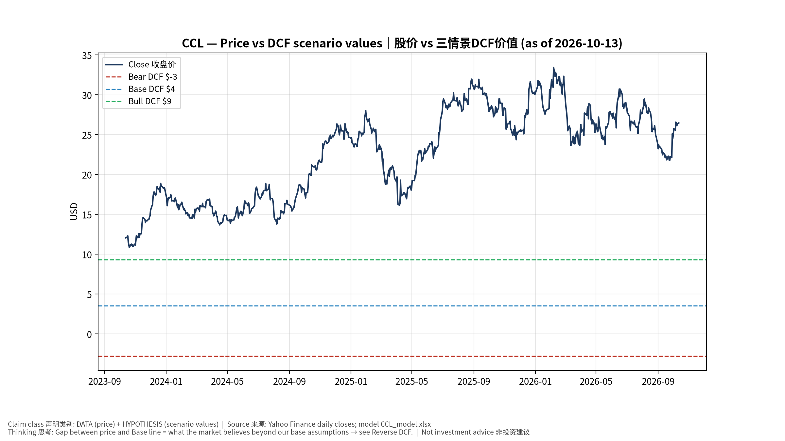
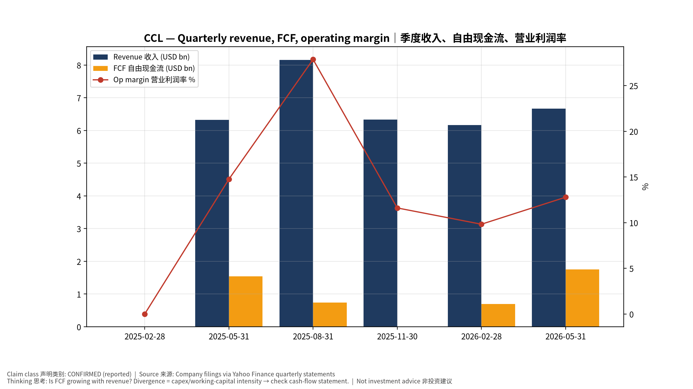
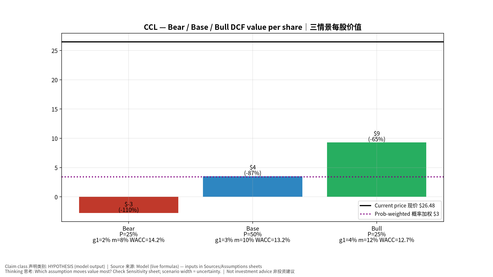
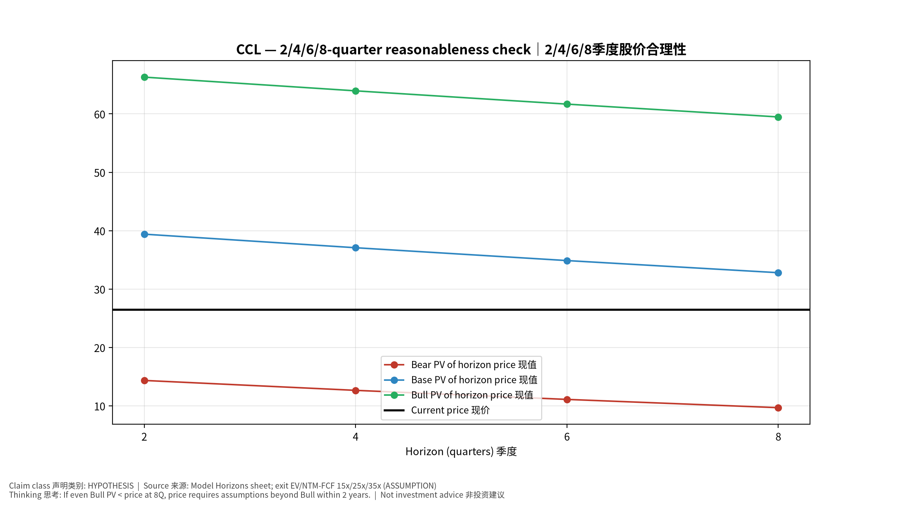
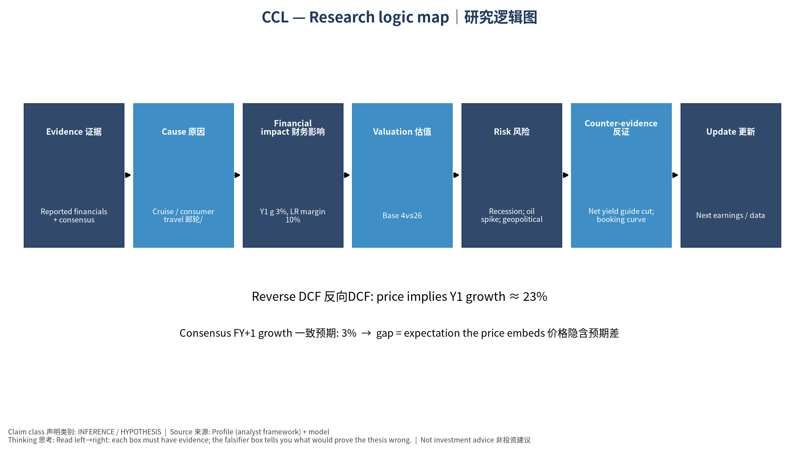

# CCL Carnival Corporation Ltd. — 个股深度研究 (专业中文版) v20261013-1812
> 数据截至 2026-10-13 18:12 SGT｜价格 $26.48｜市值 35.6 bn USD｜财报货币 USD｜非投资建议。事实=CONFIRMED/DATA；推断=INFERENCE；假设=ASSUMPTION/HYPOTHESIS。

## 1. 投资论点 Investment Thesis (HYPOTHESIS)
嘉年华是高杠杆的消费周期股，去杠杆与净收益率(net yield)提升推动重估；对油价、利率与消费信心敏感，为观察名单中的宏观/消费对照组。

- **多头驱动**: Yields keep rising; investment-grade rating; buybacks/dividend｜收益率续升；投资级评级；回购分红
- **空头驱动**: Recession; oil spike; geopolitical disruptions｜衰退；油价飙升；地缘干扰
- **证伪条件 Falsifiers**: Net yield guide cut; booking curve weakens｜净收益率指引下修；预订曲线走弱

## 2. 产品、客户与收入模式
- 主题 Theme: Cruise / consumer travel 邮轮/旅游消费
- 业务分部 Segments: North America & Australia 北美澳洲；Europe 欧洲
- 公司描述 (DATA, Yahoo/公司申报): Carnival Corporation Ltd., a cruise company, provides leisure travel services. The company operates through four segments: North America Cruise Operations, Europe Cruise Operations, Cruise Support, and Tour and Other. It operates port destinations and islands, as well as owns and operates hotels, lodges, glass-domed railcars, and motorcoaches. The company offers its services under the AIDA Cruises, Carnival Cruise Line, Costa Cruises, Cunard, Holland America Line, P&O Cruises (Australia), P&O Cruises (UK), Princess Cruises, and Seabourn brands. It sells its cruises through travel agents, tour operators, vacation planners, websites, and onboard future cruise consultants. Carnival Corporation Ltd. was founded in 1972 and is headquartered in Miami, Florida.
- 主要客户: Leisure travelers｜休闲旅客

## 3. 行业、竞争、监管与供应链 (ANALYST FRAMEWORK)
- 供应商/上游: Shipyards (Fincantieri, Meyer Werft), fuel suppliers｜造船厂、燃油供应商
- 竞争者 (含业外): Royal Caribbean, Norwegian, land-based vacations｜皇家加勒比、挪威邮轮、陆地度假
- 瓶颈/监管: Fuel cost, debt refinancing, ship deliveries｜燃油成本、债务再融资、新船交付
- 关键KPI: Net yields, occupancy, net debt/EBITDA, fuel cost/ton｜净收益率、上座率、净负债/EBITDA、燃油成本
- 零部件现货/合约价: 本版未接入付费价格源(TrendForce/DRAMeXchange等)——标注 **UNAVAILABLE**，在KPI监控中以定性方式跟踪。

## 4. 历史财务与现金流 (CONFIRMED, 季度, USD)
| 季度 | 收入 | 毛利 | 营业利润 | 净利润 | FCF | 营业利润率 |
|---|---|---|---|---|---|---|
| 2026-05-31 | 6.7 bn USD | 2.4 bn USD | 0.9 bn USD | 0.5 bn USD | 1.8 bn USD | 12.8% |
| 2026-02-28 | 6.2 bn USD | 2.2 bn USD | 0.6 bn USD | 0.3 bn USD | 0.7 bn USD | 9.8% |
| 2025-11-30 | 6.3 bn USD | 2.4 bn USD | 0.7 bn USD | 0.4 bn USD | 12.0 mn USD | 11.6% |
| 2025-08-31 | 8.2 bn USD | 3.8 bn USD | 2.3 bn USD | 1.9 bn USD | 0.7 bn USD | 27.9% |
| 2025-05-31 | 6.3 bn USD | 2.4 bn USD | 0.9 bn USD | 0.6 bn USD | 1.5 bn USD | 14.8% |
| 2025-02-28 | N/A | N/A | N/A | N/A | N/A | N/A |

资产负债: 现金 1.2 bn USD；总负债 25.2 bn USD；净现金 -23.9 bn USD。TTM FCF 3.2 bn USD（FCF率 11.6%）。

## 5. 最新财报: 实际 vs 一致预期 vs 指引
| 季度 | EPS实际 | EPS一致预期 | 超预期% |
|---|---|---|---|
| 2025-11-30 | 0.34 | 0.24524 | 0.38639998 |
| 2026-02-28 | 0.2 | 0.18359 | 0.08939999 |
| 2026-05-31 | 0.41 | 0.33862 | 0.21079999 |
| 2026-08-31 | 1.43 | 1.3508 | 0.0586 |

- 管理层指引 Guidance: 自动数据源不含指引——**UNAVAILABLE（待从公司IR新闻稿录入）**。
- 下次财报日 (Yahoo, TENTATIVE 直至公司确认): **2026-12-18**；本季EPS一致预期 0.2167（21位分析师）；收入一致预期 6.5 bn USD。

## 6. 未来2/4/6/8季度驱动与价格合理性
| 期限 | 情景 | 期限价格现值 | 相对现价 |
|---|---|---|---|
| 2Q | Bear | $14.34 | -45.8% |
| 2Q | Base | $39.40 | 48.8% |
| 2Q | Bull | $66.30 | 150.4% |
| 4Q | Bear | $12.65 | -52.2% |
| 4Q | Base | $37.07 | 40.0% |
| 4Q | Bull | $63.95 | 141.5% |
| 6Q | Bear | $11.10 | -58.1% |
| 6Q | Base | $34.88 | 31.7% |
| 6Q | Bull | $61.67 | 132.9% |
| 8Q | Bear | $9.68 | -63.4% |
| 8Q | Base | $32.80 | 23.9% |
| 8Q | Bull | $59.48 | 124.6% |

现价隐含的 EV/NTM-FCF (Base 路径): | 期限 | 隐含倍数 |
|---|---|
| 2Q | 18.5x |
| 4Q | 18.5x |
| 6Q | 18.5x |
| 8Q | 18.5x |

解读: 如果8季度后Base情景所需倍数仍远高于25x，说明价格依赖更远期的增长。

## 7. 三情景 Bear / Base / Bull (HYPOTHESIS)
| 情景 | Y1增速 | 长期FCF率 | WACC | 永续g | 概率 | 每股价值 | 相对现价 |
|---|---|---|---|---|---|---|---|
| Bear | 1.6% | 8.0% | 14.2% | 2.5% | 25.0% | $-2.77 | -110.5% |
| Base | 3.1% | 10.0% | 13.2% | 3.0% | 50.0% | $3.52 | -86.7% |
| Bull | 4.1% | 11.5% | 12.7% | 3.5% | 25.0% | $9.30 | -64.9% |

概率加权价值 **$3.39**（相对现价 -87.2%）。

## 8. 估值: DCF / Reverse DCF / ROIC-WACC / 同业 / 敏感度
- DCF Base: EV 28.7 bn USD；终值占比 37.9%。
- **Reverse DCF 反向DCF**: 在Base利润率与WACC下，现价隐含Y1收入增速 ≈ **22.9%**；一致预期FY+1增速 3.1%。
- WACC (CAPM) = rf 5.2% + β 1.60 × ERP 5.0% = 13.2%。
- SOTP segments 分部: North America & Australia 北美澳洲; Europe 欧洲. **Status: framework only** — segment revenues are INPUT REQUIRED from the latest 10-K/10-Q segment note (not auto-fed, left blank to avoid fabrication)｜分部收入需按最新财报手动录入，未自动填充以避免编造。
- 同业比较 Comps (DATA):
| Ticker | 市值 | EV/Sales | Fwd P/E | 收入增速 | 毛利率 | FCF收益率 |
|---|---|---|---|---|---|---|
| CCL | 35.6 bn USD | 2.2x | 10.3x | 3.5% | 55.4% | 9.0% |
| RCL | 75.1 bn USD | 5.2x | 13.8x | 6.5% | 50.3% | -2.0% |
| NCLH | 7.0 bn USD | 2.2x | 9.5x | 4.9% | 42.5% | -23.8% |
| VIK | 36.1 bn USD | 5.5x | 18.5x | 16.5% | 44.3% | 1.1% |

- 敏感度: 见Excel `Sensitivity` 表 (WACC × 永续增长率)。

## 9. 风险、反方论证与证伪
- 反方观点 Counter-thesis: Recession; oil spike; geopolitical disruptions｜衰退；油价飙升；地缘干扰
- 证伪指标: Net yield guide cut; booking curve weakens｜净收益率指引下修；预订曲线走弱
- 模型风险: 长期利润率与WACC为假设；终值占比高时估值对假设极敏感。

## 10. Source Ledger 来源账本
| Item | Value | Source/time |
|---|---|---|
| Price 股价 | 26.48 | Yahoo Finance quote, fetched 2026-10-13T18:12 SGT |
| Market cap 市值 | 3.561e+10 | Yahoo info.marketCap 2026-10-13T18:12 |
| Cash 现金 | 1.22e+09 | Yahoo info.totalCash (latest filing) 2026-10-13T18:12 |
| Debt 负债 | 2.516e+10 | Yahoo info.totalDebt (latest filing) 2026-10-13T18:12 |
| Revenue TTM 收入 | 2.759e+10 | Yahoo info.totalRevenue (TTM, USD) 2026-10-13T18:12 |
| FCF TTM 自由现金流 | 3.2e+09 | Sum of last 4 quarterly FCF (q_cash); quarters ['2026-05-31', '2026-02-28', '2025-11-30', '2025-08-31'] (USD) |
| Beta | 2.381 | Yahoo info.beta (5Y monthly) |
| Risk-free 10Y 无风险利率 | 0.0522 | FRED DGS10 2026-10-08 |
| FX USD per USD | 1 | n/a (USD) |
| Consensus rev growth FY0 | 0.042 | Yahoo revenue_estimate 0y |
| Consensus rev growth FY+1 | 0.0312 | Yahoo revenue_estimate +1y |

## 11. Assumption Register 假设登记表
| Assumption | Value | Rationale |
|---|---|---|
| ERP 股权风险溢价 | 0.05 | ASSUMPTION: 5.0% house mature-market ERP |
| Beta clamp | [0.8,1.6] → 1.60 | ASSUMPTION: limit extreme betas |
| Tax rate (ROIC) | 0.18 | ASSUMPTION: blended cash tax 18% |
| Year-1 growth (Base) | 0.0312 | Consensus FY+1 revenue growth (Yahoo revenue_estimate '+1y'); capped at 100% |
| Growth fade | linear Y1→terminal by Y10 | ASSUMPTION |
| Starting FCF margin | 0.116 | DATA: FCF TTM / Revenue TTM, floored -50% |
| Long-run FCF margin (Base) | 0.1 | ASSUMPTION (analyst framework, reached by Y5; see profile) |
| Bear/Bull Y1 growth multiplier | 0.5x / 1.3x | ASSUMPTION |
| Bear/Bull margin multiplier | 0.8x / 1.15x | ASSUMPTION |
| WACC adj Bear/Bull | +1.0pp / -0.5pp | ASSUMPTION |
| Terminal g Bear/Base/Bull | 2.5% / 3.0% / 3.5% | ASSUMPTION |
| Scenario probabilities | 25% / 50% / 25% | ASSUMPTION |
| Horizon exit EV/NTM-FCF Bear/Base/Bull | 15x / 25x / 35x | ASSUMPTION |
| Per-share conversion | value × fx ÷ market cap × price | METHOD: avoids ADR/share-class mismatch |

## 12. Model Provenance 模型溯源
- Model file: `CCL_model_v20261013-1812.xlsx` (live formulas; sheets Inputs→Scenarios→DCF→ReverseDCF→Sensitivity→Horizons→SOTP→Comps→ROIC_WACC→History→Sources→Assumptions)
- Engine: `production/pipeline/model.py` (Python mirror; values in this report = Python mirror, verified against LibreOffice recalculation of the xlsx)
- Data snapshot: `data/snapshots/20261013-1812` (immutable) | Fetched 2026-10-13 18:12 SGT | Generated 2026-10-13 18:12 SGT
- Version: v20261013-1812. Prior versions are never overwritten (see company history page).

## 13. 版本与事件时间轴
- v20261013-1812: 首版生产系统报告 (27家同步)。下一事件: 财报 2026-12-18 (TENTATIVE)。

## 图片报告 Image Report

*股价vs三情景价值 Price vs scenario values*

*季度财务 Quarterly financials*

*三情景 Scenarios*

*2/4/6/8季度检验 Horizon check*

*研究逻辑图 Logic map*

---

# CCL Carnival Corporation Ltd. — Equity Deep Dive (Professional English) v20261013-1812
> Data as of 2026-10-13 18:12 SGT | Price $26.48 | Mkt cap 35.6 bn USD | Reporting currency USD | Not investment advice.

## 1. Investment thesis (HYPOTHESIS)
Carnival is a levered consumer-cyclical; deleveraging and net-yield gains drive rerating. Sensitive to oil, rates and consumer confidence—a macro/consumer control group in the watchlist.

- **Bull drivers**: Yields keep rising; investment-grade rating; buybacks/dividend｜收益率续升；投资级评级；回购分红
- **Bear drivers**: Recession; oil spike; geopolitical disruptions｜衰退；油价飙升；地缘干扰
- **Falsifiers**: Net yield guide cut; booking curve weakens｜净收益率指引下修；预订曲线走弱

## 2. Products, customers, revenue model
- Theme: Cruise / consumer travel 邮轮/旅游消费 | Segments: North America & Australia 北美澳洲; Europe 欧洲
- Business description (DATA): Carnival Corporation Ltd., a cruise company, provides leisure travel services. The company operates through four segments: North America Cruise Operations, Europe Cruise Operations, Cruise Support, and Tour and Other. It operates port destinations and islands, as well as owns and operates hotels, lodges, glass-domed railcars, and motorcoaches. The company offers its services under the AIDA Cruises, Carnival Cruise Line, Costa Cruises, Cunard, Holland America Line, P&O Cruises (Australia), P&O Cruises (UK), Princess Cruises, and Seabourn brands. It sells its cruises through travel agents, tour operators, vacation planners, websites, and onboard future cruise consultants. Carnival Corporation Ltd. was founded in 1972 and is headquartered in Miami, Florida.
- Customers: Leisure travelers｜休闲旅客

## 3. Industry, competition, regulation, supply chain (ANALYST FRAMEWORK)
- Suppliers: Shipyards (Fincantieri, Meyer Werft), fuel suppliers｜造船厂、燃油供应商
- Competitors: Royal Caribbean, Norwegian, land-based vacations｜皇家加勒比、挪威邮轮、陆地度假
- Bottlenecks/regulation: Fuel cost, debt refinancing, ship deliveries｜燃油成本、债务再融资、新船交付
- KPIs: Net yields, occupancy, net debt/EBITDA, fuel cost/ton｜净收益率、上座率、净负债/EBITDA、燃油成本
- Component spot/contract prices: paid feeds not connected — **UNAVAILABLE**, tracked qualitatively.

## 4. Historical financials & cash flow (CONFIRMED, quarterly, USD)
| Quarter | Revenue | Gross profit | Op income | Net income | FCF | Op margin |
|---|---|---|---|---|---|---|
| 2026-05-31 | 6.7 bn USD | 2.4 bn USD | 0.9 bn USD | 0.5 bn USD | 1.8 bn USD | 12.8% |
| 2026-02-28 | 6.2 bn USD | 2.2 bn USD | 0.6 bn USD | 0.3 bn USD | 0.7 bn USD | 9.8% |
| 2025-11-30 | 6.3 bn USD | 2.4 bn USD | 0.7 bn USD | 0.4 bn USD | 12.0 mn USD | 11.6% |
| 2025-08-31 | 8.2 bn USD | 3.8 bn USD | 2.3 bn USD | 1.9 bn USD | 0.7 bn USD | 27.9% |
| 2025-05-31 | 6.3 bn USD | 2.4 bn USD | 0.9 bn USD | 0.6 bn USD | 1.5 bn USD | 14.8% |
| 2025-02-28 | N/A | N/A | N/A | N/A | N/A | N/A |

Cash 1.2 bn USD; debt 25.2 bn USD; TTM FCF 3.2 bn USD (FCF margin 11.6%).

## 5. Latest earnings: actual vs consensus vs guidance
| Quarter | EPS actual | EPS consensus | Surprise |
|---|---|---|---|
| 2025-11-30 | 0.34 | 0.24524 | 0.38639998 |
| 2026-02-28 | 0.2 | 0.18359 | 0.08939999 |
| 2026-05-31 | 0.41 | 0.33862 | 0.21079999 |
| 2026-08-31 | 1.43 | 1.3508 | 0.0586 |

- Management guidance: not in automated feed — **UNAVAILABLE (to be entered from IR release)**.
- Next earnings (Yahoo; TENTATIVE until company-confirmed): **2026-12-18**; current-quarter EPS consensus 0.2167 (21 analysts); revenue consensus 6.5 bn USD.

## 6. 2/4/6/8-quarter drivers & price reasonableness
| Horizon | Scenario | PV of horizon price | vs current |
|---|---|---|---|
| 2Q | Bear | $14.34 | -45.8% |
| 2Q | Base | $39.40 | 48.8% |
| 2Q | Bull | $66.30 | 150.4% |
| 4Q | Bear | $12.65 | -52.2% |
| 4Q | Base | $37.07 | 40.0% |
| 4Q | Bull | $63.95 | 141.5% |
| 6Q | Bear | $11.10 | -58.1% |
| 6Q | Base | $34.88 | 31.7% |
| 6Q | Bull | $61.67 | 132.9% |
| 8Q | Bear | $9.68 | -63.4% |
| 8Q | Base | $32.80 | 23.9% |
| 8Q | Bull | $59.48 | 124.6% |

Current-price implied EV/NTM-FCF on Base path: | Horizon | Implied multiple |
|---|---|
| 2Q | 18.5x |
| 4Q | 18.5x |
| 6Q | 18.5x |
| 8Q | 18.5x |

## 7. Bear / Base / Bull (HYPOTHESIS)
| Scenario | Y1 growth | LR FCF margin | WACC | Terminal g | Prob. | Value/share | vs price |
|---|---|---|---|---|---|---|---|
| Bear | 1.6% | 8.0% | 14.2% | 2.5% | 25.0% | $-2.77 | -110.5% |
| Base | 3.1% | 10.0% | 13.2% | 3.0% | 50.0% | $3.52 | -86.7% |
| Bull | 4.1% | 11.5% | 12.7% | 3.5% | 25.0% | $9.30 | -64.9% |

Probability-weighted value **$3.39** (-87.2% vs price).

## 8. Valuation: DCF / Reverse DCF / ROIC-WACC / comps / sensitivity
- Base DCF EV 28.7 bn USD; terminal share 37.9%.
- **Reverse DCF**: at Base margin/WACC the price implies Y1 revenue growth ≈ **22.9%** vs consensus FY+1 3.1%.
- WACC (CAPM) = rf 5.2% + β 1.60 × ERP 5.0% = 13.2%.
- SOTP segments: North America & Australia 北美澳洲; Europe 欧洲 — framework only; segment revenue inputs pending from filings.
- Comps (DATA): see table in Chinese section / Excel `Comps`.
- Sensitivity: Excel `Sensitivity` (WACC × terminal g).

## 9. Risks, counterarguments, falsifiers
Recession; oil spike; geopolitical disruptions｜衰退；油价飙升；地缘干扰 | Falsifiers: Net yield guide cut; booking curve weakens｜净收益率指引下修；预订曲线走弱

## 10–12. Source Ledger / Assumption Register / Model Provenance
See tables above (shared, bilingual). - Model file: `CCL_model_v20261013-1812.xlsx` (live formulas; sheets Inputs→Scenarios→DCF→ReverseDCF→Sensitivity→Horizons→SOTP→Comps→ROIC_WACC→History→Sources→Assumptions)
- Engine: `production/pipeline/model.py` (Python mirror; values in this report = Python mirror, verified against LibreOffice recalculation of the xlsx)
- Data snapshot: `data/snapshots/20261013-1812` (immutable) | Fetched 2026-10-13 18:12 SGT | Generated 2026-10-13 18:12 SGT
- Version: v20261013-1812. Prior versions are never overwritten (see company history page).
